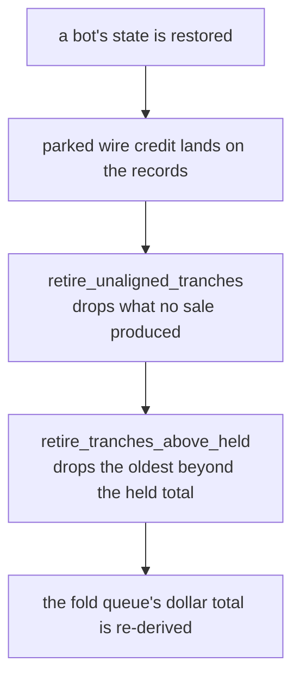

# Novel Concepts and Patent Candidate Catalogue

Active development on Acervator began in early April of 2026. It began after realizing that the AI-assisted software development tools had achieved an inflection point with their capabilities. Prior to this, efforts were being made to learn traditional coding with little success that was mainly due to an inability to get into a grinding effort for whatever reasons. This has been particularly frustrating since other subjects seem to grab and others deflect. With the advent of Claude Code however, it feels like some of us have been given a decently priced door man and well-informed guide through this and other labyrinths.

Each entry below carries an anchor. The anchor is the code that runs the
concept today, quoted from the module that holds it. Where a concept has no
code, the entry says so and gives the query that measured the absence, and then
proposes the build. Anchors describe the present state of the platform, not the
plan.

## 1 - Harvest-Fold / Scrumming

At the core of Acervator is what might not first appear as a multi-faceted concept designed to address or alleviate many of the mental pitfalls that can afflict a new trader. After having observed a number of people via Telegram and web approach the challenge of investment differently, I have come away convinced that all it only becomes as complex as the individual allows it to be. This is not to be reductive about economics or any other connected discipline but it is to say there are reliable, stable, consistent means of reading price charts and too many people are simply doing it too many different ways and this only compounds the complexity illusion further. Much of the uneasiness inflicted on the new trader surrounds the emotional desire or even personal need for the value of their positions to increase as soon as possible or show the midterm potential of becoming profitable. Those that adopt the HODL meme are, in my experience, quite crippled in their ability to sell positions even when the time is right, which is usually when most people are happiest about the market. The ironic truth is that however good a trade is, there is an equally bad one on the other side of it. Acervator attempts to respect the market by not taking profit all at once and absorbing or claiming ownership of its positions’ variance strictly based on the market local, organic price ranges. In other words, its trade actions are always proportionate to whatever the market is actually doing at the time the trade is executed. Over time, this ‘molds’ the position to the long term truth of the market and avoids the need to speculate entirely. The more bold hope for this approach is that it might add another tool for stabilizing macro-economic phenomena such as underpinning currency exchange rates between countries.

Acervator addresses ‘fundamental market unpredictability’ by allowing volatility to “orbit” around a set point we call the Target Balance. This element is what performs the first mental trick. It forces the trader to say and establish that “my position is worth X and I will support X with an equal amount of liquidity” i.e. a Target Balance of $50 is set and a total mental position of $100 is established. Trades will be executed to maintain the truth of the Target Balance always being X. After the initial entry is executed and filled, which Acervator will only do in the lower extent of the Bollinger Band on the chosen timeframe, the Scrumming Bot will persistently shave off and “Fold” back in Y% of profits through repeating Harvest-Fold operations that continue until the bot is deactivated or the market suffers a catastrophic collapse which can and do happen so don’t not leave it unmonitored. It should also be noted that the term ‘harvest’ came to replace ‘scrum’ for the sake of clarity but they may be used interchangeably throughout this text. Essentially a Scrum or Harvest is a sale of a position’s increased value over the Target Balance. The amount that the Scrumming Bot harvests or folds is pinned to the Target Delta or the amount of variation (%delta) from the most recent trade event. Much of the finer details of trade execution can be tuned by the user as expected for any professional application but the primary point here is that the amount of profit folded back is capped by the Maximum Target Growth Per Cycle setting while the ability of Acervator to prevent inverted (profit losing: buying higher than sold / selling lower than bought) trades we also have the Minimum Opposing Trade Distance rule which dictates the next trade must be Z distance from the most recent trade event. In addition, sells are not allowed to occur or be pushed below the Bollinger Band midline while buys are not allowed to occur or be pushed above the midline. As a result of just these few component features, we already have multiple soft, non-TA or non-traditional rules protecting the investor before we even start optimizing the trades themselves (pushing them as close to volatility extents as possible) via Technical Analysis and other inventions.

The harvest-fold method itself was manually executed and tested on a multiple cryptocurrency pairs throughout 2023~2026 but it has always been the aspiration to automate it and have it executed at a high rate of frequency with the operating theory that this approach to investment, being a hybrid a HODL and active trading, creates frontline area of support for whatever markets in which it participates long term. It does this by maintaining and, utilizing as directed, all earned profits. It turns any user into an active participant and liquidity provider.

After entering the space full time in 2017, I immediately began to parse and breakdown how price charts were being interpreted. This also allowed me to perform ever deeper introspections on my own response to how my mind was responding to the value of my portfolio fluctuating. I did myself absolutely no psychological favors in this pursuit but, as you will see, I had plenty of reasons to take this reckless approach. By this point, my undiagnosed and untreated military injuries had worn me down to the point where I realized I was running out of time to continue working as normal. I had, by then, been walking a torsioned pelvis for 17 years that had seized in place and, by 2020, would be causing enough pain to induce panic attacks. I could have joined the pill-mill club but I declined. In combination with the pain, the forced TA self-training, physical job, and broken marriage, I also assembled an entire GPU-based mining farm…alone. I had some business partners but their participation was basically nonexistent. The VA was providing no support and would not until 2022. The Navy and Pentagon had spit in my face by sending me PDBR paperwork that they had no intention of ever honoring no matter what I wrote down. My family more or less remained ignorant of all my turmoil while I kept the paychecks coming. So really the story of Acervator’s and Harvest-Fold is one of betrayal to a degree that allowed me to see through things more clearly than would otherwise have been possible. It has been invented out of necessity and it is my intuition that Acervator can become that necessary tool for other people as well.

#### The target and the two sides

**Functional.** The bot holds one number, and that number is the dollar value
you told it the position is worth. On every tick it compares the position
against that number. Above it by more than a dust band, the bot has surplus to
sell. Below it by more than the band, the bot has a deficit to buy. Inside the
band it does nothing at all. One function answers that question for the whole
engine, and the dust band is a tenth of a percent of the target with a floor of
one cent. At a target of $50 the band is $0.05, so a position at $60 answers
scrum and a position at $40 answers fold.

`src/trading/target_bands.py` — `target_territory`

```python
delta = float(position_value) - float(target_balance)
band = at_target_dust_band(target_balance)
if delta > band:
    return "scrum"
if delta < -band:
    return "fold"
return "at_target"
```

**Design intention.** The Target Balance is the set point the whole method
orbits. It is declared once in the bot's config and the tick re-zeroes to it.
The bot brain holds the tick, the scrumming package fires the two halves of the
cycle, and the execution module places the orders.

`src/trading/container/config.py` — `BotConfig`

```python
target_balance: float = 200.0  # Balance the bot trades relative to
scrumming_interval_pct: float = 1.0  # % market move between actions
max_target_growth_pct: float = 1.0
```

#### The distance rule

**Functional.** An opposing trade has to travel far enough to clear both legs of
the round trip. That is the operator's scrumming interval plus the exchange fee.
A one percent interval against a six tenths fee gives 1.60 percent. One function
owns the arithmetic, and the clamp is applied to the sum rather than to the
interval, because the bound exists to keep the rebuy factor sane.

`src/trading/otd_math.py` — `minimum_opposing_trade_distance_pct`

```python
total = float(interval_pct) + float(fee_pct)
return max(OTD_MIN_PCT, min(OTD_MAX_PCT, total))
```

**Design intention.** Without this rule the bot can sell low and buy back
higher, which is the one outcome the method exists to prevent. The gate that
enforces it refuses the trade until price has travelled that distance from the
pivot, and it rebuilds the required price in its own refusal message so the
operator can read why it held.

`src/trading/gate_chain.py` — `HysteresisGate.evaluate`

```python
ok = ctx.hyst_ok_scrum_side if self.side == "scrum" else ctx.hyst_ok_fold_side
if ok:
    return GateResult(passed=True)
eff_pct = ctx.scrumming_interval_pct + ctx.trading_fee_pct
```

#### The midline rule and the growth cap

**Functional.** A sell is not allowed below the Bollinger midline and a buy is
not allowed above it. The tick sets one flag for each side off the band
position, and a gate refuses the wrong side of the band. The scrum flag also
carries the phantom lock. Nothing sets that lock today, and on a ripe row the
ripe-harvest override force-passes the gate that reads it.

`src/trading/scrumming_bot.py` — `ScrummingBot.tick`

```python
scrum_ok = (bb_pos > 0.50) and not self._phantom_locked
fold_ok_midline = bb_pos < 0.50
```

**Design intention.** Profit folded back into the target is capped for one
market cycle, so a single violent move cannot inflate the set point beyond what
the next cycle can support. The cap is a percentage of the target at the moment
the cycle opened, and it shrinks as the cycle consumes it.

`src/trading/scrumming_bot.py` — `ScrummingBot.cycle_growth_cap_usd`

```python
_pct = float(getattr(self.config, "max_target_growth_pct", 1.0) or 0.0)
```

The same key answers differently in different places. Nine read sites fall back
to 1.0 and three fall back to 0.0, so a bot whose stored config lacks the key
compounds or freezes depending on which site read it first. Issue #409 carries
it.

**The issue #409 clause above is overtaken.** It is not edited and not removed.
It read:

> Nine read sites fall back to 1.0 and three fall back to 0.0, so a bot whose
> stored config lacks the key compounds or freezes depending on which site read
> it first. Issue #409 carries it.

Issue #409 closed on 2026-09-25. One declaration answers the key now, and no
read site carries a fallback of its own. `src/trading/container/config.py`
declares `TARGET_GROWTH_PCT_DEFAULT` from the field's own declared default, and
`in target_growth_pct` is the single reader. Fourteen call sites read that
function.

```
src/trading/container/config.py, in BotConfig    max_target_growth_pct: float = 1.0
src/trading/container/config.py                  TARGET_GROWTH_PCT_DEFAULT reads that default
src/trading/container/config.py, in target_growth_pct   the one reader
call sites reading target_growth_pct             14
read sites carrying their own fallback            0
```

The gate set the bot writes is named in one place: ten scrum labels and nine
fold labels, nineteen lights per bot.

`src/trading/gate_vocabulary.py` — `_GATE_ORDER_SCRUM`

```python
_GATE_ORDER_SCRUM: tuple[str, ...] = (
    "TGT",
    "INT",
    "BB",
    "FIRE",
    "TA",
    "LS",
    "TRND",
    "HTF",
    "CB",
    "OTD",
)
```

#### What the ripe-harvest override replaces at the midline

The entry above states this:

> Nothing sets that lock today, and on a ripe row the ripe-harvest override
> force-passes the gate that reads it.

**The current reading.** On a ripe row the override force-passes nothing at the
midline, because the gate has already passed. A row is ripe only when the band
position reaches the upper detect threshold, and that threshold never sits below
the midline. A ripe row is therefore above the midline by construction, so the
band half of the scrum flag is already true. The phantom lock is the only other
way that flag can read false, and no method in the platform sets it.

`src/trading/scrumming/circuit_breakers.py` — `_bb_detect_thresholds`, the
reason a ripe row is above the midline

```python
detect_frac = max(0.0, min(1.0, detect_pct / 100.0))
half = detect_frac * 0.5
return (0.5 - half, 0.5 + half)
```

**Driven.** The shipped scrum chain ran over a swept window of hand-built
candles. The last candle's close moved from 95.00 to 105.00 in steps of 0.0005,
which is 20,001 rows, and the band position read from -0.3089 to 1.3165 off the
real band reading. Both the midline and the upper detect threshold sit inside
that span, and one step moves the band position by about 0.00008, so no change
of verdict can fall between two rows.

```
20,001 rows, the phantom lock clear

the gate passed on its own merit          10,106
the gate refused and the refusal stood     9,895
the gate was passed regardless                 0
rows reaching a real verdict              20,001

6,832 rows were ripe, and the gate passed on its own on every one of them
```

**The same override does replace a refusal, on a different gate.** With the
voting panel not bullish, the override passed the bullish-vote gate on exactly
the 6,832 ripe rows, and its refusal stood on the other 13,169. The override
acts, and the midline gate is not the gate it acts on.

```
20,001 rows, the phantom lock clear, the voting panel not bullish

ta_bullish passed regardless     6,832
ta_bullish refusal stood        13,169
midline passed regardless             0
```

**What a recorded lock does.** The Simulator can recover a lock from a stored
record. Driven with the lock recovered, the midline gate was passed regardless
on the 6,832 ripe rows and its refusal stood on the other 13,169, and the record
named the override every time. That is the only state in which the override
reaches the midline gate, and nothing in the running program produces it.

```
midline_scrum overridden by ripe_harvest_override: scrum_ok=False(bb_pos=1.23)
scrum_ok=False(bb_pos=-0.22) [override not applied: ripe_harvest_override]
```

**What is still open, and it is his.** The open decision on the midline rule is
whether the band should hold a ripe scrum at all. It is not a decision about the
higher timeframe. The reading above moves the ground under it: the band does not
hold a ripe scrum today because a ripe row is already above the band midline,
not because an override lifts the band. Two settings carry that behaviour and
both are his, the BB Midline Gate tick box and the BB Detect threshold, and both
are described in [Part 6, the Trading tab](06-trading-tab.md).

Which gate each override covers is on the gate table in
[Part 7, Indicators](07-indicators.md).

## 2 - The Phantom Bot

While the Harvest-Fold method housed with the Scrumming Bot addresses several persistent and nagging questions around any given investment position (Should I buy more? Should I sell some? When? How much?), it does have the weakness of operating on a single timeframe. The Phantom Bot is another feature intended to optimize trade execution position. In this specific case, it allows a single Scrumming Bot to be inhibited by a higher timeframe signal with the intention of capturing alignments or disagreements so that trades are not being executed prematurely. The design intention here is that, for example, a 5m TF bot can be inhibited by a 15m, 30m or 1hr signal while maintaining a volatility watch on its primary TF. The intention is to build out this feature so that it obviates or reduces the need for multi-screen monitoring of individual assets.

**Functional.** A phantom is a copy of the position read on a slower chart. It
computes technical analysis on its own timeframe, stores the result, and
constructs no order. One timeframe is the default set, and a saved record names
its own.

`src/trading/scrumming_bot.py` — `ScrummingBot.__init__`

```python
self._phantom_timeframes = list(
    phantom_timeframes
    or default_phantom_timeframes(config.ta_timeframe, _offered)
)
```

**Design intention.** The inhibition the entry describes runs today. A bullish
higher timeframe stops the scrum and a bearish one stops the fold, and each
writes its own label into the blocker list so the operator can see which
timeframe held the trade. The coordinator weights the phantom summaries by their
rank before the gate reads them.

`src/trading/gate_chain.py` — `HTFDeferGate.evaluate`

```python
blocks = (
    ctx.eff_htf_blocks_scrum
    if self.side == "scrum"
    else ctx.eff_htf_blocks_fold
)
if not blocks:
    return GateResult(passed=True)
label = "HTF-bullish" if self.side == "scrum" else "HTF-bearish"
return GateResult(passed=False, blocker_message=label)
```

One part of the feature does not work, and it is the phantom lock. No method on
the coordinator creates a lock, so the flag stays clear and the lock list stays
empty. The term in the scrum flag does read the flag, and a ripe row
force-passes the gate it sits in. Whether a higher timeframe should hold a trade
at all is the open decision on issue #1359. Replacing multi-screen monitoring is
an intention, not current behaviour.

```
six ticks, three phantoms registered, one bot

the flag after every tick                        False
the coordinator's active locks                   []
the flag set by hand, band position 0.70         the midline gate refuses
the flag set by hand, band position 0.91         the ripe row force-passes it
```

**Two sentences above are overtaken in part.** Neither is edited and neither is
removed. They read:

> The scrum flag also carries the phantom lock. Nothing sets that lock today,
> and on a ripe row the ripe-harvest override force-passes the gate that reads
> it.

> The phantom lock is the only other way that flag can read false, and no method
> in the platform sets it.

**The current reading.** A method on the bot now sets the flag. It runs on every
tick, above the scrum flag, and it takes the state from the coordinator's own
active lock list rather than from a field nobody wrote. Where the operator has
phantom bots switched off it clears the flag instead.

`src/trading/scrumming_bot.py` — `ScrummingBot.tick`, the call above the flag

```python
self._refresh_phantom_lock()
if self.config.bb_midline_gate:
    scrum_ok = (bb_pos > 0.50) and not self._phantom_locked
    fold_ok_midline = bb_pos < 0.50
```

The rest of both sentences still holds. No method on the coordinator creates a
lock, so the lock list is empty on every running bot and the flag reads clear.
The ripe-harvest override still force-passes the gate on a ripe row, which is
why a held lock changes no trade. Driven across 3,201 band positions with a lock
held, the scrum flag changed on 1,601 rows and the final scrum decision on none.

The full reading, the method, the coordinator's answer and the swept figures are
on [the Indicator Voting Panel page](07-indicators.md).

**The operator's ruling, 2026-10-27.** Asked what should create a phantom lock,
he answered:

> This is a strange question. A phantom bot is simply a higher timeframe read
> that is piped through a parallel trading gate logic chain. It is intended to
> improve rather than restrict ripe scrums or folds so it must work on both
> sides. It should be thought of as an optional guardian angel that may optimize
> trades.

**Two clauses above are overtaken.** Neither is edited and neither is removed.
They read:

> The ripe-harvest override still force-passes the gate on a ripe row, which is
> why a held lock changes no trade.

> fold_ok_midline = bb_pos < 0.50

**The current reading.** The fold flag carries the lock too, so a held lock does
change a trade. The clause remains correct about the scrum side, where a ripe row
is above the midline and the override force-passes the gate anyway. On the fold
side there is no such override below the midline, so the refusal stands and the
fold is held.

`src/trading/scrumming_bot.py` — `ScrummingBot.tick`, the fold flag

```python
fold_ok_midline = (bb_pos < 0.50) and not self._phantom_locked
```

**Driven.** A bot was built by hand with a stand-in venue that refuses every
order, and the real tick was driven over 801 window levels an arm, which moved
the band position from -0.558 to 1.559. With phantom bots off, and with them on
and no lock held, every recorded verdict is identical before and after. With
them on and a lock held, the fold gate's refusal appears on the 398 rows below
the midline, and the fold decision itself moves on 362 of them. No scrum reading
moves on any row.

```
801 rows an arm, two trees compared row by row

phantoms off, lock held     every verdict identical
phantoms on,  no lock       every verdict identical
phantoms on,  lock held     fold decision differs on   362
                            scrum readings differ on     0
```

What should create a lock on the coordinator is still his, and nothing creates
one today.

**The operator's specification, 2026-10-27.** On what a phantom bot is for, and
the last change he made to its design:

> Again, the entire function of a Phantom Bot is to provide high TF over rides
> and trade optimization. From this perspective, all such questions can be
> inferred. The design spec is established but simply not fully implemented with
> the last major modification to it being the decision to only allow one Phantom
> Bot TF to be active per bot or Target Asset.

**One phantom timeframe is active per bot.** The limit is one declaration and
every site that builds a reader reads it. The active name is the highest-ranked
one the bot was given, which is the name the Phantom Bots picker already drew and
the name the rank weighting already counted for most.

`src/trading/phantom_balance.py` — `one_active_phantom_timeframe`

```python
active = max(ranked, key=tf_rank)
set_aside = sorted(
    [one for one in held if one != active],
    key=tf_rank,
)
return [active], set_aside
```

| step | module | symbol |
| ---- | ------ | ------ |
| name the one | `src/trading/phantom_balance.py` | `one_active_phantom_timeframe` |
| hold the one | `src/trading/scrumming_bot.py` | `ScrummingBot.__init__` |
| build the one | `src/trading/phantom_balance.py` | `PhantomBalanceManager.create_phantom_set` |
| keep it on a live change | `src/trading/scrumming_bot.py` | `ScrummingBot.update_phantom_config` |
| name it on the page | `src/gui/main_tabs/phantom_bots_tab_surface.py` | `configured_timeframes` |
| name it in the Simulator | `src/simulator/back_test.py` | `phantom_timeframes_for` |

**Nothing is dropped in silence.** A name the limit holds back is drawn on its
own status row, and the bot writes the same sentence to its Activity Log on the
tick that starts its phantom.

```
a bot given 6h and 1d, read off the page and the log

the picker                       1d
Configured timeframes:           6h, 1d
Set aside, one runs:             6h
the Activity Log line            Phantom timeframes set aside: 6h
```

**Two sentences below are overtaken.** Neither is edited and neither is removed.
They read:

> A bot holding three names writes all three and reads all three back, so a set
> of several survives a restart.

> A bot holding 2h, 6h and 1d writes all three. The fleet load hands all three
> back, and the phantom manager builds three PhantomBots on them.

**The current reading.** The record still carries every name and the fleet load
still hands them all back, so both sentences hold for the record. The bot now
keeps the highest of them as the one it runs and the rest as names set aside, and
the manager builds one reader rather than three.

The save writes both halves back, so a save loses no name the operator chose.

`src/trading/bot_container.py` — `BotContainer.get_full_state`

```python
_phantom_held = list(getattr(self, "_phantom_timeframes", None) or []) + list(
    getattr(self, "_phantom_tf_set_aside", None) or []
)
```

Driven on a bot given 6h and 1d, saved and restored three times in a row: the
record reads 6h and 1d on every pass, the bot runs 1d on every pass, and the
page names 6h as set aside on every pass.

**Driven.** A bot was built by hand with a stand-in venue that refuses every
order, and the real tick was driven over 801 window levels an arm, which moved
the band position from -0.292 to 1.283 in steps of 0.03 of a price unit. With
phantom bots off, and with exactly one timeframe given, every recorded verdict is
identical before and after. With two given, the lower-ranked reading no longer
reaches the gate.

```
801 rows an arm, two trees compared row by row

phantoms off              every verdict identical
one timeframe             every verdict identical
one timeframe, lock held  every verdict identical
two timeframes            scrum decision differs on   256
                          fold decision differs on    265
```

**One bot, one Target Asset.** Each bot builds its own coordinator and no code
hands one bot another bot's, so the limit at the bot is the limit at the Target
Asset that bot holds. Two bots on one asset each run their own one, and neither
changes the other.

**The saved record carries the timeframe.** The bot writes every name it holds
under the key `phantom_timeframes`. The fleet load reads that key and gives the
list to the bot it builds. The key, the change field and the bot attribute now
use one spelling.

| step | module | symbol |
| ---- | ------ | ------ |
| write the key | `src/trading/bot_container.py` | `BotContainer.get_full_state` |
| read the key | `src/trading/container/restore.py` | `StateRestoreMixin.restore_bots_from_state` |
| hold the list | `src/trading/scrumming_bot.py` | `ScrummingBot.__init__` |
| build the set | `src/trading/scrumming/tick_phases.py` | `TickPhaseMixin._tick_initialise` |
| run one timeframe | `src/trading/phantom_balance.py` | `PhantomBalanceManager.create_phantom_set` |

A record written before the key took the plural spelling still restores. The
fleet load reads the older singular key `phantom_timeframe` when the plural key
is absent. A bot holding three names writes all three and reads all three back,
so a set of several survives a restart.

**The venue decides which names survive.** The bot drops any stored timeframe
its exchange does not serve. A record naming one timeframe the exchange refuses
restores with no phantom at all, and the bot writes the dropped name to its own
log line.

**The record drops one key.** It no longer carries `phantom_config`. The
attribute behind it held an empty dictionary and no code read it. A record that
still carries the key loads, and the fleet load steps past it.

The saved fleet on the trading machine, read once:

```
38 records, all scrumming        count
phantom_timeframes                   0
phantom_timeframe                    0
phantom_config                      38
phantoms_enabled false              38
```

No bot in that fleet runs a phantom. Every record holds the enable flag off.

**Three phantom keys reach the record, and no fourth.** A saved bot carries
`phantoms_enabled`, `lock_candle_count`, and `phantom_timeframes` when the bot
holds a name its venue serves. `src/trading/bot_container.py`, in
`BotContainer.get_full_state`, writes all three. The Paper and Simulator records
carry the same three names, from `wizard_record` in
`src/paper/fleet_source.py` and in `src/simulator/fleet_source.py`. A bot built
on any of those routes carries no key spelled `phantom_config`.

**Three load paths step past the retired key.**
`src/trading/container/restore.py`, in
`StateRestoreMixin.restore_bots_from_state`, builds the live bot.
`src/paper/paper_bot_view.py` and `src/simulator/sim_bot_view.py` build the
Paper and the Simulator views, each in `config_of`. All three read the stored
declaration through `bot_config_kwargs` in `src/trading/container/config.py`,
which keeps only the names the declaration holds. A record carrying
`phantom_config` builds a bot on each of the three, with its Target Balance
intact.

**The retirement record holds no entry for it.** `_DEPRECATED_KWARGS` in
`src/trading/container/config.py` strips a retired name that a caller passes to
the bot declaration. `phantom_config` was a top-level record key and never a
field of the declaration. No load path hands it over, so the strip list needs no
entry for it. Handed to `make_bot_config` directly the name raises, and a name
the strip list does hold builds.

**The cursor tick keeps a timestamp.** `PhantomBot.tick_for_cursor` stores the
cursor itself, not a bucket number. It divides the stored cursor by the candle
length on every call, so both bucket numbers come from one divisor.

**The cursor tick is gone.** `PhantomBot` carries no such method now. No module
in the tree called it, and no module passed the simulator flag beside it. The
attribute that held the cursor went with it.

**One phantom, above the parent.** A bot whose record names no timeframe takes
one name. The name is the lowest timeframe above the bot's own TA Timeframe
that the venue serves. The class constant that held six names is gone.

`src/trading/phantom_balance.py` — `default_phantom_timeframes`

```python
above = [
    one
    for one in TIMEFRAME_ORDER
    if one in allowed and is_higher_tf(one, parent_timeframe)
]
return above[:1]
```

Driven on a Coinbase bot with a 1h TA Timeframe, the bot holds 2h. It held five
names before, and four of the five sat at or below that 1h parent.

**The record keeps every name the bot holds.** The save writes the key for any
number of names. A bot holding 2h, 6h and 1d writes all three. The fleet load
hands all three back, and the phantom manager builds three PhantomBots on them.
The save wrote no key at all for that bot before.

| step | module | symbol |
| ---- | ------ | ------ |
| write the key | `src/trading/bot_container.py` | `BotContainer.get_full_state` |
| read the key | `src/trading/container/restore.py` | `StateRestoreMixin.restore_bots_from_state` |
| pick a default | `src/trading/phantom_balance.py` | `default_phantom_timeframes` |
| build the set | `src/trading/phantom_balance.py` | `PhantomBalanceManager.create_phantom_set` |

**The eleven names are declared once.** `src/exchange/timeframes.py` declares
`ALL_TIMEFRAMES`. Five modules read that tuple. Each held its own copy of the
same ranked list before, and one module held two copies.

| reader | module |
| ------ | ------ |
| the rank order | `src/trading/phantom_balance.py` |
| the wizard page | `src/gui/main_tabs/bot_wizard_surface.py` |
| the Settings page | `src/gui/main_tabs/settings_dialog_surface.py` |
| the Phantom Bots tab | `src/gui/main_tabs/phantom_bots_tab_surface.py` |
| the Comp column | `src/gui/main_tabs/indicator_panel_surface.py` |

**A refused phantom is named on screen.** The Phantom Bots tab carries six
status rows. Two of them name the timeframes no phantom runs on. The first
names the timeframes the venue dropped. The second names the timeframes at or
below the bot's own TA Timeframe. The Comp column's cell carries that second
list in its tool tip.

| reading | module | symbol |
| ------- | ------ | ------ |
| the venue drop | `src/trading/scrumming_bot.py` | `ScrummingBot._phantom_tf_dropped` |
| the parent refusal | `src/gui/main_tabs/phantom_bots_tab_surface.py` | `below_parent_timeframes` |
| the Comp tool tip | `src/gui/main_tabs/indicator_panel_surface.py` | `comp_skipped_tooltip` |
| the engine record | `src/trading/phantom_balance.py` | `TimeframeCoordinator.get_higher_tf_bias` |

**A refused change is named too.** A line under the timeframe picker names a
stored timeframe the venue does not offer, and names a stored timeframe the
tab does not list beside the one the picker shows instead. Both builds draw
that line. In the React build a second line at the top of the tab names a
change the tab would not take and the setting it came from, and it is replaced
rather than repeated while the same change keeps arriving. The Qt build moves
its own controls and carries no second line. A change the tab takes shows
neither line.

| reading | module | symbol |
| ------- | ------ | ------ |
| the stored timeframe | `src/gui/main_tabs/phantom_bots_tab_surface.py` | `stored_timeframe_notice` |
| the refused change | `src/gui/main_tabs/phantom_bots_tab_surface.py` | `step_refusal_text` |
| the one announcement | `src/gui/main_tabs/phantom_bots_tab_surface.py` | `PhantomBotsTabModel.note_steps` |
| the drawn line | `src/gui/web/phantom_bots_tab.js` | `step-refusal` |

**The P&L column draws a dash.** A phantom is a read-only observer. It runs no
order on any path, it holds no position and it counts no cost, so it computes no
profit and there is no figure for the column to print. Its answer to the tab
carries no profit key, and the cell draws the dash the Comp column draws for a
reading it cannot make. Both builds draw that one dash. The column printed
`$+0.0000` on every row before, which an operator could not tell from a profit
of nothing.

A figure the phantom does report is still printed. A profit of exactly zero
prints `$+0.0000`, so the dash stands for an absent reading alone and never
hides a real one. A figure of a kind the money admission refuses — a stored flag,
a text number, a not-a-number, an endless number — draws the dash as well.

| reading | module | symbol |
| ------- | ------ | ------ |
| the phantom's answer | `src/trading/phantom_balance.py` | `PhantomBot.get_status` |
| the profit figure | `src/gui/main_tabs/phantom_bots_tab_surface.py` | `phantom_pnl` |
| the drawn cell | `src/gui/main_tabs/phantom_bots_tab_surface.py` | `phantom_pnl_text` |
| the money admission | `src/trading/container/config.py` | `as_finite_float` |
| the one dash | `src/gui/main_tabs/indicator_panel_surface.py` | `ABSENT_CELL_TEXT` |
| the Qt cell | `src/gui/live_settings/phantom_bots_tab.py` | `PhantomBotsTabMixin._create_phantom_bots_tab` |
| the React cell | `src/gui/main_tabs/phantom_bots_tab_surface.py` | `phantom_row` |

**A phantom answering nothing still draws its row.** The per-phantom table reads
each phantom through one guarded call. A phantom that raises, and a phantom that
hands back nothing at all, both reach the table as an empty reading, and the row
draws its absent marks. The table ended the whole tab build on either one before.

| reading | module | symbol |
| ------- | ------ | ------ |
| the guarded read | `src/gui/main_tabs/phantom_bots_tab_surface.py` | `phantom_status` |
| the Qt loop | `src/gui/live_settings/phantom_bots_tab.py` | `PhantomBotsTabMixin._create_phantom_bots_tab` |
| the React loop | `src/gui/main_tabs/phantom_bots_tab_surface.py` | `PhantomBotsTabModel.build` |

**The window's answer carries every row the tab draws.** The Bot Settings
window publishes one bot reading that each of its tabs asks for. That reading
carried the enable switch, the timeframe list and the lock figure, and the tab
read six more names the window never sent. On the running build the started
row, the dropped row and the lock-state row drew their built-in words, and
neither runtime table drew at all.

One declaration now names each status reading, its bot attribute and the value
an absent attribute gets, so a row cannot reach the page alone.

```python
BOT_REQUEST_ROW: tuple = (
    (REQUEST_ENABLED, ENABLED_ATTRIBUTE, False),
    (REQUEST_STARTED, STARTED_ATTRIBUTE, False),
    (REQUEST_TIMEFRAMES, TIMEFRAMES_ATTRIBUTE, None),
    (REQUEST_DROPPED, DROPPED_ATTRIBUTE, None),
    (REQUEST_LOCKED, LOCKED_ATTRIBUTE, False),
    (REQUEST_LOCK_TIMEFRAME, LOCK_TIMEFRAME_ATTRIBUTE, DEFAULT_LOCK_TIMEFRAME),
)
```

Driven on two bots differing in every row, the page and the Qt tab now report
the same six rows and the same two tables.

```
                              before                 after
Phantoms started              NO on both bots        YES then NO
Dropped by the venue          none on both bots      1w then 3m, 6h
SCRUM lock state              UNLOCKED on both       LOCKED then UNLOCKED
per-phantom table rows        0 and 0                1 and 2
active lock table rows        0 and 0                1 and 2
```

| reading | module | symbol |
| ------- | ------ | ------ |
| the declaration | `src/gui/main_tabs/phantom_bots_tab_surface.py` | `BOT_REQUEST_ROW` |
| the bot read | `src/gui/main_tabs/phantom_bots_tab_surface.py` | `published_bot` |
| the per-phantom read | `src/gui/main_tabs/phantom_bots_tab_surface.py` | `phantom_statuses` |
| the lock read | `src/gui/main_tabs/phantom_bots_tab_surface.py` | `active_locks` |
| the window's answer | `src/gui/main_tabs/bot_live_settings_surface.py` | `tab_bot` |
| the page's reader | `src/gui/main_tabs/phantom_bots_tab_surface.py` | `view_model` |

Paper and the Simulator read the same answer. Each builds its own window
payload by calling Live's builder, so one repair reaches all three.

```
src/gui/paper/paper_bot_live_settings_surface.py, in build_view_model
src/gui/simulator/sim_bot_live_settings_surface.py, in build_view_model
```

**A seventh status row names the timeframes the one-phantom limit holds back.**
Two sentences above are overtaken. Neither is edited and neither is removed.
They read:

> One declaration now names each status reading, its bot attribute and the value
> an absent attribute gets, so a row cannot reach the page alone.

> Driven on two bots differing in every row, the page and the Qt tab now report
> the same six rows and the same two tables.

**The current reading.** The declaration still names each reading and a row still
cannot reach the page alone. It holds seven entries rather than six, and the
seventh is the set-aside row.

```python
(REQUEST_SET_ASIDE, SET_ASIDE_ATTRIBUTE, None),
```

The row reads the same on a running bot and on a stored record. A running bot
holds the names it set aside in its own attribute; a Paper or Simulator record
holds the whole list, and one read on the page derives the same answer from
either.

`src/gui/main_tabs/phantom_bots_tab_surface.py` — `configured_timeframes`

```python
held = [str(one) for one in (getattr(bot, TIMEFRAMES_ATTRIBUTE, None) or ())]
aside = getattr(bot, SET_ASIDE_ATTRIBUTE, None)
if aside is None:
    return held
extra = [str(one) for one in (aside or ()) if str(one) not in held]
return sorted(held + extra, key=timeframe_order_key)
```

Driven offscreen on all three pages, with a bot given 6h and 1d, reading the
strings each row reports:

```
                              Live       Paper      Simulator
the picker                    1d         1d         1d
Configured timeframes:        6h, 1d     6h, 1d     6h, 1d
Set aside, one runs:          6h         6h         6h
```

## 3 - The Landing Strip

Perhaps the earliest assumption that hit me the most and really presented the catalyzing challenge to creating all of my alternate trading methods, is that you cannot predict what the market will do and after only a short while of actively trading I asked the questions: “But what if I don’t have to?” “What if I decide that I do not have to speculate at all?” I do not remember exactly when I first used the term but I think it was when I was trading A34 and A27 some years ago while participating in a Telegram group with some psytrance friends and associations called the Better Bitcoin Bureau. The name changed a few times but this is the one I recall.

The concept emerged from my persistent use of Heikin-Aishii candles. I had decided on this candle style early just by intuition. I could say it was because I “felt it looked nicer” but that does not quite capture the magnetism. To me, they just structurally make more sense and are less sloppy than traditional candles. What I began to observe over and over was the propensity for crypto markets to form long, tapering structures from these candles and that the likelihood of market reversal could be pinned to 1) the landing strip length and 2) its proximity to the Bollinger Band. Further, I found that those markets that formed these on 1D or higher timeframes would often have explosive breakouts like a volcano that had charged up to blow out. These findings can be historically verified and back tested. I manually performed this observation all the way down to 1 minute trading and found that it was only at this lowest TF that it started to exhibit sub-50% reliability. Given this, the concept has been transposed into Acervator as a core component and trading logic gate with the number of candle strip candles being a user configurable setting.

This is also where I should mention that I am not at all a quant or mathematical trader. I consider myself a visual or tactical trader that focuses on market reversals. I have taught myself to visually interpret price chart structure using a given set of indicators used by countless other technical analysts. When looking at some of the labeling within Acervator, however, one will readily see military references and hints at how I view asset accumulation as something akin to progressive territory capture on a perpetual gameboard. The less skilled traders are surrendering it with every cycle of the market.

**Functional.** Two detectors build the Landing Strip and both run on every
tick. The first places price inside the Bollinger channel and counts trailing
Heikin Ashi bodies under a tightness threshold. It reads the operator's control
directly.

`src/trading/scrumming_bot.py` — the first detector's call

```python
min_pattern_candles=self.config.bb_landing_strip_candles,
```

**Design intention.** The second detector is the one that scores the taper. It
counts a run of shrinking Heikin Ashi bodies, names the band the run reached,
and returns a confidence boost the tick adds to its own. On a tapering rally
into the upper band it answers detected, side upper, length three, boost 0.1437.
The same tape without the taper answers not detected, and a five-candle tape
answers not detected. A detected strip can force a direction, which is why the
gate vocabulary marks it an override rather than a gate.

`src/trading/indicators/landing_strip.py` — `detect_landing_strip_v2`

```python
def detect_landing_strip_v2(
    candles: list[Candle],
    min_consecutive: int = 3,
    shrink_threshold: float = 0.90,
    bb_tolerance_pct: float = 3.0,
    use_ha: bool = True,
    bb_period: int = 20,
    bb_std: float = 2.0,
) -> TighteningResult:
```

The second detector does not read the setting. The tick hands it a literal
three, so the wizard's Landing Strip Candles control moves the first detector
and leaves the second where it is. Both defaults sit at three, so the two agree
until the operator changes the control.

`src/trading/scrumming_bot.py` — the second detector's call

```python
tightening = detect_landing_strip_v2(
    candles,
    min_consecutive=3,
    shrink_threshold=0.90,
    bb_tolerance_pct=3.0,
)
```

Issue #432 carries it.

**The issue #432 clause above is overtaken.** It is not edited and not removed.
It read:

> The tick hands it a literal three, so the wizard's Landing Strip Candles
> control moves the first detector and leaves the second where it is. Issue
> #432 carries it.

Issue #432 closed on 2026-10-23. The literal three is a named constant now, and
the call states why the two counts are different things. `min_consecutive`
counts shrinking Heikin Ashi bodies; the wizard's control counts the newest
small-body candles the band-proximity check needs. The control is not meant to
move the second detector.

```
src/trading/ata_gate_scan.py   TIGHTENING_MIN_CANDLES = 25
src/trading/ata_gate_scan.py   TIGHTENING_MIN_CONSECUTIVE = 3
src/trading/ata_gate_scan.py   TIGHTENING_SHRINK_THRESHOLD = 0.90
src/trading/ata_gate_scan.py   TIGHTENING_TOLERANCE_PCT = 3.0

src/trading/container/config.py, in BotConfig   bb_landing_strip_candles: int = 3
src/trading/scrumming_bot.py                    the call passes the four constants
```

## 4 - Bollinger Band Travel Detection

Allowing a strategy to “see” where it is in relation to local width of the Bollinger Band is another aspect of treating the immediate market as a region on a map through which a stack of tokens is traveling. Along the route, we are able to offload surplus at the peaks and pick up additional supplies in the next valley. This is used in combination with Minimum Opposing Trade Distance. The complete question then becomes “Has the market traveled 70% (default), is current price X% distant from the most recent trade event, and is Target Delta not zero? When combining these gates with the (Technical Analysis) Indicator Voting Panel and Landing Strip Detection, you have a full market structure detection suite that is able to incrementally adjust a position’s size and generate recurring profits or growth with each market cycle.

**Functional.** The tick measures how far price has moved since the last trade
and divides that by the current band width. When the fraction reaches the
operator's percentage and the target delta is positive, the travel flag is set.
The default is seventy percent and the wizard offers zero to a hundred. That is
the compound question the entry states, and the code asks it in one expression.

`src/trading/scrumming_bot.py` — `ScrummingBot.tick`

```python
_bb_width = max(bb_result.upper - bb_result.lower, 1e-12)
band_travel_frac = abs(ticker.last - self._last_trade_price) / _bb_width
if (
    abs(ticker.last - self._last_trade_price)
    >= self.config.band_travel_pct / 100.0 * _bb_width
    and delta > 0
):
    band_travel_triggered = True
```

**Design intention.** A fixed percentage means two different things in a quiet
market and a violent one. Measuring the move against the band width makes the
threshold follow the volatility instead. The flag then clears a standing trend
hold and lets the harvest through. Travel is no gate of its own: the ten scrum
labels carry no travel light.

`src/trading/scrumming_bot.py` — what the flag releases

```python
trend_override = abs(delta) >= _interval_usd * 2.0 or band_travel_triggered
```

**The clause above saying travel is no gate of its own is overtaken.** It is not
edited and not removed. It read:

> Travel is no gate of its own: the ten scrum labels carry no travel light.

The labels still carry no travel light. Travel is now a term inside Minimum
Opposing Trade Distance, which is the combination the entry above names.
`src/trading/otd_math.py`, in `band_extension_pct`, turns `band_travel_pct` and
the band span into a percentage of the band midline, and
`minimum_opposing_trade_distance_pct` adds that percentage to the interval and
the fee. Zero keeps the term absent.

```python
span = float(upper) - float(lower)
price = float(reference_price)
travel = float(travel_pct)
if travel <= 0.0 or span <= 0.0 or price <= 0.0:
    return BAND_EXTENSION_ABSENT_PCT
return span * (travel / 100.0) / price * 100.0
```

## 5 - Position-Aware Technical Analysis

Traditional TA treats a signal (e.g., RSI > 70) as context-independent. Position-Aware TA encodes the current Bollinger Band position as context: RSI > 70 near the upper band confirms overbought (sell bias), but RSI > 70 near the lower band is a failed oversold — a trap for mean-reversion buyers. The system applies this inversion systematically across all oscillator signals. In other words, it attempts to strengthen the price to Bollinger Band relationship by reading additional indicators with relation to it. If you have the landing strip, band travel, opposing trade distance, and a bullish or bearish confidence score from the Indicator Voting Panel, it is likely a trading event will occur. In the end, many of these functions were layered in one after the other until I saw the platform take most trades that I would myself manually execute most of the time.

**Functional.** The band context enters at the bot, not inside the voters. The
tick reads the band position once, marks the upper quarter and the middle band,
and accumulates a skew from the votes that arrive. A bullish vortex adds 0.12 at
the upper band and takes 0.05 back in the middle. A bullish MACD adds 0.08 and
takes 0.03 on the same test. Ichimoku and Stochastic RSI move the skew on
direction alone, with no band term at all.

`src/trading/scrumming_bot.py` — `ScrummingBot.tick`

```python
at_upper_bb = bb_pos > 0.75
in_bb_middle = 0.35 <= bb_pos <= 0.65

if (
    sig.indicator == "vortex"
    and sig.direction == SignalDirection.BULLISH
):
    if at_upper_bb and sig.confidence > 0.5:
        position_boost += 0.12
    elif in_bb_middle:
        position_boost -= 0.05
```

**Design intention.** The skew relaxes or tightens the confidence floor the vote
has to clear. A floor of 0.30 becomes 0.2679 at a skew of plus 0.12 and 0.3158
at a skew of minus 0.05. A skew of minus one returns infinity, which no
confidence can clear, so a fully contradicted reading is refused outright rather
than discounted.

`src/trading/scrumming_bot.py` — the two terms the floor reads

```python
_ta_conf_skew = position_boost + bb_confidence_boost
```

The inversion does not reach the oscillator modules. Each indicator computes
from candles alone, and the band position appears in six indicator modules only:
Bollinger, band proximity, landing strip, M top, spring and W bottom. Neither
the RSI module nor the Stochastic RSI module takes a band argument. Today the
band context re-weights the vote after the fact. It does not re-read the
oscillator.

## 6 - Market Inspector

This addition was, like the Phantom Bot above, a move towards making Acervator “hyper-vigilant” of hypothetical opportunities that take the form of oppositional trades (assets that move inversely to one another) and bot swarm network topologies. The bot swarm itself will be covered in a moment but basically this feature allows for the creation of custom capital reinforcement networks where profits are configured to flow between positions in a manner that can potentially strengthen a portfolio faster than just focusing on single, isolated bot instances.

The Market Inspector is designed to analyze the broader market for groups of assets from which to build topologies and identify non-active assets that could be traded in opposition to active positions. Its findings can be pushed to the Simulator for historical back testing, to the Paper Trader for live market and real time validation, and, of course, Live Trading should the user choose to do so.

**Functional.** The Inspector walks daily, weekly and monthly candles, scores
each market, and keeps the result. It then pairs a long-signal market with a
short-signal market when the correlation of their returns over a rolling window
sits inside a negative window. Those are the oppositional trades the entry
describes, and the ranking puts the most negative correlation first.

`src/trading/market_inspector.py` — `MarketInspector._find_opposing_pairs`

```python
corr = self._pearson(r_l[-m:], r_s[-m:])
if self._corr_min <= corr <= self._corr_max:
    pairs.append(
        OpposingPair(long_side=lo, short_side=sh, correlation_30d=corr)
    )
```

**Design intention.** The findings are meant to leave the screen. A separate
module turns those signals into swarm proposals with the bots and the wires
already written, and one push target exists today: the Simulator asks the
Inspector for its current proposals at build time.

`src/gui/main_tabs/simulator_tab.py` — `_build_simulator_tab`
The Simulator rebuild removed this file; it is not in the tree.
The file is back in the tree:
`src/gui/main_tabs/simulator_tab.py, in SimulatorTabMixin._build_simulator_tab`
seats the Sim tab, or the note naming a caught build. The block below is not in
it: `set_topology_getter` is in no file, so nothing wires a getter at build
time. The Inspector still answers
`src/gui/main_tabs/market_inspector_surface.py, in current_topology_proposals`,
and `src/gui/main_window.py, in _push_candidate_to_sim` is the push the operator
presses.

```python
if hasattr(self._simulator, "set_topology_getter"):
    self._simulator.set_topology_getter(
        lambda: (
            self._market_inspector.current_topology_proposals()
            if hasattr(
                getattr(self, "_market_inspector", None),
                "current_topology_proposals",
            )
            else None
        )
    )
```

No Paper Trader exists to push to; entry 17 gives the measurement. Issue #23
tracks the tab's build-out and the topology and oppositional pushes, and
issue #290 a live connector defect on Refresh.

**The issue #290 clause above is overtaken.** It is not edited and not removed.
It read:

> and issue #290 a live connector defect on Refresh.

Issue #290 closed on 2026-10-17. The Inspector holds no connector. The window
hands it a getter, and Refresh calls that getter and copies what it answers, so
a wired source is read fresh on each press rather than kept from the build.

```
src/gui/main_tabs/market_inspector_tab.py, in _build_market_inspector_tab
    set_exchange_source(connectors_getter=..., scheduler=...)

src/gui/market_inspector.py, in set_exchange_source   stores the getter
src/gui/market_inspector.py                           dict(self._connectors_getter() or {})
```

## 7 - Bot Swarm and Smart Wire Network w/ Provenance Tracking

The Bot Swarm, which is how I presented the concept to Claude, is my version of a capital reinforcement network. At the Exchange level (swarms cannot be connected across multi-API boundaries) profit from individual bots can be routed to others with such outputs being termed Wire Credits since they are sent and received along Smart Wires which connect the bots. Each such wire can have its own flow rate. The network nodes are designed to protect a given bot from excessive outflows which would cripple its own growth capacity. The other piece of this is that Wire Credits are Provenance tracked which allows outflows to eventually start sending profits back to the originating bot with the over-arcing philosophy being long-term investment with accumulation and position strengthening rather than just sitting around waiting for a good outcome that might not arrive.

In combination with the Market Inspector, the Bot Swarm can receive and deploy groups of pre-configured and pre-connected bot clusters that immediately begin participating in the market. This layer, along with future portfolio-level algorithms, will enable the fully automated and persistent execution of complex trading strategies from a single terminal window.

**Functional.** The wire manager holds the topology and one ledger for each bot.
A wire records a source, a target and a flow percentage, and a realised fold
moves the share along it. The outflow is capped so a funder keeps its own growth
capacity: a ten dollar scrum profit against a hundred dollar target releases
ninety percent, and a zero profit releases nothing.

`src/trading/smart_wire.py` — `compute_safe_outflow_pct`

```python
if scrum_profit_usd <= 0:
    return 0.0

if band_upper <= band_lower:
    distance_to_fold_pct = 0.0
else:
    distance_to_fold_pct = max(
        0.0, min(1.0, (current_price - band_lower) / (band_upper - band_lower))
    )
```

**Design intention.** Provenance is what makes the network more than a pipe.
Each credit that lands on a tranche keeps the id of the bot that supplied it, so
an outflow can eventually route profit back to the bot that funded it. The
detail list is bounded at twenty entries per tranche and everything older folds
into a rolled total, which keeps the sums exact without letting the record grow
without limit.

`src/trading/scrumming/wire_routing.py` — `_WIRE_CREDIT_CAP`

```python
_WIRE_CREDIT_CAP = 20
if not isinstance(wc, list) or len(wc) <= _WIRE_CREDIT_CAP:
    return 0
overflow = wc[:-_WIRE_CREDIT_CAP]
del wc[:-_WIRE_CREDIT_CAP]
```

How much of an arriving inflow a bot stacks onto an open position is its own
setting, and it defaults to one percent.

`src/trading/container/config.py` — `BotConfig.wire_inflow_stack_pct`

```python
wire_inflow_stack_pct: float = 1.0
```

That setting is removed. An arriving inflow is added to the tranches the
receiving bot already holds, or parked until a sell opens one, and no figure
sizes it.

```python
if self._fold_tranches:
    share = self._spread_wire_usd_over_fold_queue(u, [credit])
```

Two mechanisms move capital between bots, and both are called throughout. The
fold distribution sends a share of each realised fold to every wired target,
and the scrum routing sends a share of each sale's proceeds along the same
wires. No mechanism funds a new bot out of a parent's mature profit. Deploying
a pre-connected cluster from the Market Inspector is an intention.

## 8 - Hunger and Satiety Indices

These elements were implemented as part of an effort to boost accumulation and scrumming performance in longer term bearish or bullish conditions that might not latch all logic gates to trigger a fold or scrum despite the Target Delta not being zero. This piece adds a factor to the bot that makes it more aggressively evaluate subsequent candles and will increase its likelihood of executing the re-zeroing action. This allows for trades to be executed in the hypothetical ‘dead zone’ between Minimum Opposing Trade Distance and the lower or upper Bollinger Band extent if the candle structure begins to float or cruise within it for too long.

**Not built.** Neither index exists in code today. No aggression factor shortens
the wait between candles, and the bot has no term that widens its willingness to
fire inside the dead zone between the Minimum Opposing Trade Distance and the
band extreme.

**The build this specifies.** The engine already carries a skew term that
relaxes the confidence floor, and hunger is that term driven by time rather than
by band position. A counter grows while the target delta is non-zero and nothing
fires, and it resets to zero on a fill. That reset is satiety. Two new config
fields set the rate and the ceiling, and the counter joins the skew the floor
already reads, so no new gate and no new call site are needed.

*Proposed, not present, in `src/trading/container/config.py`:*

```python
hunger_gain_per_candle: float = 0.0
hunger_skew_max: float = 0.20
```

*Proposed, not present, in `ScrummingBot.tick`:*

```python
if territory != "at_target" and not fired_this_tick:
    self._hunger_candles += 1
else:
    self._hunger_candles = 0
hunger_skew = min(
    float(self.config.hunger_skew_max),
    self._hunger_candles * float(self.config.hunger_gain_per_candle),
)
_ta_conf_skew = position_boost + bb_confidence_boost + hunger_skew
```

The default gain of zero keeps present behaviour exactly, so the feature ships
switched off and the operator turns it on per bot. Issue #433 carries the build.

## 9 - Accumulation Shadows

The Accumulation Shadow was invented as a means of taking maximum advantage of long term and bearish conditions. It allows for a Scrumming to create a Shadow of itself that focuses on accumulating a smaller chunk of the target asset during a bearish regime. The shadow is allowed to accumulate downward but does not scrum. It was a bullish regime to be dedicated and then detonates thereby claiming all of its profits at once. Shadows operate in parallel with their parent bots and will be listed as Shadow Tranches once they are fully implemented.

**Not built.** The Accumulation Shadow has no code. No shadow bot, shadow
tranche or shadow regime exists today.

Three functions collapse or remove a tranche, and none of them knows a shadow
kind. One merges two rungs, one removes an aged row, and one discards a queue.
Despawn removes a tranche; it does not delist one. The entry's own wording,
"once they are fully implemented", matches the code.

`src/trading/stack_math.py` — `_apply_merge_rule`

```python
def _apply_merge_rule(tranches: list[Tranche]) -> list[Tranche]:
    """Combine adjacent tranches whose prices are within MERGE_THRESHOLD.

    A merged Tranche keeps the higher `price` and the summed `size`, and the
    survivors are re-indexed from 0.
    """
```

**The build this specifies.** A shadow is a tranche kind, not a second bot. It
accumulates downward, never sells, and exits in one move when the regime turns.
The tranche dict gains a kind key, the three collapse functions skip a row that
carries it, and the exit reuses the detonation executor that already sells a
surplus and reseeds the lots.

*Proposed, not present, in `src/trading/scrumming/fold_tranches.py`:*

```python
def _despawn_aged_tranches(self, now: Optional[float] = None) -> dict:
    for t in list(self._fold_tranches):
        if t.get("kind") == "shadow":
            continue
```

A row with no kind key behaves exactly as it does today, so the change is
invisible until a shadow is spawned. Issue #433 carries the build.

## 10 - Charge Up Permission Gate

This is client-side trade batching. It operates in conjunction with the Fold and Stack Tranches (explained later) to allow these individual positions to be combined into a single trade action in response to a given market trend.

**Not built.** The Charge Up Permission Gate has no code today. Fold and Stack
Tranches do run, and entry 11 anchors them. Nothing combines them into one
batched order.

**The build this specifies.** The fold chain already carries a gate that refuses
when no tranche is queued, and the context it reads already counts them. Charge
Up is the same test with a threshold: hold the fold until enough tranches are
eligible, then release them together. It is a new gate class in the existing
chain, and it needs no new context field.

*Proposed, not present, in `src/trading/gate_chain.py`:*

```python
class ChargeUpGate(Gate):
    """FOLD-only: hold until ``min_tranches`` rows are queued, then release."""

    name = "charge_up"
    side = "fold"

    def __init__(self, min_tranches: int = 1) -> None:
        self.min_tranches = int(min_tranches)

    def evaluate(self, ctx: GateContext) -> GateResult:
        if ctx.n_fold_tranches >= self.min_tranches:
            return GateResult(passed=True)
        return GateResult(passed=False, blocker_message="charging")
```

The gate enters the fold chain before the hysteresis gate, and the gate
vocabulary gains one fold label, taking the row from nineteen lights to twenty.
A threshold of one reproduces present behaviour exactly. Issue #433 carries the
build.

## 11 - Fold, Stack, Extractor, and Shadow Tranches / Provenance Queue

The term tranche emerged in Acervator as the concept of placing soft boundaries around where an opposing trade 1) can initially happen in terms of price level, 2) denote the amount of the position expected to be transacted once the price thresholds are met or exceeded, 3) allows wire credits to be fed into Fold Tranches (Buys) and Extractor Tranche profits to be distributed across Stack Tranches (Scrums / Sells) for additional accumulation and profit optimization. For the sake of clarity, Fold Tranches spawn after a Scrum (Sell) occurs; Stack Tranches spawn after a Fold (Buy) occurs; and Extractor Tranches spawn when an Extractor Bot finds a favorable Alternate Currency entry on its chosen timeframe and these tranches remain until the acquired Alternate Currency stack is sold by either the Extractor Bot (Sibling) or its corresponding Scrumming Bot (Parent). All Tranches will persist under a bot’s Details > Tranches Tab.

**Functional.** Three of the four tranche kinds run. Fold Tranches spawn on a
scrum and hold the price of the sale that made them. Stack Tranches spawn on a
fold and are priced as a ladder above the buy. A three-unit scrum at 100 with a
one percent split and linear spacing returns rungs at 101, 102 and 103 carrying
one unit each. Two rungs closer than a tenth of a percent merge, so 100, 100.05
and 105 come back as 100.05 carrying two units, then 105 carrying one.

`src/trading/stack_math.py` — `split_scrum_into_tranches`

```python
def split_scrum_into_tranches(
    scrum_price: float,
    scrum_size: float,
    n_target: int,
    split_distance_pct: float = DEFAULT_INITIAL_GAP_PCT,
    spacing_mode: str = DEFAULT_SPACING_MODE,
    min_opposing_pct: float = 0.0,
    min_order_size: float = 0.0,
) -> list[Tranche]:
```

**Design intention.** Extractor Tranches are the sibling-and-parent relationship
the entry describes. The Extractor opens a position on an alternate pair, names
the tranche with an id that survives a restart, and hands the base currency back
to the parent Scrumming Bot on exit. The parent raises its own target by the
amount that arrived rather than selling it straight back out as surplus.

`src/trading/extractor_bot.py` — `ExtractorBot.tranche_id_for_position`

```python
"""Build the stable Extractor Tranche id: ``bot_id|pair|opened_at``.

The row emitter and `set_tranche_arbiter` both format
`opened_at` through this one method, so they can never format
it differently and disagree on the same id.
"""
```

Shadow Tranches do not exist; entry 9 gives the measurement and the proposal.

The queue sorts the fold tranches by their reference price, highest first, and
drops any row whose reference or unit count is not a finite number. Wire credits
ride on the tranche, which is the provenance the entry names.

Three defects stand against the Tranches tab and the rows it draws: spawned
tranches do not match the scrum that spawned them (issue #367), the list is not
visible and lifetime counters reset (issue #133), and the Units column prints a
quantity that does not exist (issue #201). One more sits behind them. The
capital reservation registry answers before a sale is placed, and of the five
bot construction sites only the two Simulator controllers hand the bot a
registry (issue #427).

**The sentence above is overtaken.** It is not edited and not removed. It read:

> The capital reservation registry answers before a sale is placed, and of the
> five bot construction sites only the two Simulator controllers hand the bot a
> registry (issue #427).

Three sites build a bot, and none of them hands it a registry. The constructor
accepts one and every caller leaves it unset, so each bot resolves the
process-wide registry instead.

```
src/gui/live_bot_window.py, in _run_bot                    builds a bot, passes no registry
src/gui/main_window.py, in _create_bot                     builds a bot, passes no registry
src/trading/container/restore.py, in restore_bots_from_state  builds a bot, passes no registry
src/trading/scrumming_bot.py, in ScrummingBot.__init__     capital_registry defaults to None
```

The engine already records the consequence at
`src/trading/container/registry.py, in register`, which states that the setter
has no caller. A sale is therefore admitted against the process-wide table
rather than an injected one.

The first anchor in the block above named a line that had moved. The bot it
means is built in `src/gui/live_bot_window.py`, in `_run_bot`, and that is the
anchor the block now carries.

**The issue #367 clause above is overtaken.** It is not edited and not removed.
It read:

> spawned tranches do not match the scrum that spawned them (issue #367)

Issue #367 closed on 2026-10-03. A spawned tranche carries the sale that made
it. The sell loop writes the fill price onto each new record and carries the
lot's own buy price with it, and the bounding pass then reads the sale's own net
rate, which is the dollars the sale left with this bot divided by the units it
sold.

```
src/trading/scrumming/execution.py
    each new record carries   usd, units, ref (the fill price), initial_buy_price

src/trading/scrumming/fold_tranches.py, in _bound_new_fold_tranches
    reads   the slice this sale appended, scrum_usd and scrum_asset
    rate    scrum_usd / scrum_asset, the sale's own net rate
```

**The issue #133 clause above is overtaken.** It is not edited and not removed.
It read:

> the list is not visible and lifetime counters reset (issue #133)

The list is visible. A reading over a fleet shaped like the saved one drew every
row. A queue of one tranche draws one row and a queue of twenty-three draws
twenty-three, each row thirty pixels tall, each carrying its own Fire button,
none hidden. `src/gui/live_settings/fold_tranches_tab.py`, in
`_create_fold_tranches_tab`, sets the row count from the fold rows plus the
Extractor rows and fills each one.

No code resets the lifetime counters. The only writer of the reset stamp is
`src/trading/scrumming/fold_tranches.py`, in `clear_lifetime_tranche_counters`,
and its only callers are the Clear Lifetime Counters control on each Fold
Tranches tab. One lifetime figure does fall without a control:
`src/trading/scrumming/fold_tranches.py`, in `_bound_new_fold_tranches`, lowers
the opened count each time one sell's per-lot records merge into one record,
which the Lifetime tranches opened tooltip states.

**The issue #201 clause above is overtaken.** It is not edited and not removed.
It read:

> the Units column prints a quantity that does not exist (issue #201)

Every figure the Fold Tranches table draws from a saved row passes one admission
rule first. The rule takes a value only when it is exactly a whole number or a
decimal number and finite, so it refuses a stored true-or-false value, a
not-a-number, an endless value, text, and a whole number too large to hold. A
refused figure draws an em dash, never a quantity, a price or an age.

The Extractor row's Age, Units and marked value read through that rule in
`src/gui/live_settings/fold_tokens.py`, in `_compose_extractor_tranche_cells`,
and its tooltip reads the leased amount and the alt holding the same way in
`_compose_extractor_tranche_tooltip`. The other build draws the same row from
`src/gui/main_tabs/fold_tranches_tab_surface.py`, in `extractor_row_cells` and
in `guarded_extractor_units`.

The Clear fold tranches confirmation states the queued cash and the queued units
before the queue is discarded. Both figures are totalled by
`src/gui/live_settings/fold_tokens.py`, in `fold_queue_figure_total`, and by
`src/gui/main_tabs/fold_tranches_tab_surface.py`, in `queue_figure_total`. A
total is reported only when every queued row is readable; otherwise the figure
draws an em dash rather than a partial sum offered as the whole queue. A missing
key counts as nothing, which is how the table's own cells read it.

The same confirmation warns him when the bot also holds parked Smart Wire
credit, because clearing the queue opens the absorb window. That figure reads
through the same rule in `src/gui/live_settings/fold_tokens.py`, in
`fold_parked_credit`, and in `src/gui/main_tabs/fold_tranches_tab_surface.py`,
in `FoldTranchesTabModel.parked`. A credit that cannot be read counts as a
credit that stands: `fold_parked_credit_stands` and `parked_credit_stands` keep
the warning drawn and the Clear Wire control live, and the amount alone draws an
em dash. A credit of nothing draws no warning and leaves that control off.

### What the panel draws for a count it cannot work out

The cycle close ratio is the closed count over the opened count less the
discarded count. A merge lowers the opened count while the discarded count
holds, so the top of that sum can pass its bottom.
`src/gui/live_settings/fold_tokens.py`, in `compose_cycle_close_ratio`, draws
the dash for that pair and names the two counts beside it, never a share above
one hundred percent. `src/gui/main_tabs/fold_tranches_tab_surface.py`, in
`cycle_close_ratio`, draws the same thing for the React page.

### How the ratio cell picks its colour

Red under a half, amber under four fifths, green above, and no colour at all
while fewer than five tranches are openable. The allotment cell above it draws
red when the queue claims more units than the bot holds.

The cell prints the share and decides the colour on the counts themselves. The
share is worked out for the text alone, so the division has no part in the
verdict.

`src/gui/main_tabs/fold_tranches_tab_surface.py`, in `cycle_close_ratio`

```python
if int(closed) < denominator * RATIO_RED_BELOW:
    return [text, FOLD_RATIO_RED_FG_HEX]
if int(closed) < denominator * RATIO_AMBER_BELOW:
    return [text, FOLD_RATIO_AMBER_FG_HEX]
```

Both ways of asking give the same answer on every count either cell can be
given. Swept over 1,399,894 whole-number pairs, with denominators up to one
hundred thousand and every closed count within three of each threshold, no cell
changes colour; 9,396 allotment readings stepped by the smallest amount a stored
figure can move give the same result. The Fold Tranches screen on the Electron
build, the Stack Tranches screen beside it and the Qt panel all draw the same
colour for the same counts.

### The Qt panel reads the same three names

The Qt Fold Tranches panel wrote the three figures in as plain numbers, so the
arithmetic check could not read any of its three colour decisions. It now reads
the names the Electron page declares, and it decides on the counts the way that
page does.

The names are declared in `src/gui/main_tabs/fold_tokens_surface.py`.

`src/gui/live_settings/fold_tokens.py`, in `compose_cycle_close_ratio`

```python
if denominator < RATIO_MIN_DENOMINATOR:
    return (text, None)
if int(closed) < denominator * RATIO_RED_BELOW:
    return (text, FOLD_RATIO_RED_FG_HEX)
if int(closed) < denominator * RATIO_AMBER_BELOW:
    return (text, FOLD_RATIO_AMBER_FG_HEX)
```

Every colour is what it was. Swept over 131,302 whole-number pairs, with
denominators from one to two hundred and three larger ones up to one hundred
thousand, and every closed count from nothing up to the denominator, the panel
draws the same colour on every pair and agrees with the Electron page on all
131,302 of them. Both counts are whole numbers, so a step of one is the finest
step there is and no colour change can fall between two readings.

Moving the three declarations moved 77,340 of the 131,302 colours, on both sides
together. Loosening the amber figure by a thousandth moved 151 of them. The same
two moves against the old panel moved nothing on the Qt side, which left it
disagreeing with the Electron page on 77,340 readings.

The arithmetic check now reads thirty-two of this panel's comparisons, where it
read twenty-nine before. The three it gained are the three it could not see.

### Standing tranches against the sells that opened them

The queue may never hold more tranches than the sells that opened them, outside
a strong trend. `src/trading/scrumming/fold_tranches.py`, in
`_bound_new_fold_tranches`, counts each such sell, and
`src/gui/live_settings/fold_tokens.py`, in `compose_scrum_sells_row`, is the row
on the panel that reports the pair. A standing count above the sells draws red.
A bot whose save predates the sell counter draws the dash in place of a sell
count.

### One row number, not two

The `#` column is the tranche's place in the queue, and the Fire button quotes
that number back in its confirmation.
`src/gui/live_settings/fold_tokens.py`, in `configure_tranche_row_numbers`,
hides the table's own row header, which drew the display position instead. The
two disagreed on four of five rows under Oldest first and under Largest USD
first. The React page draws only the declared columns, so it never held a
second row number.

The Paper and Simulator Fold Tranches tabs call that same function on their own
tables, so a tranche carries one number on all three screens. Both forks also
draw the standing-against-sells row from `compose_scrum_sells_row`, the function
named in the section above, rather than composing a row of their own.

### What sets the Details window's opening width

The Fold Tranches tab is the widest tab, and the Fold-Tranche Cycle Health box
is the widest thing on it. The despawn preview value is the longest line in that
box. `src/gui/live_settings/fold_chrome.py`, in `install_despawn_rows`, lets
that line wrap, which drops the tab's demand from 1938 to 1548 pixels. At a 1920
by 1080 display `src/gui/bot_live_settings.py`, in `open_at_content_size`, then
opens the window at its full content width with a whole tranche row inside it.
The screen clamp in `dialog_open_size_px` stays, because the operator cannot
drag back a window wider than the display.

### Every tranche names the opposing event that produced it

A fold tranche holds the tokens the scrum that made it sold. A scrum stack holds
the base currency the fold that made it spent. Each record now carries the
identity of that event and the two amounts the event produced, so the amount on
the record can be read against the amount the event supplied.

`src/trading/scrumming/sizing.py`, in `fold_tranche_records`, is the one place a
fold tranche is built. It takes the sale's own figures as its whole budget and
hands them out across the lots the sale consumed, so a record carrying an amount
the sale did not produce cannot be written there.

```python
def fold_tranche_records(
    lots: list,
    fill_price: float,
    sold_units: float,
    proceeds_usd: float,
    event_id: str,
    created_ts: float,
) -> tuple[list, float]:
```

Three sites called their own copy of that loop before: the scrum phase, the
distribution phase and the operator's Manual Fire. All three now call this one
function. The second value it returns is the units a sale sold that no lot
covered, and each site writes a FOLD ALIGNMENT SHORT line naming that figure.

`src/trading/scrumming_bot.py`, in `_open_stack_from_scrum`, is the one place a
stack tranche is built, and it writes the same three fields from the fold fill
that spawned the ladder.

The Units cell on the Fold Tranches row reads the tranche's units against the
units its event sold, and its mouse-over names the event and both amounts.
`src/gui/main_tabs/fold_tranches_tab_surface.py`, in `units_cell`, is the one
declaration of that cell, and the Live, Paper and Simulator tables each call it.

The Stack-Tranche Cycle Health box gains a row reading the standing size against
what the events that produced it acquired, from
`src/gui/main_tabs/stack_tranches_tab_surface.py`, in
`compose_event_alignment_row`. The row draws red while the standing size passes
what was produced.

### Marked units above held units, and what produces it

Driven on hand-built tranches with no venue reached, three scrums in a row at one
price read 0.60, 2.20 and 5.40 times the holding. Every tranche's units equalled
the units its own sale sold on all three. The ratio first passed one on the
second scrum.

A bot that scrums three times without folding holds the units of three sales in
its queue and only the remainder in its position, so the ratio climbs on every
scrum and falls on every fold. The same six-event sequence read 2.20, 0.60 and
0.00 on the three folds that followed.

So a ratio above one is not by itself a tranche whose amount no event produced.
The reading that separates the two is the amount on the record against the amount
its event supplied, which is what the row now states.

### A split against an unknown venue minimum is refused

A Stack ladder divides one fold's acquired tokens across spaced prices, and every
piece must reach the smallest order size the venue published. Where the venue
published no size rule the floor is unknown, and the split is refused rather than
sized against a guess.

`src/trading/stack_math.py`, in `split_scrum_into_tranches`, refuses a minimum
that is not a positive finite number, and `src/trading/scrumming_bot.py`, in
`_open_stack_from_scrum`, passes the venue's own figure through unmasked so an
absent rule arrives as the absence it is. The scrum still sells as one undivided
order; only the split is refused.

**The signature in the code block at the head of this entry is overtaken.** It is
not edited and not removed. It read:

```python
    min_order_size: float = 0.0,
```

The parameter now defaults to `None`, and both `None` and zero are refused:

```python
    min_order_size: Optional[float] = None,
```

Driven on a hand-built ladder of one unit over four rungs: a floor of 0.20 gives
four pieces of 0.250000, a floor of 0.40 gives two of 0.500000, and both have
every piece at or above the floor. A floor of 2.00 against one unit is refused.
No floor at all is refused. In every arm that is not refused the pieces sum to
the units the fold acquired.

`src/trading/stack_math.py`, in `_apply_min_order_size`, reads the smallest piece
the ladder actually holds rather than a count of pieces. Two rungs that merge
leave the ladder with pieces of unequal size, and a count can fit while a piece
sits under the floor. On a merged ladder of one unit the same arm read pieces of
0.500000, 0.250000 and 0.250000 against a floor of 0.300000 before, and three
pieces of 0.333333 after.

### The merge distance is one declaration both tranche types read

Two tranches within a tenth of a percent of each other in price combine.
`src/trading/stack_math.py`, in `within_merge_distance`, is the one declaration
of that distance, and `MERGE_THRESHOLD` beside it holds the figure.

The Stack ladder read that distance already, inside its own build.
`src/trading/scrumming/sizing.py`, in
`merge_fold_tranches_within_distance`, now reads the same declaration for the
fold queue. The survivor keeps the lower reference price, which is the stricter
fold threshold, sums the cash and the units, takes the units-weighted original
cost and names both events.

```python
def within_merge_distance(lower_price: float, higher_price: float) -> bool:
```

`src/trading/scrumming/fold_tranches.py`, in
`_combine_fold_tranches_within_distance`, runs it on the standing queue each time
a sale queues a tranche, and lowers the opened counter by what it combined so the
panel's reconciliation still balances.

`src/trading/stack_math.py`, in `merge_into_standing_rungs`, moves a new rung
into a standing rung inside the same distance. A standing rung holding a venue
order is never a candidate, since combining it would need that order cancelled.

Driven in one run on both types: a pair 0.05 percent apart combined and a pair
0.5 percent apart did not. On the fold pair the survivor's cash and units were
the sums of both, and its original cost was the units-weighted figure.

### What this changes for a queue that is already aligned

Three sales at prices a percent apart, driven through the real queueing path,
produced the same three tranches before and after, to the digit. Sweeping the
fold gate over 120,001 prices from $40.000 to $160.000 in steps of $0.001 gave
356,457 admitted rows, 3,352,311.201596 admitted units and $537,573,705.000000
of planned spend on both readings, and the same digest over every price.

Three sales at one price produced three tranches before and one after. The cash
and the units the gate admits and plans over the same swept domain are identical
on both readings; the row count falls from 352,323 to 117,441 because one record
stands where three stood.

A queue that already exceeds its holding is not changed by any of this. What
happens to an excess that already stands is the operator's decision.

### The standing excess is retired on load

**The decision above has been taken.** The operator's ruling: drop the standing
tranches whose amount no sale produced, keep the aligned ones, and bring the
marked total back under the held total.

`src/trading/scrumming/fold_tranches.py`, in `retire_unaligned_tranches`, is the
sweep. `src/trading/scrumming/state_io.py`, in `import_scrumming_state`, is the
one caller. It runs once per bot, as that bot's state is restored, and after the
parked wire credit has landed on the records. Every record queued after it is
handed out of one sale's own figures, so the standing set is the only set that
can hold an amount no sale produced, and that set does not grow.

No standing tranche carries the identity of the event that produced it, because
the field did not exist when the tranche was queued. The sweep does not read it.
One relation holds across every record the creation path makes: a record's
dollars, less the wired-in dollars the record itself records, equal its units
times the price its sale filled at, less the trading fee.

```
sale dollars / (units x sale rate)  =  1 - trading fee / 100
```

`src/trading/scrumming/sizing.py`, in `unproduced_fold_amount`, reads that and
answers why no sale produced a record's amount, or nothing where one could.
`tranche_wire_usd` beside it takes off the wired-in dollars first, because wire
money reaches a tranche with no units behind it.

The window carries one merge distance of slack at each edge, the distance at
which `src/trading/stack_math.py`, in `within_merge_distance`, already calls two
prices one price. For a bot at a 0.6 per cent fee a record is kept from 0.99301
to 1.00100 of price times units.

A record with no price, with no lot behind its units, or with no readable figure
is retired at every fee. A drop counts as discarded and never as closed, so the
panel's opened less closed less discarded still equals what stands, and the
dropped record's price, its units, its dollars and the reason it went are written
to the bot log.

**Where the sweep spares a record.** A Trading Fee % lowered by more than a
tenth of a point moves every record the earlier sales queued below the window at
once. `src/trading/scrumming/sizing.py`, in `unaligned_fold_tranches`, spares a
record the fee window condemns where another standing record shares its implied
fee, and where no record passed the window at all. Records agreeing on one fee
are sales at one fee, which is what a changed setting leaves standing, and the
log names the fee and how many were spared.

`src/trading/stack_math.py`, in `unproduced_stack_amount`, is the stack side. A
stored rung carries no figure of the fold event that acquired its units, because
`split_scrum_into_tranches` spreads one fold's tokens over spaced rungs and the
alignment is at their sum. Size and price are all a single stored rung can be
tested against, and a rung holding a resting venue order is kept whatever it
reads, because dropping the record would strand that order on the book.

Driven on constructed records in a redirected home, with no venue reached. On a
queue holding one aligned record beside one carrying a quarter of its sale's
dollars, the tree before this work kept both and the tree after kept the aligned
one and retired the other. Over a swept domain of 120 records a sale produced,
both trees left the same 120 records with the same digest, the same
$468,656,385.72274005 and the same 27,528.615 units. Moving one of those records
by one digit changed the digest and left all 120 standing. A bot whose fee
setting read 0.00 per cent against five records queued at 0.6 per cent retired
none of them and wrote the refusal.

### The marked total is brought under the held total on load

The sweep above retires the records whose own figures no sale produced. The
operator's second ruling covers what is left: keep the aligned tranches up to
the held total and retire the oldest beyond it, so the units the queue marks
never exceed the units the bot holds.

**This is not a limit on how many tranches stand.** Many may stand on either
side, in any number. Only their sum is bounded.

`src/trading/scrumming/fold_tranches.py`, in `retire_tranches_above_held`, is
the sweep. `src/trading/scrumming/state_io.py`, in `import_scrumming_state`, is
the one caller, and it runs this sweep straight after the alignment sweep and
before the fold queue's dollar total is re-derived. So it judges only what the
alignment sweep left standing, and the re-derive reads the queue it leaves.



**Which figure is the held total.** `import_scrumming_state` does not restore
`_current_holdings`; the exchange supplies that on the next tick, and it still
reads zero while the sweep runs. `src/trading/scrumming/fold_tranches.py`, in
`_held_units_now`, therefore sums the units of this bot's restored lots, the
same figure the restore drift warning in `import_scrumming_state` already sums.
A lot holding no readable units figure is counted beside the total, never added
as zero.

**A held total of zero or less refuses the whole sweep** and every tranche is
kept. A bot whose lots were never saved would otherwise lose the lot. The
refusal is written to the bot log and names the figure it read.

**Which field dates a record.** `src/trading/scrumming/sizing.py` declares
`FOLD_AGE_KEY` as `created_ts`, written by `fold_tranche_records`, and
`STACK_AGE_KEY` as `opened_ts`, written by `split_scrum_into_tranches`. The age
sweep and this one read the same two names.
`src/trading/scrumming/sizing.py`, in `tranches_beyond_held_total`, sorts the
standing records oldest first on that field and drops from the front while the
remainder still marks more than the held total, so the newest records are the
ones that stay. A record whose stamp is not a positive finite number sorts as
the oldest and is counted, and the log line states how many records the ordering
could not place.

One sale stamps every record it queues with one `created_ts`, so a tie is the
normal case. A tie keeps the queue's own order, which is the order those records
were written in.

**A queue that equals its held total exactly is left alone.** Two things make
that hold. `tranches_beyond_held_total` sums the marked units with `math.fsum`,
which is exactly rounded, so the order the records are added in cannot push the
total above the held figure; a running total of seven equal parts of ten
thousand units reads 1.82 trillionths above it, which is near three times the
real excess of 0.68 trillionths. And
`src/trading/scrumming/sizing.py`, in `units_dust_at`, reads `UNITS_DUST`
against the held figure and takes the larger of the absolute figure and that
share of it, because one bit of a figure above ten thousand units is already
wider than the absolute dust.

Measured at thirteen scales from a thousandth of a unit to a billion units, and
at four part counts each: of 52 such queues the running total and the absolute
dust dropped a record from 10, and the exact sum with the scaled dust dropped
none. A queue genuinely above its held total still loses its oldest records at
every one of those scales.

**The two queues are measured separately and never added together.** A fold
tranche's units left the position when the scrum sold them; a stack rung's units
are still in it, because `split_scrum_into_tranches` places a sell for each
rung. One total across both is not a quantity. Each queue is measured against
the one held total on its own.

A rung holding a resting venue order is kept whatever the arithmetic says,
exactly as the alignment sweep and `src/trading/scrumming_bot.py`, in
`clear_stack_tranches`, keep it, and its units are charged against the held
total first. Where those kept rungs alone still mark more than the bot holds,
the log line says so rather than claiming the invariant.

**What this costs.** Every record dropped here is units the bot sold and will
now never buy back at that price. The operator chose this with that consequence
stated. Each drop is written to the bot log with its price, its units, its
dollars, its age in days and the reason it went, and counts as discarded and
never as closed, so opened less closed less discarded still equals what stands.
No order is placed or cancelled, and holdings, cost basis and target balance are
unchanged.

**Only a pending rung marks units.** The clause above that says a stack rung's
units are still in the position holds for a pending rung only. It is not edited
and not removed. A rung reads pending until its sell fills or ends unfilled. A
filled rung's units left the position when the sell filled. A cancelled rung's
sell never reaches the book. Neither has units left to deliver.

So the sweep measures the stack queue on its pending rungs alone, and it retires
only pending rungs. A filled or cancelled rung stays in the queue, and the log
line counts how many stood outside the stack total. The sell for each rung, and
the `opened_ts` stamp the ordering reads, come from `_open_stack_from_scrum`; the
ladder arithmetic the clause names places nothing.

```
src/trading/stack_math.py, in rung_is_pending                          the one reading of a pending rung
src/trading/stack_math.py, in _rung_is_order_free                      reads rung_is_pending
src/trading/scrumming/fold_tranches.py, in retire_tranches_above_held  measures and retires those rungs only
src/trading/scrumming_bot.py, in _open_stack_from_scrum                places each rung's sell, writes opened_ts
```

`src/trading/stack_math.py` — `rung_is_pending`

```python
def rung_is_pending(record: dict) -> bool:
    """Does `record` read `pending` as its `status`; a filled or cancelled rung
    marks no units."""
    return str(record.get(STACK_STATUS_KEY, "")) == STACK_STATUS_PENDING
```

**What a dropped rung costs.** The paragraph above says every record dropped here
is units the bot sold and will never buy back at that price. That holds for a fold
tranche. A dropped rung is units the bot holds and will not sell at that rung's
price, and the log line states both.

Driven on constructed records in a redirected home, with no venue reached and no
order placed. Two pending rungs of 4 units, inside 10 units held, stood beside a
filled rung of 6 and a cancelled rung of 6. The tree before this work read 20
marked units and dropped both pending rungs and the filled one. This tree reads
8 and keeps all four. Fourteen status readings ran, each at 3 and at 30 units
against 10 held. The tree before this work counted all fourteen. This tree
counts only the three pending readings, and still retires a pending rung of 30
that holds no venue order. Over 600 bots holding only pending rungs, both trees
left the same queues and dropped the same 1,130 rungs. Lowering one digit of one
lot on one side only made 227 of the 600 differ.

```
at 100 units held, pending rungs inside the holding   pending rungs lost
                                                       before    after
60 pending in 6 rungs, 30 filled in 3, newer               0        0
60 pending in 6 rungs, 60 filled in 6, newer               2        0
60 pending in 6 rungs, 60 cancelled in 6, newer            2        0
90 pending in 9 rungs, 90 filled in 9, newer               8        0
100 pending in 10 rungs, 10 filled in 1, newer             1        0
60 pending in 6 rungs, 200 filled in 20, newer             6        0
60 pending in 6 rungs, 60 filled in 6, older               0        0
```

Where the filled rungs were the older ones, or the pending rungs held venue
orders, the tree before this work dropped 2 filled records instead. This tree
drops none.

**What the screen reads afterwards.** The allotment row described under *How the
ratio cell picks its colour* draws its figure through
`src/gui/live_settings/fold_tokens.py`, in `compose_units_marked_row`, on the Qt
panel and through `src/gui/main_tabs/fold_tokens_surface.py`, in
`compose_units_marked_row`, on the Electron page. After a load that sweep ran
on, that row reads at or below `1.00x` and draws no red, unless a resting venue
order pinned a rung or no held total was readable.

Driven on constructed records in a redirected home, with no venue reached and no
order placed. Three fold records of 30 units each against 40 units held kept the
newest and retired the two older ones; the tree before this work kept all three.
Over 400 bots whose held figure sat just above their marked total, both trees
left the same queues with the same digest on all 400 and dropped nothing.
Lowering one digit of that held figure left 4 of the 400 digests matching and
dropped 945 records. Over 1,200 pseudo-random bots, 645 stood above their held
total on the tree before this work and 62 after it, and those 62 are exactly the
bots whose remaining excess sits in rungs holding a resting venue order, each
reported as such. The counter reconciliation held on all 1,200. Blinding the
date stamp on all three records of the first reading made the sweep report three
records it could not place.

The Product Manual PDF rebuild is owed for this page.

## 12 - Technical Analysis Indicator Confidence Tiers

Most TA systems stack indicators additively. The Tier-4 suite organizes signals into four confidence tiers with cumulative weighting: Tier-1 (structural, highest weight), Tier-2 (confirmation, medium weight), Tier-3 (momentum), Tier-4 (context). Entries require Tier-1 + Tier-2 alignment; Tier-3/4 scale confidence but cannot override. This tier system arose out of queries with Claude Code while it was roleplaying as a TA Archetype and is only one such example where most of the other such contributions deal with bug fixes.

**Not built as tiers.** The four-tier scheme is a design. The engine has no
tier. The signal record carries an indicator name, a timeframe, a direction, a
confidence, a weight, a details map, a timestamp and an abstention flag, and
nothing else. No field names a tier, no code groups the voters into tiers, and
no rule requires a Tier-1 and Tier-2 alignment before an entry.

`src/trading/indicators/types.py` — `Signal`

```python
@dataclass
class Signal:
    """One indicator's output at a point in time."""

    indicator: str
    timeframe: str
    direction: SignalDirection
    confidence: float
    weight: float = 1.0
    details: dict = field(default_factory=dict)
    timestamp: float = field(default_factory=time.time)
    abstained: bool = False
```

**What runs instead.** A flat per-indicator weight. Each of the twelve voters
carries one number between 0.8 and 1.2, and a signal's score is its direction
times its confidence times that weight. Every vote can move the total, and none
can veto another.

`src/trading/ta_engine.py` — `DEFAULT_WEIGHTS`

```python
DEFAULT_WEIGHTS = {
    "bollinger_bands": 1.0,
    "vortex": 0.9,
    "macd": 1.2,
    "stochastic_rsi": 1.0,
    "ichimoku": 1.1,
    "volume": 0.8,
    "slingshot": 1.0,
    "adx": 1.0,
    "kaufman_er": 1.0,
    "supertrend": 1.0,
    "zscore": 0.9,
    "rsi": 0.8,
}
```

Since 2026-10-28 a new bot starts with all twelve at 0.0, written by
`src/trading/ta_engine.py, in new_bot_weights`, and votes neutral until Save on
the Settings window hands it the TA Indicators figures. The published figures
above are unchanged, and a saved bot votes as it did.

**The build this specifies.** A tier is a second map beside the weights, and the
veto is one test in the aggregator. The signal record grows one field, and it
has to go last: the record is built positionally in this tree, so inserting a
field earlier would re-bind an existing argument.

*Proposed, not present, in `src/trading/ta_engine.py`:*

```python
DEFAULT_TIERS = {
    "bollinger_bands": 1,
    "ichimoku": 1,
    "supertrend": 1,
    "macd": 2,
    "vortex": 2,
    "adx": 2,
    "stochastic_rsi": 3,
    "rsi": 3,
    "slingshot": 3,
    "volume": 4,
    "kaufman_er": 4,
    "zscore": 4,
}
```

*Proposed, not present, in `VotingEngine._aggregate`:*

```python
_lead = {s.tier for s in signals if not s.abstained and s.direction is not NEUTRAL}
if require_tier_alignment and not {1, 2} <= _lead:
    consensus_conf = 0.0
```

Issue #433 carries the build.

## 13 - Initial-Purchase-Price Floor on Folds

This rule asserts that a subsequent Fold occurring after a Scrum MUST be less than sell. This, of course, is asserted by Bollinger Band Travel, Minimum Opposing Trade Distance, Target Balance Not Zero, etc.

**Functional.** The floor runs, and it lives on the tranche. Every fold tranche
stores the price of the scrum that spawned it. The row is released only when
price has fallen to that reference multiplied by the rebuy factor, and the
factor is one minus the opposing trade distance. A one percent interval with a
six tenths fee gives a distance of 1.60 percent and a factor of 0.984, so a
tranche spawned by a sale at $100.00 folds back at $98.40 or lower.

`src/trading/scrumming/fold_tranches.py` — `_fold_eligible_tranches`

```python
return [
    t
    for t in self._fold_tranches
    if ticker_last <= float(t.get("ref", 0)) * otd_factor
]
```

A tranche can take money from more than one sale. When a sell's money moves
into an older part-spent row instead of opening a new one, the row keeps the
price its own scrum sold at, so the distance is still measured from a price a
sale happened at. The dollars-per-unit rate across every sale that fed the row
is held apart from that price as the row's blend rate, and only the units
arithmetic reads it.

`src/trading/scrumming/sizing.py` — `tranche_sale_rate`

```python
blended = float(record.get("blend_rate", 0) or 0)
if blended > 0:
    return blended
return float(record.get("ref", 0) or 0)
```

A row fed at one price alone carries no blend rate, and its rate is its scrum
price. `src/trading/scrumming/fold_tranches.py`, in
`_top_up_remnant_fold_tranches`, moves the money and writes a blend rate only
where the two rates differ. `src/trading/scrumming/sizing.py`, in
`units_at_scrum`, is the one place that turns a row's dollars back into the
units it sold; the fold executor and `fold_surplus_usd` both read it, so the
units a fold is measured against and the surplus it books cannot disagree.

**Design intention.** The same distance is held in three places so the rule
cannot be true for the bot and false for a row. The bot-wide hysteresis gate
holds it, the per-tranche filter above holds it, and each new ladder rung is
priced against it.

`src/trading/otd_math.py` — `fold_rebuy_factor_from_pct`

```python
def fold_rebuy_factor_from_pct(otd_pct: float) -> float:
    """Convert an already-clamped OTD percentage to a FOLD rebuy factor.

    Multiply a tranche's ``ref`` by this to get the HIGHEST price at
    which that tranche is still eligible to be re-bought:

        eligible  <=>  ticker.last <= ref * factor
    """
    return 1.0 - (float(otd_pct) / 100.0)
```

The lot carries its own cost basis as well as the scrum reference, and the tick
counts the rows eligible against that basis.

`src/trading/scrumming/tick_phases.py` — the lot's own basis

```python
_patent_only_eligible = sum(
    1
    for _t in self._fold_tranches
    if ticker.last
    <= float(_t.get("initial_buy_price", _t.get("ref", 0)))
)
```

One gap sits in the same path, and the function names it in its own docstring.
The fold gate wraps the distance call and falls back to a distance of zero when
a config value is not a number. At that fallback the rule is not active.

### Where a tranche's rebuy guide is placed

The owner states the rule for where a tranche sits:

> Placement of Tranches must first be a function of Minimum Opposing Trade
> Distance + Trading Fee + BB Extension (if present...).

The guide is measured from the price the tranche's scrum sold at, the `ref` on
the stored row, and never from the price first paid. A row shows both: the Sell
ref column holds the first and the Original cost column holds the second. A
guide above the cost basis is normal, because a bot that sold high can buy back
above its own cost and still gain units.

`src/trading/otd_math.py` — the guide, from the sell reference

```python
def fold_rebuy_price(sell_ref_price: float, otd_pct: float) -> float:
    return float(sell_ref_price) * fold_rebuy_factor_from_pct(otd_pct)
```

Two of the three terms reach the guide. The opposing trade distance is
`scrumming_interval_pct` and the trading fee is `trading_fee_pct`, both declared
in `src/trading/container/config.py`, and
`minimum_opposing_trade_distance_pct_from_config` is the one place that reads
either. Moving the declared interval from 1.0 to 7.3 moves the guide on a
hundred-dollar sell reference from $98.40 to $92.10; moving the declared fee
from 0.6 to 2.9 moves it to $96.10.

The band extension is the third term and no caller supplies it yet.
`band_extension_pct` states it as a share of the reference price, taking the
band's own span the way `src/trading/indicators/bb_proximity.py`, in
`detect_bb_proximity`, takes it. Moving the declared `bb_tolerance_pct` from 1.0
to 4.7 moves that term from 0.200% to 0.940%, and a distance holding it would
read 2.540% in place of 1.600%. A band makes the distance differ per tranche,
and `src/trading/scrumming/sizing.py`, in `eligible_fold_tranches`, takes one
factor for the whole queue, so wiring the term reaches that function,
`src/trading/scrumming/tick_phases.py`, `src/paper/paper_run.py` and
`src/simulator/back_test.py`.

### A guide above the price it is measured from cannot be produced

An earlier reading of the factor trusted its caller to clamp the percentage
first. Its own docstring said so:

> Convert an already-clamped OTD percentage to a FOLD rebuy factor.

The current reading is that the factor clamps its own argument, so a negative
percentage cannot lift it above 1.0 and the guide cannot read above the price it
is measured from.

`src/trading/otd_math.py` — the clamp inside the factor

```python
def fold_rebuy_factor_from_pct(otd_pct: float) -> float:
    return 1.0 - (clamped_otd_pct(otd_pct) / 100.0)
```

Swept from -5.0% to 60.0% in steps of 0.001%, 5,000 of the 65,001 percentages
produced a guide above its own reference before the clamp moved and none produce
one now. The worst was 1.05 times the reference at -5.0%. The configured path
never reached that domain: over 251,001 interval and fee pairs from -2.0 to 3.0
in steps of 0.01, the guide ratio stayed between 0.94 and 1.00 both before and
after.

The Fold Tranches page model held the percentage and the factor as two numbers a
host could set apart. Asked for a percentage of 1.60 and a factor of 1.04, the
row drew a guide of $104.00000000 against a sell reference of $100.00000000. The
model now derives the factor from the percentage and the same request draws
$98.40000000.

### What the row's percentage means

The Status cell states the move the live price must still make to reach the
guide, so the figure carries a minus while the price sits above it. With a
hundred-dollar sell reference and a distance of 1.60%, a price of $110 reads
`Need price ≤ OTD (-10.55%)` and a price of $90 reads
`Price-OK (+9.33% vs OTD)`. The earlier reading stated where the price sat
rather than the move it must make, so the same two prices read `+11.79%` and
`-8.54%`.

`src/gui/main_tabs/fold_tranches_tab_surface.py` — the signed move

```python
def status_move_pct(price: float, threshold: float) -> float:
    return (threshold - price) / price * 100.0
```

The Min rebuy tooltip names both prices the guide sits between: *A guide, not a
trigger: sell ref $100.00000000 less 1.60% is $98.40000000. A fold-back still
needs TA.* The Live, Paper and Simulator panels and both React pages draw
`min_rebuy_cell` and `status_cell` from this one module, so no screen can carry
a different figure.

## 14 - Position Ceiling and Detonation

This setting allows a total profit cap to be set for a given position before it sells its entire or a large portion of its total value.

**Functional.** The entry covers two mechanisms. They act on opposite sides of
the cycle and both start disabled. The ceiling brakes buying. It is the anchor
target multiplied by a factor clamped between one and ten, and the fold rate
tapers as the position approaches it: full rate below half the ceiling, a linear
taper from full to a tenth across the upper half, and a hard stop at the
ceiling. The ceiling starts no sale.

`src/trading/scrumming_bot.py` — `ScrummingBot.fold_rate_taper`

```python
ratio = self.ceiling_ratio
if ratio is None:
    return 1.0
if ratio >= 1.0:
    return 0.0
if ratio < 0.5:
    return 1.0
return 1.0 - (ratio - 0.5) / 0.5 * 0.9
```

**Design intention.** Detonation sells. It requires the feature to be enabled, a
position above the anchor, and a bullish consensus at or above the confidence
minimum on the detonation timeframe, which defaults to one day. The check is
edge triggered, so one bull reversal fires it once, and a rate limit spaces the
checks. The executor then market-sells the surplus above the anchor, clears the
fold tranches and reseeds the lots. It harvests the excess above the anchor, not
the whole position.

`src/trading/scrumming_bot.py` — `ScrummingBot._check_detonation_trigger`

```python
conf_min = float(getattr(self.config, "detonation_confidence_min", 0.75))
is_bullish = (
    summary.consensus_direction == SignalDirection.BULLISH
    and summary.consensus_confidence >= conf_min
)

fired = is_bullish and not self._detonation_last_signal_bullish
self._detonation_last_signal_bullish = is_bullish
```

Both features default to off, and the ceiling multiple defaults to five.

`src/trading/container/config.py` — `BotConfig`

```python
position_ceiling_enabled: bool = False
position_ceiling_multiple: float = 5.0  # Range [1.0, 10.0]
```

Issue #336 records both pairs among the wizard
settings that never reach the bot. Issue #107 records a detonation that can fire
twice across a restart. Any earlier description reading "bearish" is wrong: the
code compares against the bullish direction.

**The issue #336 and issue #107 clauses above are overtaken.** They are not
edited and not removed. They read:

> Issue #336 records both pairs among the wizard settings that never reach the
> bot. Issue #107 records a detonation that can fire twice across a restart.

Issue #336 closed on 2026-10-04 and issue #107 closed on 2026-10-17. Both pairs
reach the bot, and the detonation flag survives a restart.

```
src/trading/container/config.py, in _BOT_CONFIG_SCRUMMING_ONLY_FIELDS
    position_ceiling_enabled, position_ceiling_multiple,
    detonation_enabled, detonation_timeframe, detonation_confidence_min

src/trading/scrumming/execution.py   reads position_ceiling_enabled and the multiple
src/trading/container/config.py, in ceiling_multiple   the one reader of the multiple
src/trading/bot_container.py         publishes both to the screen
src/trading/scrumming_bot.py         reads detonation_enabled before the bar fires
```

The flag the detonation bar reads is saved with the bot and read back on load,
so a restart no longer presents a bull run the bar has already fired on as a
fresh one.

```
src/trading/scrumming/state_io.py
    saved     detonation_last_signal_bullish
    restored  detonation_last_signal_bullish, False when the record has none
```

### How the taper and the detonation bar read today

Two readings in section 14 above carry wording this unit changed. They stand as
written, and these are the readings that replaced them.

| written above | what it reads now |
| --- | --- |
| "the fold rate tapers as the position approaches it" | The fold size tapers. The figure multiplies the dollars a fold spends and never the interval between folds. The schedule itself is unchanged: full size below half the ceiling, a linear taper to a tenth across the upper half, a hard stop at the ceiling |
| "`src/trading/scrumming_bot.py` — `ScrummingBot.fold_rate_taper`" | `src/trading/scrumming_bot.py, in ScrummingBot.fold_size_taper`, reading the same schedule from `src/trading/scrumming/sizing.py, in fold_size_taper` |
| "a bullish consensus at or above the confidence minimum" | Unchanged, and the minimum now reaches the status record every screen reads, so the Fire tooltip on a Bot Swarm row names the figure a vote has to clear |

`src/trading/scrumming_bot.py, in ScrummingBot.fold_size_taper` — the property

```python
ratio = self.ceiling_ratio
if ratio is None:
    return 1.0
return fold_size_taper(ratio)
```

The opening confidence figure is one declaration, read by the stored record and by
the Min Confidence box.

`src/trading/container/config.py` — the figure

```python
DETONATION_CONFIDENCE_MIN_DEFAULT: float = 0.75
```

### The detonation vote and its bar, 2026-10-28

Two readings in section 14 above carry wording this change moved. They stand as
written, and these are the readings that replaced them.

| written above | what it reads now |
| --- | --- |
| "`conf_min = float(getattr(self.config, "detonation_confidence_min", 0.75))`" | The fallback reads `DETONATION_CONFIDENCE_MIN_DEFAULT`, and the vote the bar is compared against reads the bot's own twelve weights |
| "a bullish consensus at or above the confidence minimum on the detonation timeframe" | Unchanged, and the minimum can now be set from 0.00 to 1.00, so a reading the vote reaches can fire it |

`src/trading/scrumming_bot.py, in ScrummingBot._check_detonation_trigger`

```python
engine = VotingEngine(weights=self._ta_weights)
```

The Product Manual PDF rebuild is owed for this page.

## 15 - Proof of Accumulation (PoA)

This is another one of the larger and more distinguishing features of the platform. At this point, it is a design proposal for a blockchain that provides certified trade performance between competitors without revealing their specific strategy tunings within Acervator or their identity. When this blockchain is initiated, ZERO tokens for it will exist in the world. I intend it to be, much like A15 to 1) have a fixed supply, 2) mean something through its generation and acquisition. Tokens are only created through the PoA tournaments and defeating Token Beasts or inflicting the most damage to them in a colosseum format. Additional functions would allow PoA tokens to be socketed into the platform to change its appearance and identify a user as a victor.

**Functional.** The competition package is the Proof of Accumulation package,
and its engine runs without a screen. The engine walks a competition through
registration, active trading, submission and adjudication, and hashes each
entrant's config so a strategy proves consistency without publishing itself. A
Merkle log produces the root that stands in for the trade record.

The token ledger is append-only and hard-capped. Balances come from replaying
the log, and no operation edits one. An award that would cross the cap raises
rather than trimming, and an award id repeats at most once.

`src/competition/token_ledger.py` — `TokenLedger.award`

```python
event_id = self._event_id(bot_id, competition_id, tier.name)
if event_id in self._seen:
    return None

if self.total_minted() + tier.base_value > TOTAL_SUPPLY_CAP:
    raise OverflowError(
        f"Supply cap {TOTAL_SUPPLY_CAP:,} ACRV would be exceeded. "
        f"Only {self.remaining_ever()} tokens remain mintable."
    )
```

**Design intention.** The fixed supply is the whole point of the token, so the
cap is a constant the ledger reads rather than a policy a caller can pass. It
reads ten million.

`src/competition/season_schedule.py` — `TOTAL_SUPPLY_CAP`

```python
TOTAL_SUPPLY_CAP = 10_000_000  # Hard cap — immutable
```

Nothing in the running platform starts a competition. Every module that would
request one sits outside the running application, and the retired-tab sentinels
assign nothing to the competition and testnet tabs. The canonical tab order now
lists an Accumulation tab, and that tab is empty: it draws its
name, one sentence saying it is not built, and issue #147, which covers the
build-out.

`src/competition/local_testnet.py` — the in-platform chain, built every session

```python
MAX_SUPPLY_WEI = TOTAL_SUPPLY_CAP * (10**TOKEN_DECIMALS)
```

Read on the current tree, no session builds the chain. The main window no
longer installs the testnet bridge at launch, so the bridge and the eleven
competition parts it installs stay unbuilt, and its 250 ms timer never starts.
The competition package stays on disk while Proof of Accumulation is paused.

`src/gui/main_window.py` — `MainWindow._setup_ui`, the first two build steps

```python
            main_layout = self._timed_build_step(
                "header strip", self._build_header_strip
            )

            self._main_tabs = _main_tab_book_class()()
```

The trophy generator draws the trophy as vector art and letters SOLVE ET COAGULA
around its rim. No module imports it. Token Beasts and the colosseum appear in
no Python file at all.

## 16 - Technical Analysis, Goodness of Fit, and the Confidence Index

The Confidence Index is the collated result of the 12-indicator Voting Panel and emulates the concept of a set of features (market structures / indicators) being read by a system having similar measurements for a given or expected or past action i.e. a Fold will always have a certain number of indicators voting bearish before its released for execution.

**Functional.** The Confidence Index runs. The voting engine builds twelve
voters and holds twelve weights, and both count twelve when driven. The net is
the bullish score minus the bearish score, and the confidence is the absolute
net divided by the summed weight of the voters that did not abstain. Two bulls
at weights one and two against one bear at weight one give a net of 2.0 and a
confidence of 0.5. A single bull beside an abstainer of weight three gives 1.0,
not 0.25, which shows the abstainer leaving the denominator.

`src/trading/ta_engine.py` — `VotingEngine._aggregate`

```python
net = bull_score - bear_score

voted_weight = sum(s.weight for s in signals if not s.abstained)
consensus_conf = abs(net) / voted_weight if voted_weight > 0.0 else 0.0
```

**Design intention.** Confidence measures the breadth of agreement across the
panel, not the strength of one reading. That is why an abstention has to be
declared rather than inferred: an indicator with too little history returns a
fabricated middle reading, and counting it would dilute a real consensus.

`src/trading/indicators/types.py` — `Signal.weighted_score`

```python
@property
def weighted_score(self) -> float:
    """Signed score: direction * confidence * weight."""
    return self.direction.value * self.confidence * self.weight
```

**Goodness of fit is not built.** The phrase names the work of comparing the
Simulator against the live platform, and the criterion for that comparison is
gates latching identically on the same data. The measure has no settled
definition yet and nothing here to attach it to, so nothing is proposed. Issue
#117 carries it.

In development.

**The issue #117 clause above is overtaken.** It is not edited and not removed.
It read:

> The measure has no settled definition yet and nothing here to attach it to, so
> nothing is proposed. Issue #117 carries it.

Issue #117 closed on 2026-09-19. The criterion is settled and it is in the tree.
A run reads identical when no light disagrees and both armed flags match, and
every disagreeing light is charged to one of three causes.

```
src/simulator/validation.py, in latches_identically
    true while   no light disagreed, scrum armed matches, fold armed matches

src/simulator/validation.py, in causes   how many disagreeing lights per cause
src/simulator/validation.py              CAUSES = (TAPE_CAUSE, FIXTURE_CAUSE, CHAIN_CAUSE)
src/simulator/parity_report.py           one report per run, a page and a sidecar
```

No standing defect touches the panel. The eight
indicator implementations that departed from their published formulae are all
repaired, one indicator per unit, and issue #414 is closed.
The API Interaction Log and the Stocks window's New Accumulation Bot box both
name the twelve voters the engine builds.

## 17 - Tiered Strategy Validation and Workflow

Acervator has many unique characteristics and many of these are rooted in attempting to protect an investor from themselves. As such, I have designed a means of self-contained strategy testing that is meant to educate and validate before any attempt at using the platform against actual personal funds is ever attempted. Some may be confident or skilled enough to skip these protective steps. That is an individual user choice. I did not follow this workflow while developing it but I know exactly how my strategy works and when it is not. Given this, the intended workflow for a new user of Acervator should be Simulator > Paper Trader > Live. The system is configured so that the relevant operational elements, such as the Market Inspector, can inject Simulator and Paper equivalents into the appropriate Bot Swarm layers or bot fleet under the respective tab.

**Functional.** All four stages exist. The Inspector, Sim, Paper and Live tabs
are all built and inserted. The Inspector no longer hands its proposals to the
Sim tab: the rebuild removed that hook, and Sim and Paper each load a fleet from
the stored bot record instead. Live is the tab the part list calls Trading, and
it is third in the canonical order.

`src/gui/main_tabs/main_window_surface.py` — `CANONICAL_TAB_ORDER`

```python
CANONICAL_TAB_ORDER = (
    SIM_TAB,
    PAPER_TAB,
    LIVE_TAB,
    CHARTS_TAB,
    INSPECTOR_TAB,
    SWARM_TAB,
    ACCUMULATION_TAB,
    HISTORY_TAB,
    STATUS_TAB,
    CONSOLE_TAB,
)
```

**The Paper stage is built.** Issue #19 added `src/paper/`, the Qt tab and the
React panel. Before that no file named for it existed in the tree and none had
ever been committed on any branch, which is what the query below measured. One
default still records the older state: the shelved stock window imports a module
name that does not exist, so it adds no tab of its own.

`src/gui/main_tabs/stock_main_window_surface.py` — the declared default

```python
paper_trader_available: bool = False,
paper_trader_error: Any = "No module named 'src.gui.paper_trader_tab'",
```

**Design intention.** Paper is the stage that proves a strategy against the real
market in real time before real money reaches it, and its defining property is
that it runs at the market's own pace. What it shares with Live and what
it forks is settled: one trading logic, three data sources. What it does
not do is import the live stateful shells. That was a build, and issue #19
landed it after the Simulator rebuild.

Issue #19 covers the build-out. Two surfaces that told the operator a Paper
Trader was present were issues #422 and #426, and both folded into #19. Issue
#117 tracks the Simulator rebuild that gated it.

Issue #117 closed on 2026-09-19 and issue #19 closed on 2026-09-26, so neither
tracks anything now. Both screens are in the tree:
`src/gui/paper/paper_trading_tab.py` and
`src/gui/paper/paper_react_trading_tab.py` draw Paper, and
`src/gui/main_tabs/simulator_tab_surface.py` with
`src/gui/react_simulator_tab.py` draw the Simulator.

Today the workflow runs Market Inspector, then Simulator, then Paper, then Live.
Every stage has a screen.
