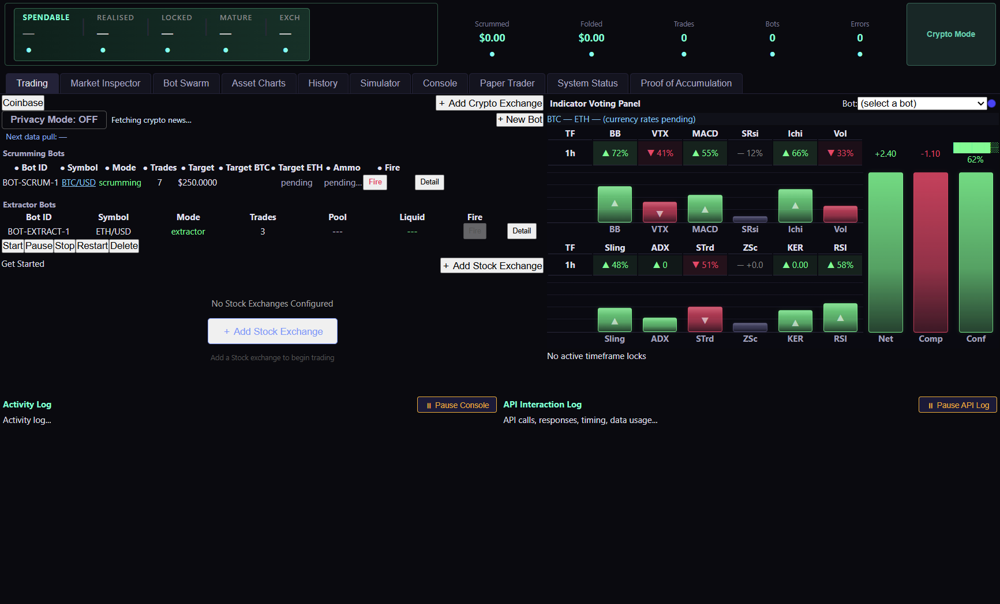

# System Architecture and Features Catalogue

Acervator features a semi-modular / layered design that nests a hyper-vigilant trading engine capable of operating in multiple investment domains simultaneously and all from one terminal. The Main Window contains all of the various subsections found in each subsystem tab. As it stands the existing and planned subsystem tabs are: Simulator, Paper Trading, Trading (Live), Market Inspector, Bot Swarm, Asset Charts, History, Console, Proof of Accumulation (PoA), and System Status. Most of these subsystems interact with each other to some degree with key isolations existing between the three trading tabs and their wiring to Market Inspector, Bot Swarm, and History.

Now: the window builds nine tabs in this order: Sim, Paper, Live, Charts, Inspector, Swarm, History, Status and Console, and it builds no Proof of Accumulation tab (`src/gui/main_tabs/main_window_surface.py, in BAR_TAB_ORDER`).

## The mark


The splash screen paints this mark at launch (`src/gui/main_tabs/splash_screen_painter.py, in compose_still`).

## Trading Tab

Here you see the first subsystem we are going to cover and this will primarily be due to familiarizing the prospective investor or user with the core trading philosophy and strategies that drive Acervator. To begin, the platform runs locally on whichever hardware is selected. A single authorization phase requiring a purchased license key will be the only non-exchange communication the application will ever need. The user’s keys and secrets are stored locally and encrypted after API handshake verification passes which allows the chosen exchange to be initialized. At a later development stage, I have plans for dedicated hardware that uses a hardware key for quick boot into a given user’s account and also allows the platform to run in isolation under Linux.

Now: no license check exists, and beyond the exchanges the app calls news feeds, CoinGecko and Yahoo Finance, plus AI, alert and posting services when you switch them on (`src/gui/crypto_news_ticker.py, in fetch_one`).


1 - Add Exchange - User provides valid API key and secret for target exchange - Platforms validates with an API handshake - Exchange Initializes

Now: most crypto exchanges must pass a live balance check before the key is saved, most broker keys save unchecked, and blank key rows add the exchange with no key. Its tab appears when the Settings window closes (`src/gui/settings_dialog.py, in SettingsDialog._add_exchange`, `src/gui/main_window.py, in MainWindow._sync_exchange_tabs`).

After an exchange is connected to the platform, bots can be added to target entire or portions of existing positions as well as using standing liquidity to enter positions for the first time. The two primary bots used by Acervator are known as Scrumming and Extractor with the conceptual Modulus Bot to be added later. The first two are the active traders that continuously interact with the market whereas the Modulus Bot will be a macro-strategic interface designed to trigger portfolio-scale shifts in response to custom market signals and it can best be visualized as a modular synthesizer with investment and market-specific functions.

### Scrumming Bot

If Acervator has a crown jewel, this is it. The scrumming bot is what houses and executes the harvest-fold method and the harvest-fold method is what leads to the creation of the platform itself. All else stems from this origin point and the simple revelation that allowed the method to be discovered (or probably rediscovered) by nonmathematical eyes. Instead of paying attention to what my entire portfolio was doing, I opted to start focusing on a single position until I had found a strategy that was more reliable than Grid Bots or standard speculation. I was convinced such a method existed and thought it absurd that price charts could not be played better when there was obviously so much room for improvement. You do not have to predict the market. You flow and mold your portfolio to it as time goes. Scrumming allows profits to be shaved off, held and re-investment in a cyclical, reliable manner that sizes its trades in direct proportion to actual market movement as it relates to position value drift. Trading in this manner allows a fixed balance for a position to be maintained and asserts the truth that “Position X is Y value. Any deviation from Y is a Target Delta and is subject to a Scrum (Sell) or Fold (Buy).” The primary weaknesses to this strategy are not have an equal amount of liquidity to the position value (a $500 Scrumming Bot should be supported by $500 of liquidity when initialized) and severe market downturns will little or no short term upside which can lock most liquidity for the position into the Target Asset. Scrumming is a survival strategy and is directionally agnostic but also depends on the market to cycle. I also refer to this simply as Accumulation Trading.

### Scrumming Bot Terms

Target Balance - The initial value of the position to be taken or controlled by the Scrumming Bot. The bot will monitor the market for bullish or bearish conditions, check for Target Balance deviations (Target Delta), and re-zero back to the set point. It will repeat this until stopped by the user or some other market condition.

Target Delta - The amount by which a position value has drifted from the Target Balance. The Target Delta is denoted by the Ammo column under the Scrumming Bot list of the Trading Tab. This is the amount of value that will be fired during the appropriate market conditions.

Now: a scrum and a cartridge fire the Target Delta, and an ordinary fold fires its queued tranche dollars instead (`src/trading/scrumming/tick_phases.py, in TickPhaseMixin._tick_execute_fold`).

Scrum - To sell an amount from an investment position that allows it to return to its initial price level. This never closes the position. This is the first half of the infinitely divisible circle that can persist for such positions in a healthy market.

Fold - To buy an amount for an investment position that allows it to return to its initial price level. This also drives Compounding Growth based on Local Volatility and is restricted by the Maximum Growth Per Cycle setting which has been set to a conservative 1% globally for Acervator’s live test and development run.

Now: each fold spends queued tranche dollars whose rebuy price the market has reached, up to the growth room left this cycle, so the Target Delta does not size it (`src/trading/scrumming/tick_phases.py, in TickPhaseMixin._tick_execute_fold`). A buy goes out only when the venue's free balance of its quote currency, read just before the send, covers the buy's price times its amount; otherwise nothing is sent and the log names both figures (`src/exchange/ccxt_connector.py, in CCXTConnector.place_order`). The fee is not counted, so a buy that fits only without its fee still reaches the venue, which refuses it. Every venue call of a fold's buy, from its open-orders read to its send, waits its turn in the venue's call queue, and a full queue does not refuse it; a balance the venue does not confirm still refuses the buy (`src/trading/scrumming/execution.py, in waives_queue_cap_by_path`).


When the +New Bot button is pressed, the above window appears. Currently there are two “trading mode”

options (this will be change to Strategies). We are only interested in the Scrumming Bot at this point.

Now: the first page offers two options on the Crypto class, and every other class offers only its own Scrumming option (`src/gui/main_tabs/bot_wizard_surface.py, in mode_offer`).


After Scrumming / Accumulation is selected, next we are presented with Exchange, Base Currency, and Target Asset options.

Exchange - A privately and federally licensed financial platform that allows API interfacing for remote or automated trade execution.

Base Currency - This will be a National Currency, Stable Coin, or High Volume Crypto (A15, A14, BNB) for which multiple trading pairs are available on the selected exchange.

Now: the drop-down lists seven declared currencies first, then every other currency the venue quotes a market in, even with one pair (`src/gui/main_tabs/bot_wizard_surface.py, in base_items_for`).

Target Asset - This is the asset in which the scrumming bot bases its position. If $50 and A05 are selected, it will strive to maintain and compound against a balance of $50 in A05 until it is shut down or some other adverse market condition occurs.

### Trading Parameters

Next we come to the combined Scrumming Bot configuration page which has several sections for fine tuning how the specific instance behaves. Given that Acervator, at the time of this writing, is still in active development the description for each setting should be seen as a design intention should any issues be encountered.


Order Visibility - Trades are listed on the order books or tracked internally to the platform.

Now: each order takes its own id, so the venue cannot hand back an order it has already answered. A lost send keeps its id for a retry of the same decision at any size or price, until an order comes back for it or the holdings audit finds its units and books them. A send the venue refuses gives its id back unless an earlier send under that id went unanswered, and the log names each id as it ends. A fold or a tranche fire names the tranches it buys, and an earlier order that comes back pays the queue by units (`src/trading/scrumming/reconciliation.py, in ReconciliationEngineMixin._settle_lost_order`). Another bot's audit leaves the units of an unanswered buy alone (`src/trading/container/aggregation.py, in FleetAggregationMixin.sum_sibling_tracked_units`). A venue that refuses a used id answers with that earlier order, read by client id. Where the read fails, the id stays held and each later try reads and sends nothing (`src/exchange/ccxt_connector.py, in CCXTConnector.place_order`).

A send that gets no answer writes ORDER LOST to the system log and the bot's log, naming its decision and id. An audit that reads units past the book while that id is held, and books none of them as that order, writes LOST ORDER UNMATCHED. The id's end writes LOST ORDER ENDED once, naming whether the venue answered a retry or the holdings audit booked it, and how many audits met it unmatched first (`src/exchange/idempotency.py, in UnansweredSend.ended_line`). Where the venue answered after one or more of those audits, the answer may hold units an audit already adopted, and the next audit takes them out (`src/trading/bot_container.py, in BotContainer._audit_next_tick`).

The venue's answer to that id first takes back what those audits moved on their own while it was held, up to the units the order filled, so the order books once at the venue's price. A buy's units leave the reconciliation lots those audits wrote, newest first, a sale's units go back to every lot, and the log writes LOST ORDER ANSWERED with the units (`src/trading/scrumming/reconciliation.py, in ReconciliationEngineMixin._return_audit_adoption`).

Aggressive Trading - Trades are priced so that they fill immediately. Trading like this is a bit like guerilla warfare. In and out before anyone notices.

Now: only Stack tranches in Order Book mode change, each going out as an immediate-or-cancel limit at its ladder price, and every other order ignores this box (`src/trading/scrumming_bot.py, in ScrummingBot._open_stack_from_scrum`).

Stack Mode - Stack Mode enables Stack Tranches which operate on the Sell or Scrum side. This forms the “upside” of the organic ladder structure whereas Fold Tranches form its “downside”.

Split Distance - This setting determines the spacing between tranches if Tranche Spread (not available yet) is being used.

Now: Split Distance sets the percent gap between Stack tranches while Stack Mode is on, and no Tranche Spread row exists (`src/trading/stack_math.py, in ladder_offsets_pct`).

Tranche Spread - This allows a given Scrum or Fold to divide its result X# of times across multiple incremented (as dictated by Split Distance) positions.

Now: no Tranche Spread row exists; Stack Mode splits a scrum across rising prices, and a fold buy goes out as one order (`src/trading/stack_math.py, in split_scrum_into_tranches`).

Tranche Count - This can also be referred to as Spread Count. It determines how pieces a given Scrum or Fold is split into and distributed across incremented tranches as opposed to just one.

Now: Tranche Count is the sell tranches one Stack ladder aims for, 2 to 20, and a fold buys in one order (`src/trading/scrumming_bot.py, in ScrummingBot._spawn_stack_from_fold`).

Spacing - This adds a scaling factor Split Distance and works in conjunction with Tranche Spread and Tranche Count to induce curves and more aggressive growth within the ladder structure.

Now: Spacing multiplies Split Distance tranche by tranche: Linear 1, 2, 3; Quadratic 1, 4, 9; Exponential 1, 2, 4 (`src/trading/stack_math.py, in level_multipliers`).

Personal Hold - Setting to be removed.

Now: no Personal Hold row or config field exists, and the bot drops a saved value when it loads (`src/trading/container/config.py, in _sanitize_deprecated_kwargs`).


Scrolling down we next find the first block of Scrumming Settings. These are the core or basic metrics for a Scrumming Bot.

Opposing Trade Interval - Establishes the minimum travel distance required by price action from the point a given trade in order the next trade of the opposite type to occur.

Now: a scrum needs this share of target as Target Delta, and after a fold this interval plus the fee; a fold rebuy adds Band Travel, and the distance is at least two fees (`src/trading/scrumming/sizing.py, in eligible_fold_tranches`).

BB Tolerance - Determines the minimum distance of the Bollinger Band extent price action must be in order for a trade action to occur.

Now: BB Tolerance sets how close to a band, as a percent of band width, price must sit to count for the Landing Strip, which can pass the TA gate (`src/trading/ta_engine.py, in vote_sides`).

Landing Strip Candles - Determines the strictness of Landing Strip detection. Minimum is three candles. Longer Landing Strips are historically more likely to indicate an impending market reversal than shorter ones assuming the taper remains intact or grows tighter.

Now: the box runs 2 to 10 and opens at 3; the band check reads it, and the shrinking-body check keeps its own fixed 3 (`src/trading/indicators/bb_proximity.py, in detect_bb_proximity`).

TA Timeframe - This is the timeframe at which the bot operates and denotes the price chart it will monitor for trade decisions.

Target Balance - This is the intended starting and locked value for the investment position that the Scrumming Bot is controlling.

Now: Target Balance is the starting value and the anchor; fold surplus grows the live target above it, and Apply Changes can move both (`src/trading/scrumming_bot.py, in ScrummingBot._apply_fold_target_growth`).

Max Entry Price - If the new bot does not detect the requisite amount (as dictated by Target Balance) of the Target Asset, this price threshold sets a limit at which it will attempt to perform the initiating Fold.

Now: every fold, hedge and entry buy refuses above this price; sells, a bot row's Fire and cartridge rebalances never read it, and 0 means no ceiling (`src/trading/scrumming/execution.py, in ExecutionEngineMixin._execute_buy`).

Min Entry (Should Be Exit) Price - If the new bot detects a requisite amount (as dictated by the Target Balance) of the Target Asset, this price threshold sets a limit at which it will attempt to perform the initiating Scrum.

Now: every fold, hedge and entry buy refuses below this price; no sell reads it, and 0 means no floor (`src/trading/scrumming/execution.py, in ExecutionEngineMixin._execute_buy`).

Trading Fee % - This allows the trading fee for the target exchange to be set. This is added to Minimum Opposing Trade Distance to further ensure buys / sells are properly distant and that a given bot is not losing an excessive amount to fee chop in volatile but overly tight market regimes.

Now: the distance adds the larger of this box and the highest fee the venue has charged this bot, a box of 0 reads as 0.6, and it never falls under two fees (`src/trading/otd_math.py, in trading_fee_pct_from_config`).

Max Target Growth % - This determines the maximum amount of growth the Target Balance can increase in a given Market Cycle with a cycle being a Fold / Scrum / Fold sequence. Essentially any Fold preceded by a Scrum will be allowed to Fold an amount of profit back in and, if Surplus remains after the Target Delta is re-zero’d, it can be used to increase Target Balance up to this hard limit for that cycle. This is the organic compounding mechanic.

Now: a cycle ends at a plain scrum fill or at the opposite band extreme; this figure caps target growth and each fold order, and only a fold spends wire credits (`src/trading/scrumming/tick_phases.py, in TickPhaseMixin._book_scrum_fill`).

Scrum Fold Ratio - This precedes Surplus calculation as described under Max Target Growth %. It determines how much of a given trade’s profits will be redistributed to directly contribute to its own organic compounding. Note that this does not interfere with normal Target Delta re-zeroing and is intended to only serve as a “cushion” to slow runaway compounding when Wire Credits are being received from multiple sources.

Now: on a plain scrum or cartridge sale this share of proceeds, after wire routing, queues for buy-back and the rest stays cash; a Stack tranche fill queues nothing (`src/trading/scrumming/fold_tranches.py, in FoldTrancheAccountingMixin._apply_scrum_fold_pct`).


Next are the “advanced” Scrumming settings which primarily affect when the bot is allowed to fire a trade. These can be thought of as “calibrating the scope”.

Detect Threshold - Intended as the point at which the bot “takes the safety off” and starts looking for a shot. To be re-evaluated.

Fire Threshold - The final Bollinger Band approach metric. Once satisfied, the bot can fire a trade.

Now: Fire Threshold sets how close to a band the ramp reaches FIRE; a scrum past the Detect line fires without it, and folds never read it (`src/trading/gate_chain.py, in RipeHarvestScrumOverride`).

BB Midline Gate - This is another, perhaps redundant layer, of Bollinger Band travel protection. It is different in that it is concerned with distance from the midline instead of the entire local width.

Read Rate - To be re-evaluated.

Band Travel - Previously described. To be re-evaluated.

BB Bullseye Check - If current price and Bollinger Band thresholds are equal, the user can opt to perform a double-sized trade.

Now: past Detect, or on a 0.5% band touch or 0.2% wick, a cleared interval and distance arm the BB priority skew, which lowers the vote floor, and no trade doubles (`src/trading/scrumming_bot.py, in ScrummingBot.tick`).

Wire Inflow Stack - To be re-evaluated.

Now: no Wire Inflow Stack row or config field exists; incoming wire dollars spread evenly over open fold tranches, or park until a sale opens one (`src/trading/scrumming/wire_routing.py, in WireRoutingMixin.apply_wire_income`).

Hedge Rebalance Active - Determines if Current Price drifting below Initial Entry Price will have a limited amount of funds that can be used to keep re-zeroing the Target Delta at key bearish thresholds or areas of possible reversal.

Now: while ticked, the reserve reads no entry price and buys from 1% under target, past the interval or with a tranche queued, with band position under 0.40 and no bullish vote, and a bot that has made no first buy waits for the band and its own vote first (`src/trading/scrumming_bot.py, in ScrummingBot.tick`).

Hedge Balance - Sets a limit on the amount of additional liquidity a given bot is allowed to absorb when Current Price drifts below Initial Entry Price.

Now: Hedge Balance caps a dollar reserve separate from Target Balance; each hedge buy spends up to half of it, and 8% of compound growth refills it (`src/trading/scrumming_bot.py, in ScrummingBot.tick`). A hedge or an entry holds its dollars on the in-flight ledger until its send ends, so a second buyer cannot pass on them (`src/trading/scrumming/execution.py, in ExecutionEngineMixin._execute_buy`). Every venue call of a hedge buy, from its open-orders read to its send, waits its turn in the venue's call queue, and a full queue does not refuse it (`src/trading/scrumming/execution.py, in waives_queue_cap_by_path`).


Now we arrive at some safety controls. Circuit Breakers are designed to fully inhibit trade actions for a given period should an extreme volatility (pump and dump) event occur. Soft Circuit Breakers have a candle-count based timer whereas Hard Circuit Breakers require the user to clear the bot to continue trading.

Now: an up candle stops scrums and a down candle stops folds for the cooldown, and a hard breaker stops every order until you press Reset All Breakers (`src/trading/bot_container.py, in BotContainer.guarded_place_order`).

Soft CB Threshold - The amount of instantaneous, single-candle price action required for the bot to pause trading for a number of candles denoted by Soft CB Cooldown.

Now: each breaker reads a candle once, when the shared candles first show it, and takes the high-to-low range it has reached by then against its open; a move later in that candle is not read, and the soft breaker shuts only that candle's side (`src/trading/scrumming/circuit_breakers.py, in CircuitBreakerMixin._check_circuit_breakers`).

Hard CB Threshold - The amount of instantaneous, single-candle price action required for the bot to be hard stopped at which point the user must re-authorize trading.

Now: a trip refuses every order until you press Reset All Breakers: the bot reads HELD and sends one alert, and an order already at the venue can still fill and books. Fire and Self-Destruct say they were refused, keep nothing, and must be pressed again after the reset, and a trip that lands while one of them waits refuses it even when the reset comes first. A cartridge, a detonation, an expiry close and a first entry decide again on the first tick after it (`src/trading/bot_container.py, in BotContainer.order_refusal`).

Soft CB Cooldown - This is the number of candles that must close before the Soft Circuit Breaker opens again.

Now: the count falls by one each time the shared candles show a new newest candle, which means the one before it has closed, and the side opens at zero; no count falls while the hard breaker holds (`src/trading/scrumming/circuit_breakers.py, in CircuitBreakerMixin._read_breaker_candle`).

Max Cartridge Size - This is the maximum amount of deviation allowed for the Target Delta. At this threshold the bot is actively and aggressively looking for a trade opportunity.

Now: at this share of Target Balance the bot fires a market rebalance past the band and vote gates, unless the opposing distance holds it or no queued tranche qualifies, and it spends only dollars no other bot's queued buy-backs or wire credits hold (`src/trading/scrumming/execution.py, in ExecutionEngineMixin._execute_manual_rebalance`); a bot that has made no first buy waits for the band and its own vote first (`src/trading/scrumming/tick_phases.py, in TickPhaseMixin._first_buy_clears`). A cartridge with no dollars it may spend sends nothing and writes one refusal line, and the tick goes on to the fold gates, so a fold still spends its own tranche (`src/trading/scrumming_bot.py, in ScrummingBot.tick`). The unfilled dollars of another bot's resting fold left the free balance, so they count once (`src/trading/container/aggregation.py, in FleetAggregationMixin._one_sibling_hold`). A fold's balance check and every venue call of its rebalance wait their turn in the venue's call queue, and a full queue does not refuse them; a balance the venue does not confirm still refuses the fold (`src/trading/scrumming/tick_phases.py, in TickPhaseMixin._tick_cartridge_fire`).

Smart Cartridge - This allows the Max Cartridge Size to organically resize in response to current price range as defined by the current-candle Bollinger Band reading.

Smart Ceiling - To be re-evaluated.


After Circuit Breakers, which help defend against extreme volatility, we come to Risk Controls. These are designed to cap the amount of profit or growth a given bot can earn before performing a full position exit.

Now: Risk Controls cap accumulation: folds taper toward the ceiling and stop, and a detonation sells what sits above the anchor while the bot keeps trading (`src/trading/scrumming/execution.py, in ExecutionEngineMixin._execute_detonation`).

Enable Position Ceiling - Enables a growth cap for a given position.

Ceiling Multiple - This setting caps the maximum amount of growth a position at a multiple of the Target Balance (anchor) and, once reached (and under higher timeframe bullish conditions with Detonation enabled) will allow the entire position to be sold and the corresponding bot will pause all further operations. Without Detonation enabled, this becomes a user notification.

Now: folds taper from half the ceiling and stop at it, which the log records, and a detonation ignores the ceiling while the bot runs on (`src/trading/scrumming_bot.py, in ScrummingBot._check_detonation_trigger`).

Enable Detonation - Enables an entire remaining position to be sold after the Ceiling Multiple growth threshold is crossed.

Now: a detonation sells only the value above the anchor, on a new bullish higher-timeframe turn, whether or not any ceiling is set or crossed (`src/trading/scrumming/execution.py, in ExecutionEngineMixin._execute_detonation`).

Detonation TF - Selects the timeframe for the chart that is being evaluated for bullish conditions that will allow the detonation to occur.

Min Confidence - This is the minimum technical analysis confidence index (via the Indicator Voting Panel) that will allow the detonation to occur.

Now: a detonation also needs three agreeing indicators, so a vote that only two indicators could reach waits at any bar, `src/trading/scrumming_bot.py, in ScrummingBot._check_detonation_trigger`.

Next we use the Strategy Gate Flags which allows top-level trade restrictions to be enabled or disabled thus relaxing or restricting the conditions under which a trade action can occur. The settings, in this case, are self-descriptive.

Now: on a running Scrumming bot this group also holds a Hunger tick box and a Hunger Pace box, which ease the scrum and fold vote floor over idle candles (`src/gui/live_settings/settings_tab.py, in SettingsTabMixin._add_hunger_rows`), and an Accumulation Shadow tick box, which sends a bearish fold's extra units to a Shadow Tranche (`src/gui/live_settings/settings_tab.py, in SettingsTabMixin._add_shadow_row`).


Moving onto the final section, we have Profit Routing which was intended to allow profits to be routed differently during initial set-up. This will be re-evaluated and potentially removed.

Now: the wizard carries no Profit Routing group, and you route profit with Smart Wires on the Swarm tab, by dragging between bot tiles or through Quick Routing (`src/gui/bot_wizard.py, in TradingParamsPage.set_mode`).

Route - Destination for profits.

Now: no Route row exists, and each Smart Wire names its target bot and the percent it carries (`src/trading/smart_wire.py, in SmartWireManager.register_wire`).

Target bot ID - Field for manually a bot ID which was intended to create a Smart Wire under the Bot Swarm tab.

Now: no Target bot ID row exists, and dragging from one bot tile to another opens the box that sets the wire's percent (`src/gui/bot_visualizer.py, in BotVisualizationTab._show_wire_config`).


Lastly we have the selection for the Phantom (Balance) Bots. These are intended to provide trade action overrides from higher timeframe charts and indicator sets which, in turn, may result in an improved trade or prevent a premature one.

Now: a phantom is a read-only observer on one higher timeframe that feeds the Composite Net and the defer gates, so it can refuse a trade and never places one (`src/trading/scrumming_bot.py, in ScrummingBot.tick`).

### Extractor Bot (Partially Built; Untested)

The second type of bot offered within Acervator is the Extractor. These operate quite differently from Scrumming Bots and actually operate as Siblings of them. In fact, an Extractor Bot cannot even be called unless a corresponding Base Currency Scrumming Bot (i.e. A15:USD or A14:USD) is already active. This is due to the core operating principle of the Extractor bot to acquire more of these base currencies by performing trades against available alternate currency pairings. It does this by using and blocking off a portion of the Parent’s position within an Extractor Tranche that represents an active position taken against one of the available alternate pairs. The Extractor Tranche remains open until its opposing accumulating (or Short Position if preferred by the user) or profit taking trade is filled. Extractor Tranches can be of any size but should generally be a relatively small fraction of the Parent’s total position which will allow the Extractor to take multiple positions if available and allowed by the specific user.

Now: creation stops unless exactly one Scrumming Bot on that exchange holds the base currency; the bot then claims its chunk, buys fixed Artillery rounds and never shorts (`src/gui/main_window.py, in MainWindow._extractor_parent_refusal`).


Chunk size (USD) - This determines the maximum amount of the parent’s pool that the Extractor can use.

Artillery size (USD) - This determines the individual size of Extractor Tranches.

Watch list top-N - The determines the number of Alternate Currency pairs the bot will scan for potential extraction.

Watch list refresh - This determines the rate at which the Extractor will scan its watched markets. This is the equivalent of a Timeframe for the Extractor but covers multiple pairs.

Now: this row sets how many candles pass before the bot ranks its list again, and the bot reads the listed pairs about every five seconds (`src/trading/extractor_bot.py, in ExtractorBot._refresh_interval_seconds`).

Pool Reserve - To be re-evaluated.

Now: no Pool Reserve row exists; a round fires while the free chunk, which exits refill with their gains, still holds its size (`src/trading/extractor_bot.py, in ExtractorBot._has_chunk_capacity`).

Exit % - To be re-evaluated.

Max compounding tier - Allows the Extractor to attempt a number of compounding Swing Trades with a given Extractor Tranche with subsequent re-entries based upon the Parent Scrumming Bot’s Minimum Opposing Trade Distance + Trade Fee + Bollinger Band extension settings.

Now: no Max compounding tier row exists; each exit returns its base currency to the pool, and the pair enters again only on a later bearish signal (`src/trading/extractor_bot.py, in ExtractorBot._book_exit`).

Max cost-basis multiple - To be re-evaluated.

Now: no Max cost-basis multiple row exists; the bot holds one position per pair and adds no round while that pair stays open (`src/trading/extractor_bot.py, in ExtractorBot.tick`).

Direction - To be re-evaluated.

Now: no Direction row exists; the Extractor buys an alternate pair on a bearish signal and sells on a bullish one only when the sale nets more base after fees (`src/trading/extractor_bot.py, in ExtractorBot._evaluate_open_position`).


Standing alt units (inverted) - To be re-evaluated.

Now: no Standing alt units row exists; every position starts from a bought round, and the bot keeps no standing alternate holding (`src/trading/extractor_bot.py, in ExtractorBot._book_artillery`).

Correction skip candles - To be re-evaluated.

Now: no Correction skip candles row exists; the bot adds no correction buys to an open position and only waits for its exit (`src/trading/extractor_bot.py, in ExtractorBot._evaluate_open_position`).

Drawdown threshold - To be re-evaluated.

Now: no Drawdown threshold row exists; a position reads drawdown whenever its dollar value sits below its entry value, by any amount (`src/trading/extractor_bot.py, in ExtractorBot._is_in_drawdown`).

Trend Strength Threshold - To be re-evaluated.

Now: no Trend Strength Threshold row exists; the Extractor reads only the bullish or bearish consensus and ignores trend strength (`src/trading/extractor_bot.py, in ExtractorBot._entry_signal_matched`).

### Additional Main Window > Trading Tab Features

#### Trade Logic and Gate Activity

This spool displays the trading logic and gate activity.


#### API Interaction Log

This spool displays API handshake information and data transfer speeds for these messages.

Now: this spool lists each API entry with its reason, endpoint, result, the venue's answer time in milliseconds, any wait for a worker and a data usage note (`src/gui/main_tabs/main_window_surface.py, in api_event_block`).


### Add Crypto Exchange Button (to be changed - Add Exchange)

Now: the button reads + Add, the active class name, then Exchange or Broker, and the Exchange menu item reads Add Exchange (`src/gui/main_tabs/asset_class_surface.py, in add_exchange_label`).

While the initial set up of Acervator requires at least one valid exchange API, additional exchanges can be added and have their own bot swarms. The current upper operational limit of Acervator is unknown. Multi-exchange testing has yet to be attempted as of 8/25/26 with API compatibility work pending. This button also currently opens the Settings Panel but on the incorrect ‘User’ Tab when it should be ‘Exchanges’.

Now: the button, the Exchange menu and Start on a broker, or on Robinhood on the Crypto class, with no stored key all open Settings on the Exchanges tab, and a first launch opens with no exchange (`src/gui/main_window.py, in MainWindow._run_settings_window`).


## How to use the Trading tab

This part is for lookup. Each row names one control, says what it does and what it reads, and cites the code behind it.

### Two builds of this tab

A frozen build draws the variant stamped into it. A source run reads `ACERVATOR_VARIANT` and draws React when nothing names a variant (`src/_variant.py, in resolve_variant`).

Every press on this page runs the same handler on both builds. The React page sends each press to `src/gui/react_trading_tab.py, in TradingTabReact.run_press`, which calls the handler the Qt button holds.

### The menu row and the status bar

| Control | What it does and what it reads |
| --- | --- |
| File > Settings | Opens Settings on its User tab. `src/gui/main_window.py, in MainWindow._open_settings` |
| File > Reset All Settings | Asks Yes or No, then clears every setting, exchange and stored key. The box names the orders resting at each stored venue, and the system log gets VENUE KEPT or VENUE REMOVED for each venue. `src/gui/main_window.py, in MainWindow._reset_settings`, `src/gui/main_tabs/settings_dialog_surface.py, in reset_resting_words` |
| File > Exit | Closes the window. `src/gui/main_window.py, in MainWindow._setup_menu` |
| Exchange > Add Exchange | Opens Settings on the Exchanges tab, in both builds. A class with no venue logs a note instead. `src/gui/main_window.py, in MainWindow._add_exchange` |
| Theme | Repaints the window in one of five themes and remembers it. Reads the `theme` and `accent_color` settings. `src/gui/main_window.py, in MainWindow._switch_theme` |
| Help > About | Shows the version and a feature list. `src/gui/main_tabs/main_window_surface.py, in about_text` |
| API load pill | Names the busiest exchange, its calls per minute, its busy share and any refused calls. Amber above 50% and red above 75% of the worse of busy share and 600 calls a minute. Reads the API log for the last 60 seconds. `src/exchange/api_load_monitor.py, in APILoadMonitor.sample` |
| AI state label | Shows AI: OFF, READY or NO PACKAGE, then AUTH or UNAUTH once feedback arrives. Reads the `ai_monitor` settings and `ai.feedback` events. `src/gui/main_window.py, in MainWindow._on_ai_feedback` |

### The header strip

Every figure repaints each 2 seconds (`src/gui/main_window.py, in MainWindow._refresh_header_strip`). With Sim or Paper in front, the strip reads that tab's own fleet. Otherwise figures cover the whole fleet, except AMMO, which reads the active class, and EXCH, which reads the active layer.

| Cell | What it shows and what it reads |
| --- | --- |
| SPENDABLE | Exchange wallet cash, the highest reading among the bots. A dash until cash or positions read above zero. `src/trading/container/aggregation.py, in FleetAggregationMixin._add_bot_stats` |
| P/L | Unrealised profit and loss, signed, as the exchange reports it. `src/gui/main_tabs/header_strip_surface.py, in unrealised_amount` |
| LOCKED | Dollar value of all positions: holdings times price times the quote's dollar rate, summed. A dash until cash or positions read above zero. `src/trading/container/aggregation.py, in FleetAggregationMixin._bot_position_usd` |
| MATURE | Position value above three times cost, summed, once an exchange answers. `src/trading/container/aggregation.py, in FleetAggregationMixin._add_bot_stats` |
| EXCH | Exchange sub-tabs on the active layer. `src/gui/main_window.py, in MainWindow._refresh_header_strip` |
| AMMO | Whole-dollar distance from target. Green when more bots sit above target, red when more sit below. `src/gui/main_tabs/header_strip_surface.py, in sector_ammo` |
| SCRUMMED, FOLDED | Dollars sold and bought this year, read from the exchange's trade history. A zero year shows the app's own running total. `src/trading/container/aggregation.py, in FleetAggregationMixin.get_aggregate_stats` |
| ACCUMULATED | Each bot's live target less its anchor, summed. `src/trading/container/aggregation.py, in FleetAggregationMixin.get_aggregate_stats` |
| TRADES | Orders filled this year, one per order, summed. `src/trading/scrumming/reconciliation.py, in ReconciliationEngineMixin.sync_ytd_trade_count` |
| BOTS | Running bots. `src/trading/container/aggregation.py, in FleetAggregationMixin._read_one_bot` |
| ERRORS | Bot errors since the last reset. A press opens the Error Log, with Recent events, Per-bot snapshot and Reset all errors. `src/gui/main_window.py, in MainWindow._build_error_log_dialog` |
| Round cell dots | Hide that cell behind asterisks. Filled shows and hollow hides. `src/gui/main_tabs/header_strip.py, in HeaderStripMixin._build_header_strip` |

### The asset class group

One square holds six segments: Crypto, Stock, Commodities, Forex, Indices and Futures / Perps. A press retitles the window, moves the Live layer and filters the tabs again (`src/gui/main_tabs/header_strip.py, in HeaderStripMixin.select_asset_class`). A class with no venue draws Get Started and a greyed button that says so (`src/gui/main_tabs/asset_class_surface.py, in class_state`).

### The tab row

| Tab | What it does | Follows the class | Page |
| --- | --- | --- | --- |
| Sim | Replays bots on stored history. | Yes | [simulator.md](08-tabs/simulator.md) |
| Paper | Runs bots on live prices with a pretend balance. | Yes | [paper-trader.md](08-tabs/paper-trader.md) |
| Live | Trades on real venues with real orders. | Yes | this page |
| Charts | Draws one chart per traded symbol. | Yes | [asset-charts.md](08-tabs/asset-charts.md) |
| Inspector | Scans markets and proposes topologies. | Yes | [market-inspector.md](08-tabs/market-inspector.md) |
| Swarm | Draws bots as nodes, with wires. | Yes | [bot-swarm.md](08-tabs/bot-swarm.md) |
| History | Shows venue trades, paired and graded. | Yes | [history.md](08-tabs/history.md) |
| Status | Shows subsystem health. | No | [system-status.md](08-tabs/system-status.md) |
| Console | Shows every log line and signal check. | No | [console.md](08-tabs/console.md) |

The class-following tabs are declared in `src/gui/main_tabs/class_filter_tab.py, in CLASS_TAB_ATTRS`, and each tab's mouse-over in `src/gui/main_tabs/main_window_surface.py, in TAB_TOOLTIPS`.

### One sub-tab per exchange

| Control | What it does and what it reads |
| --- | --- |
| Get Started tab | Shows until the class has an exchange, with a heading, an Add Exchange button and a hint. `src/gui/main_tabs/trading_tab.py, in TradingTabMixin._build_trading_tab` |
| Add Exchange corner button | Opens Settings on the Exchanges tab, and greys when the class has no venue. `src/gui/main_window.py, in MainWindow._add_exchange` |
| Exchange sub-tabs | One page per stored exchange, seated on every class it serves. Reads the stored exchange list, and the tabs change when a Settings window closes. A press changes the page. `src/gui/main_tabs/trading_tab.py, in TradingTabMixin._show_exchange_tab`, `src/gui/main_window.py, in MainWindow._sync_exchange_tabs` |
| Privacy Mode | Masks all registered fields, or shows them again when all are masked. It reads ON only when all are masked. `src/gui/main_tabs/exchange_tab_surface.py, in flip_privacy_masks` |
| + New Bot | Opens the Create Auto Trader wizard on this class. It refuses while the fleet is sealed or no stored venue serves the class. `src/gui/main_window.py, in MainWindow._create_bot` |
| Data pool line | Shows cache slots, freshest and oldest ages, stale count and cache-hit share, each second. `src/gui/main_tabs/exchange_tab_surface.py, in pull_rate_text` |
| DATA POOL STOPPED banner | A red line. It shows when this venue made no calls and the newest reading is over 60 seconds old. `src/exchange/fetch_stall.py, in stall_seconds` |
| News line | One headline each 15 seconds from ten RSS feeds, fetched hourly. Hover pauses it, and a press opens the story. `src/gui/crypto_news_ticker.py, in open_story` |

### The bot tables

On the Scrumming table, a press on a row draws that bot on the Indicator Voting Panel, and a second press on the same row clears the panel (`src/gui/main_tabs/bot_status_table_surface.py, in selection_after_press`). A press on a column label sorts that column, and blanks sink (`src/gui/main_tabs/bot_status_table_surface.py, in order_statuses`). A press on an Extractor row only selects it for the command bar (`src/gui/react_exchange_tab.py, in ExchangeTabReact.select_extractor`). A held bot's Symbol cell turns red, and it and the Fire button name the hold in their mouse-over (`src/gui/main_tabs/bot_status_table_surface.py, in held_tooltip`).

| Scrumming Bots column | What it shows and what it reads |
| --- | --- |
| Asset | The asset's kept logo, else its name. A press opens the asset's organisation site over https, and an asset with no address opens nothing. `src/gui/main_tabs/bot_status_table_surface.py, in organisation_address` |
| Symbol | The pair, coloured by bot state. A press opens the pair's chart on the exchange's site. `src/gui/main_tabs/bot_status_table_surface.py, in BotStatusTableModel._symbol_cell` |
| Current Position Value | Held units at a fresh exchange price. Blank when the price is missing or over 20 seconds old. `src/gui/main_tabs/table_cells_surface.py, in TableCellsModel.position_value_cell` |
| Trades | The bot's trade count. `src/gui/main_tabs/bot_status_table_surface.py, in BotStatusTableModel._write_row` |
| Target | The balance the bot returns to: the grown target, else the Target Balance. `src/gui/main_tabs/bot_status_table_surface.py, in target_value` |
| Target A15, Target A14 | The target restated in that asset, with its 24-hour drift. Blank when the asset is that market, a dash when the pair is unlisted, and pending until the rate arrives. `src/gui/main_tabs/table_cells_surface.py, in TableCellsModel.target_denom_cell` |
| Ammo | Distance from target, unsigned. Green above target, red below, grey when stale. It reads the exchange's units where it has them, else the bot's. `src/gui/main_tabs/table_cells_surface.py, in TableCellsModel.ammo_cell` |
| Fire | One press on one bot. The next section covers it. While the hard breaker holds, a press is refused and keeps nothing, so press it again after Reset All Breakers. On a bot no tick runs, it is refused the same way, so press it again after Start. `src/trading/bot_container.py, in BotManager.force_fire` |
| Detail button | Opens the bot settings window and selects the row. `src/gui/main_window.py, in MainWindow._on_bot_clicked` |
| Round header dots | Hides that column behind asterisks. Filled shows and hollow hides. Target's three columns share one field, as do Position Value and Ammo. `src/gui/main_tabs/bot_status_table_surface.py, in BotStatusTableModel.on_privacy_toggled` |

| Extractor Bots column | What it shows and what it reads |
| --- | --- |
| Bot ID | The bot's id. `src/gui/main_tabs/extractor_bot_table_surface.py, in row_values` |
| Symbol | The pool's base currency, with a coin mark. `src/gui/main_tabs/extractor_bot_table_surface.py, in row_values` |
| Mode | The word extractor, coloured by state. `src/gui/main_tabs/extractor_bot_table_surface.py, in row_values` |
| Trades | The bot's trade count. `src/gui/main_tabs/extractor_bot_table_surface.py, in row_values` |
| Pool | The pool budget in dollars, from the configured chunk size. `src/gui/main_tabs/extractor_bot_table_surface.py, in row_values` |
| Liquid | The pool's share not in a position, in green, yellow or red. The mouse-over counts positions. `src/gui/main_tabs/extractor_bot_table_surface.py, in deployment_split` |
| Fire | Always off. Manual Fire sits per position in the Detail window. `src/gui/main_tabs/extractor_bot_table_surface.py, in buttons` |
| Detail button | Opens the bot settings window. `src/gui/main_window.py, in MainWindow._on_bot_clicked` |

### The Fire button

A press queues a market order to target on the next tick, past the gates, and it refuses inside 1% of target (`src/trading/scrumming/execution.py, in ExecutionEngineMixin._execute_manual_rebalance`). A press that buys also sends nothing while the venue lists an open buy on the market, or while that list cannot be read (`src/trading/scrumming/execution.py, in ExecutionEngineMixin._refuses_stacked_buy`).

While the hard breaker holds a bot, a press queues nothing and the status log names the breaker, and the button keeps its colour (`src/trading/bot_container.py, in BotManager.force_fire`).

Now: while the hold stands, the button reads Held, dotted, and its mouse-over names the hold (`src/gui/main_tabs/bot_status_table_surface.py, in refused_fire`).

Now: a press that buys spends only dollars no other bot's queued buy-backs or wire credits hold, and the log names those dollars when none are left (`src/trading/scrumming/execution.py, in ExecutionEngineMixin._held_for_other_bots`). A press on a tranche whose fold still waits on the venue's answer sends nothing and reads refused (`src/trading/bot_container.py, in BotContainer.guarded_place_order`).

Fire and Ammo use their colours differently. Ammo is green above target, and Fire is red to sell above target.

| What the button shows | What it means |
| --- | --- |
| Solid red, glowing | Above target, every gate clear. A press sells to target. `src/gui/main_tabs/bot_status_table_surface.py, in BotStatusTableModel._armed_fire` |
| Dashed red | Above target, and a gate holds the sale. The mouse-over names it. A press sells anyway. `src/gui/main_tabs/bot_status_table_surface.py, in BotStatusTableModel._armed_fire` |
| Solid green, glowing | Below target, every gate clear. A press buys to target. `src/gui/main_tabs/bot_status_table_surface.py, in BotStatusTableModel._armed_fire` |
| Dashed green | Below target, and a gate holds the buy. A press buys anyway. `src/gui/main_tabs/bot_status_table_surface.py, in BotStatusTableModel._armed_fire` |
| Muted, dashed, glowing | The position ceiling stops automatic buys. A press buys past it. `src/gui/main_tabs/bot_status_table_surface.py, in BotStatusTableModel._armed_fire` |
| Amber fill, amber text or red text | Parked at target: at the band, tracking or searching. A press does nothing. `src/gui/main_tabs/bot_status_table_surface.py, in BotStatusTableModel._armed_fire` |
| No Trade, dotted | A press will not act. The distance sits inside 1% of target, or the exchange disputes the bot's unit count. `src/gui/main_tabs/bot_status_table_surface.py, in manual_fire_verdict` |
| Held, dotted | A press will not act. The hard breaker holds every order, and the mouse-over names the hold. `src/gui/main_tabs/bot_status_table_surface.py, in manual_fire_verdict` |
| Grey, off | The bot is neither running nor paused. `src/gui/main_tabs/bot_status_table_surface.py, in BotStatusTableModel._fire_button` |

### The command bar

Each command acts on the selected row. With no row selected it logs "Select a bot first." Hold SHIFT for the all-bots form.

| Button | What it does and what it reads |
| --- | --- |
| Start | Connects to the exchange, then starts the bot. `src/gui/main_window.py, in MainWindow._on_bot_command`. A bot keeps one tick loop in any state: Start resumes the loop a paused or errored bot already has. It does not end a hard hold: the log names the breaker and writes no RUNNING line. `src/trading/bot_container.py, in BotContainer.start` |
| Pause, Stop | Pauses or stops the bot. `src/gui/main_window.py, in MainWindow._on_bot_command`. A paused or stopped bot reads nothing and sends nothing on its own, and a fill books at the first worked tick after Start. `src/trading/scrumming_bot.py, in ScrummingBot.tick_stop_reason` |
| Restart | Stops the bot, connects again and starts it. `src/gui/main_window.py, in MainWindow._on_bot_command` |
| Delete | Asks Yes or No first. Yes stops the bot and removes it. SHIFT changes nothing. `src/gui/main_window.py, in MainWindow._on_bot_command` |
| SHIFT: Start All | Starts every idle or stopped bot, one at a time, with a progress window. A held bot is passed at once and listed with its hold. `src/gui/main_window.py, in MainWindow.run_fleet_sequence` |
| SHIFT: Restart All | Restarts every bot the manager holds, one at a time. `src/gui/main_window.py, in MainWindow.run_fleet_sequence` |
| SHIFT: Pause All, Stop All | Pause All takes every running bot and Stop All takes every bot, on every exchange and class. `src/gui/main_window.py, in MainWindow._global_bot_cmd` |

Each command that reaches the handler writes one BOT COMMAND line to the system log. It names the command, the route it came by, the branch that runs and the venue. The route reads the React Live page command bar, the Live tab command bar on the Qt build, or the fleet sequence, which runs at launch and on Start All and Restart All. A command no branch answers, or a bot the manager no longer holds, writes BOT COMMAND WITH NO BRANCH (`src/gui/main_window.py, in MainWindow._on_bot_command`).

On the React build, the Live page then writes LIVE PAGE COMMAND. It names the command, SHIFT, the venue and what the page did with the press: sent to the bot handler, sent to the fleet handler, or refused with no bot highlighted. A press no venue page holds, or one with no handler, writes LIVE PAGE COMMAND DROPPED (`src/gui/react_trading_tab.py, in TradingTabReact.run_press`).

```python
#: Each command ``MainWindow._on_bot_command`` runs a branch for, keyed as it dispatches.
BOT_COMMAND_BRANCHES = (
    START_COMMAND,
    PAUSE_COMMAND,
    STOP_COMMAND,
    RESTART_COMMAND,
    DELETE_COMMAND,
    ADJUST_STACK_COMMAND,
)
NO_BRANCH = ""

#: The route each caller of ``MainWindow._on_bot_command`` names itself by.
REACT_LIVE_COMMAND_ROUTE = "the React Live page command bar"
LIVE_COMMAND_BAR_ROUTE = "the Live tab command bar"
FLEET_SEQUENCE_ROUTE = "the fleet sequence"
```

### The two log panes

| Control | What it does and what it reads |
| --- | --- |
| Activity Log | Timestamped bot lines, gate lights and system messages. It keeps 5,000 lines. `src/gui/widgets/status_log.py, in StatusLog` |
| Pause Console | Holds new lines until Resume Console. The buffer holds 2,000, and a full buffer drops the newest. `src/gui/widgets/status_log.py, in StatusLog.log` |
| API Interaction Log | One block per API entry. It keeps 2,000 lines. `src/gui/main_tabs/trading_tab.py, in TradingTabMixin._build_trading_tab` |
| Pause API Log | Holds new entries until Resume API Log. The buffer holds 2,000, and a full buffer drops the oldest. `src/gui/main_window.py, in MainWindow._on_api_event` |

### The Indicator Voting Panel on this tab


[07-indicators.md](07-indicators.md) holds the indicator formulae.

| Control | What it does and what it reads |
| --- | --- |
| Bot selector | Picks the bot whose votes draw. It lists every Scrumming bot, on every class. `src/gui/indicator_panel.py, in IndicatorVotingPanel.update_bot_list` |
| Previous, next | Step the selector one bot, and stop at each end. `src/gui/indicator_panel.py, in IndicatorVotingPanel._step_bot` |
| Staleness label | An amber line naming stored votes and their age, or the cause when no votes exist. `src/gui/indicator_panel.py, in IndicatorVotingPanel.show_no_data` |
| Rate strip | A15 and A14 dollar prices, small units per dollar and per cent, and the source. `src/gui/indicator_panel.py, in IndicatorVotingPanel.update_currency_rates` |
| Privacy dot | Masks the selector text. The votes stay visible. `src/gui/indicator_panel.py, in IndicatorVotingPanel._apply_privacy_mask` |
| TF column | One row per timeframe, the bot's own plus its phantoms', shortest first. `src/gui/main_tabs/indicator_panel_surface.py, in timeframe_rows` |
| Twelve voter columns | BB, VTX, MACD, SRsi, Ichi, Vol, Sling, ADX, STrd, ZSc, KER and RSI. Each cell shows direction and confidence; ADX, ZSc and KER show raw readings. `src/gui/main_tabs/indicator_panel_surface.py, in indicator_cell_text` |
| Net | The signed bull-minus-bear tally for that row. `src/gui/main_tabs/indicator_panel_surface.py, in net_cell` |
| Comp | Net blended with the higher-timeframe phantoms, and a dash on phantom rows. `src/gui/main_tabs/indicator_panel_surface.py, in comp_cell` |
| Conf | A block bar and an agreement percentage. `src/gui/main_tabs/indicator_panel_surface.py, in conf_cell` |
| Bars | One bar per voter and one pillar each for Net, Comp and Conf, for the first-listed timeframe. `src/gui/main_tabs/indicator_panel_surface.py, in collated_pillars` |
| Locks line | Reads No active timeframe locks. Nothing creates a lock, so it stays. `src/gui/indicator_panel.py, in IndicatorVotingPanel._setup_ui` |



## How to use the Bot Wizard

The wizard's title reads Create Auto Trader. The Qt build draws `BotCreationWizard` and the React build draws `BotWizardReactDialog`, and a failed React import falls back to Qt (`src/gui/main_window.py, in MainWindow._create_bot`).

### The walk through the wizard

| Step | What it does and what it reads |
| --- | --- |
| Scrumming order | Trading Mode, Select Asset Pair, Trading Parameters, Phantom Bots, Finish. `src/gui/bot_wizard.py, in BotCreationWizard.nextId` |
| Extractor order | Trading Mode, Extractor Pool, Trading Parameters, Finish. `src/gui/bot_wizard.py, in BotCreationWizard.nextId` |
| Back, Next, Cancel | Back returns one page and keeps your entries. Cancel closes the wizard and makes no bot. `src/gui/main_tabs/bot_wizard_surface.py, in BotWizardModel.go_back` |
| Finish | Closes the wizard and builds the bot, which waits IDLE until Start. `src/gui/main_window.py, in MainWindow._create_bot` |
| A market no bot can trade | Finish keeps the wizard open and names why no built variant trades that market. `src/gui/bot_wizard.py, in BotCreationWizard.accept` |
| Pre-flight check | Scrumming only, after Finish. A missing venue, a missing symbol or a failed market read stops creation, and a failed price read does not. An inactive market, or a target under 3x the minimum cost, asks Yes or No. `src/gui/preflight_check.py, in check_symbol` |
| Parent check | Extractor only, after Finish. It stops creation unless exactly one Scrumming Bot holds the base currency. `src/gui/main_window.py, in MainWindow._refuse_extractor_without_parent` |

### Trading Mode page

| Class | What it offers |
| --- | --- |
| Crypto | Crypto Scrumming, ticked, and Base Currency Extractor (Multi-Target). `src/gui/main_tabs/bot_wizard_surface.py, in mode_offer` |
| Stock, Commodities, Forex, Indices, Futures / Perps | One ticked row: that class's own Scrumming option. No Extractor. `src/gui/main_tabs/bot_wizard_surface.py, in mode_offer` |

### Select Asset Pair page

| Row | What it does and what it reads |
| --- | --- |
| Exchange | Lists the stored venues that serve the class. Picking one loads its markets. `src/gui/bot_wizard.py, in AssetSelectionPage._fetch_markets` |
| Base Currency | Seven declared money legs, then any other leg the venue quotes. It opens on a leg the venue quotes. `src/gui/main_tabs/bot_wizard_surface.py, in opening_base_index` |
| Target Asset | Markets quoted in that base, highest volume first. A market no bot can trade says so and says why. `src/gui/bot_wizard.py, in AssetSelectionPage._filter_assets` |
| Information button | The Qt build opens the asset's description. The React build always answers that no description is available. `src/gui/main_tabs/bot_wizard_surface.py, in BotWizardModel.show_info` |
| Status line | Counts the pairs, and counts those that cannot carry a bot. `src/gui/bot_wizard.py, in AssetSelectionPage._filter_assets` |

### Trading Parameters rows

The first column gives each row's range and factory opening value. Order Visibility, Aggressive Trading, Target Balance, Enable Phantom Bots and Candles to lock open on your stored default (`src/gui/bot_wizard.py, in TradingParamsPage`). On a running bot the same rows wait for Apply Changes and reach the next tick.

| Row | What it does and what it reads |
| --- | --- |
| Order Visibility (Order Book) | Order Book sends limit orders and rests tranches on the book. Internal sends market orders and tracks tranches in the app. Reads `visibility`. `src/trading/scrumming/execution.py, in ExecutionEngineMixin._execute_sell` |
| Aggressive Trading (off) | Sends Stack tranches in Order Book mode as immediate-or-cancel limits. A tranche above the market cancels unfilled. Reads `aggressive_trading`. `src/trading/scrumming_bot.py, in ScrummingBot._open_stack_from_scrum` |
| Stack Mode (on) | Turns a scrum into a rising sell ladder, and ladders a fold's bought units too. Reads `stack_mode`. `src/trading/scrumming/execution.py, in ExecutionEngineMixin._execute_sell` |
| Split Distance (0.1 to 20%, 1%) | Sets the percent gap between tranches. Reads `split_distance`. `src/trading/stack_math.py, in ladder_offsets_pct` |
| Tranche Count (2 to 20, 3) | Sets the tranches a ladder aims for. Fewer appear under the venue minimum, or where two prices merge within 0.1%. Reads `stack_tranche_count_target`. `src/trading/stack_math.py, in split_scrum_into_tranches` |
| Spacing (Linear) | Picks the multipliers: Linear, Quadratic or Exponential. Reads `stack_spacing_mode`. `src/trading/stack_math.py, in level_multipliers` |

### Scrumming Settings rows

| Row | What it does and what it reads |
| --- | --- |
| Opposing Trade Interval (0.1 to 20%, 1%) | Sets the Target Delta a scrum needs, and the base of the opposing trade distance. Reads `scrumming_interval_pct`. `src/trading/otd_math.py, in minimum_opposing_trade_distance_pct` |
| BB Tolerance (0.25 to 5%, 1%) | Sets how close to a band, in percent of band width, price counts for the Landing Strip. Reads `bb_tolerance_pct`. `src/trading/indicators/bb_proximity.py, in detect_bb_proximity` |
| Landing Strip Candles (2 to 10, 3) | Sets the tight Heikin Ashi candles the band check needs. Reads `bb_landing_strip_candles`. `src/trading/indicators/bb_proximity.py, in detect_bb_proximity` |
| TA Timeframe (the venue's list, 1h) | Sets the candle length for votes, bands and breakers. Reads `ta_timeframe`. `src/trading/scrumming_bot.py, in ScrummingBot.tick` |
| Target Balance ($1 to $1,000,000, $200) | Sets the value the bot trades toward. On Apply, a figure above the anchor keeps accrued growth, and one at or below moves both. Reads `target_balance`. `src/trading/scrumming_bot.py, in ScrummingBot.set_target_balance_live` |
| Max Entry Price (0 to 10,000,000, 0 off) | Refuses fold, hedge, entry and tranche Fire buys above this price. Reads `max_entry_price`. `src/trading/scrumming/execution.py, in ExecutionEngineMixin._execute_buy` |
| Min Entry Price (0 to 10,000,000, 0 off) | Refuses the same buys below this price. Reads `min_entry_price`. `src/trading/scrumming/execution.py, in ExecutionEngineMixin._execute_buy` |
| Trading Fee % (0 to 5%, 0.6%) | Sets the fee inside the opposing distance. A higher fee the venue charged replaces it. Reads `trading_fee_pct`. `src/trading/otd_math.py, in trading_fee_pct_from_config` |
| Max Target Growth % (0 to 100%, 1%) | Caps target growth per cycle and the size of each fold order. 0% freezes the target and stops folds. Reads `max_target_growth_pct`. `src/trading/scrumming_bot.py, in ScrummingBot.cycle_growth_cap_usd` |
| Scrum Fold Ratio (1 to 100%, 100%) | On a plain scrum or cartridge sale, queues this share of proceeds for buy-back, and the rest stays cash. A Stack tranche fill queues nothing. Reads `scrum_fold_pct`. `src/trading/scrumming/fold_tranches.py, in FoldTrancheAccountingMixin._apply_scrum_fold_pct` |
| Unit lines under this group | Name the market's unit rule. A whole-unit market adds its minimum, interval and position notes. `src/gui/main_tabs/bot_wizard_surface.py, in unit_notes` |

### Advanced Scrumming rows

| Row | What it does and what it reads |
| --- | --- |
| Detect Threshold (10 to 90%, 75%) | Starts TRACK and sets the hard line: no scrum below it, no fold above it. Reads `scrum_detect_pct`. `src/trading/scrumming/circuit_breakers.py, in CircuitBreakerMixin._bb_detect_thresholds` |
| Fire Threshold (0.1 to 10%, 0.5%) | Sets how close to a band FIRE starts. A scrum past Detect passes it, and the first buy reads it. Reads `scrum_fire_pct`. `src/trading/scrumming/tick_phases.py, in TickPhaseMixin._tick_target_ramp` |
| BB Midline Gate (on) | Keeps scrums above the midline and folds below it. Reads `bb_midline_gate`. `src/trading/scrumming_bot.py, in ScrummingBot.tick` |
| Read Rate (1 to 60 min, 5) | Sets the minutes between full reads in SEARCH. TRACK and FIRE read ten times faster, and a bot the hard breaker holds reads at the SEARCH rate. Reads `scrum_read_rate_min`. `src/trading/scrumming_bot.py, in ScrummingBot.tick` |
| Band Travel (0 to 100%, 70%) | Widens the fold distance by this share of band width, and lifts trend hold after that much travel. 0 is off. Reads `band_travel_pct`. `src/trading/otd_math.py, in band_extension_pct` |
| BB Bullseye Check (on) | Counts a band touch within 0.5%, or a wick within 0.2%, toward the BB priority skew. Reads `bb_bullseye_check`. `src/trading/scrumming_bot.py, in ScrummingBot.tick` |

### Hedge Rebalance rows

| Row | What it does and what it reads |
| --- | --- |
| Hedge Rebalance Active (on) | Lets the reserve buy into a gap under target. Apply fills the reserve on tick and freezes it on untick. Reads `hedge_rebalance_active`. `src/trading/scrumming_bot.py, in ScrummingBot.set_hedge_rebalance_active_live` |
| Hedge Balance ($0 to $999,999,999, $200) | Sets the reserve ceiling. Apply leaves the current reserve alone. Reads `hedge_balance`. `src/trading/scrumming_bot.py, in ScrummingBot.set_hedge_balance_live` |

### Circuit Breakers rows

| Row | What it does and what it reads |
| --- | --- |
| Soft CB Threshold (0 to 100%, 25%, 0 off) | Shuts one side when a candle's range reaches this share of its open at the one read of that candle. Reads `circuit_breaker_soft_pct`. `src/trading/scrumming/circuit_breakers.py, in breaker_move` |
| Hard CB Threshold (0 to 100%, 35%, 0 off) | Trips the hard breaker at this range, and every order stops until a reset. The bot reads HELD and sends one alert. Each candle is read once, when the shared candles first show it, so a move after that does not count. Reads `circuit_breaker_hard_pct`. `src/trading/scrumming/circuit_breakers.py, in CircuitBreakerMixin._check_circuit_breakers` |
| Soft CB Cooldown (1 to 100, 3) | Sets how many new candles the shared candles must show before the shut side opens again. Reopening the app reads the newest candle as new, so it spends one. Reads `circuit_breaker_cooldown_candles`. `src/trading/scrumming/circuit_breakers.py, in CircuitBreakerMixin._read_breaker_candle` |
| Max Cartridge Size (0 to 200%, 10%, 0 off) | Fires a market rebalance once the Target Delta reaches this share of target. A bot that has made no first buy holds this buy until the band and its own vote clear: `src/trading/scrumming/tick_phases.py, in TickPhaseMixin._first_buy_clears`. Reads `max_cartridge_size_pct`. `src/trading/scrumming/tick_phases.py, in TickPhaseMixin._tick_cartridge_fire` |
| Smart Cartridge (off) | Replaces that percent with the Bollinger range, floored at the interval. Reads `max_cartridge_smart`. `src/trading/scrumming/tick_phases.py, in TickPhaseMixin._tick_smart_cartridge_pct` |
| Smart Ceiling (1 to 100%, 30%) | Caps the Smart Cartridge figure. Reads `max_cartridge_smart_ceiling_pct`. `src/trading/container/config.py, in smart_cartridge_ceiling_pct` |

### Risk Controls rows

| Row | What it does and what it reads |
| --- | --- |
| Enable Position Ceiling (off) | Tapers folds from half the ceiling and stops them at it. Scrums continue. Reads `position_ceiling_enabled`. `src/trading/scrumming_bot.py, in ScrummingBot.fold_size_taper` |
| Ceiling Multiple (1 to 10x, 5x) | Sets the ceiling as a multiple of the anchor. Reads `position_ceiling_multiple`. `src/trading/scrumming/sizing.py, in position_ceiling` |
| Enable Detonation (off) | Sells the value above the anchor on a new bullish turn, then resets the target, the fold queue and the lots. Reads `detonation_enabled`. `src/trading/scrumming/tick_phases.py, in TickPhaseMixin._tick_detonation` |
| Detonation TF (1d or 1w, 1d) | Picks the chart the hourly check reads. Reads `detonation_timeframe`. `src/trading/scrumming_bot.py, in ScrummingBot._check_detonation_trigger` |
| Min Confidence (0 to 1, 0.75) | Sets the bullish confidence bar. Confidence must also top what two indicators reach. Reads `detonation_confidence_min`. `src/trading/scrumming_bot.py, in ScrummingBot._check_detonation_trigger` |

### Strategy Gate Flags rows

Past the Detect line a ripe harvest passes the bullish TA and uptrend flags, and below it the band gate holds the scrum, so those two flags change no scrum (`src/trading/gate_chain.py, in RipeHarvestScrumOverride`).

| Row | What it does and what it reads |
| --- | --- |
| SCRUM requires bullish TA (on) | Asks for a bullish vote, which a ripe harvest passes. Reads `scrum_require_ta_bullish`. `src/trading/gate_chain.py, in effective_gate_flags` |
| SCRUM holds in sustained uptrend (on) | Holds past 13 of 20 up candles, which a ripe harvest passes. Reads `scrum_hold_in_uptrend`. `src/trading/gate_chain.py, in TrendHoldGate` |
| SCRUM defers to higher-TF bullish (on) | Refuses a scrum while the phantom bias reads bullish. Reads `scrum_defer_to_htf`. `src/trading/gate_chain.py, in HTFDeferGate` |
| FOLD requires bearish TA (on) | Asks for a bearish vote. A deep fold, past the interval under target, passes it. Reads `fold_require_ta_bearish`. `src/trading/gate_chain.py, in DeepFoldOverride` |
| FOLD defers to higher-TF bearish (on) | Refuses a fold while the phantom bias reads bearish. Reads `fold_defer_to_htf`. `src/trading/gate_chain.py, in HTFDeferGate` |

### Phantom Bots rows

| Row | What it does and what it reads |
| --- | --- |
| Enable Phantom Bots (on) | Starts one read-only observer when the bot initialises, and again on the first worked tick after a Stop or a Restart. Reads `enable_phantoms`. `src/trading/scrumming/tick_phases.py, in TickPhaseMixin._start_phantom_set` |
| Timeframe boxes | Picks one timeframe above the bot's own. Timeframes the venue lacks grey out. Reads `phantom_timeframes`. `src/gui/bot_wizard.py, in PhantomConfigPage._timeframe_refusal` |
| Candles to lock (1 to 10, 2) | Stores a lock length. Nothing creates a lock, so nothing uses it. Reads `lock_candle_count`. `src/trading/phantom_balance.py, in TimeframeCoordinator` |

### Extractor rows

The Extractor Pool page sets the venue and the base currency, and the parameter page sets the rest.

| Row | What it does and what it reads |
| --- | --- |
| Exchange | The same venue list. Picking one fills the alternate pair list again. `src/gui/bot_wizard.py, in ExtractorPoolPage._on_exchange_changed` |
| Pool Base Currency | Five declared currencies, opening on the first. It sets what the pool grows and which pairs it may trade. `src/trading/extractor_bot.py, in ExtractorBot._pair_filter_matches` |
| Alternate pair list | A read-only view of pairs quoted in that base. The bot ranks its own. `src/gui/bot_wizard.py, in ExtractorPoolPage._refresh_alt_list` |
| Chunk size (USD) ($10 to $10,000,000, $100) | Base currency the bot may put to work, turned into base units on its first run. Reads `extractor_chunk_size_usd`. `src/trading/extractor_bot.py, in ExtractorBot.set_initial_chunk_rate` |
| Artillery size (USD) ($0.50 to $100,000, $5) | The dollar size of every round. A round larger than the free chunk does not fire. Reads `extractor_artillery_size_usd`. `src/trading/extractor_bot.py, in ExtractorBot._fire_artillery` |
| Watch list top-N (5 to 10, 8) | How many top-volume pairs it watches. A pair it holds stays listed on top of that. Reads `extractor_scan_top_n`. `src/trading/extractor_bot.py, in ExtractorBot._refresh_watch_list` |
| Watch list refresh (10 to 240 candles, 60) | Candles between rankings of the list. Reads `extractor_scan_refresh_candles`. `src/trading/extractor_bot.py, in ExtractorBot._refresh_interval_seconds` |
| Exit % (10 to 100%, 100%) | The share sold on a bullish exit. Below 100 the rest stays open. Reads `extractor_exit_pct`. `src/trading/extractor_bot.py, in ExtractorBot._execute_bullish_exit` |

### Whole-Unit Market and Contract Expiry rows

Each group shows only for a market that needs it.

| Row | What it does and what it reads |
| --- | --- |
| Whole-Unit Market group | Shows for a Scrumming market sized in whole units, or one whose session takes whole units out of hours. `src/gui/bot_wizard.py, in TradingParamsPage.set_market` |
| Open Position At (0 to 1,000 units, 0) | The opening size. 0 or 1 leaves the two-unit minimum. Reads `whole_unit_opening_units`. `src/trading/container/config.py, in whole_unit_opening_units` |
| Contract Expiry group | Shows for a Scrumming market with an expiry date. `src/gui/main_tabs/bot_wizard_surface.py, in market_expires` |
| Expiry Close (Finish the sell ladder) | Finishes the sell ladder or sells the whole position inside the lead time. Buys stop there either way. Reads `expiry_close_action`. `src/trading/bot_container.py, in BotContainer.guarded_place_order` |
| Expiry Lead Mode (Share of the contract's life) | Picks a share of the contract's life or a number of days. Reads `expiry_lead_mode`. `src/trading/container/config.py, in expiry_lead_resolved_days` |
| Lead Fraction (0 to 1, 0.20) | The share of life left at bot start. 0 is off. Reads `expiry_lead_fraction`. `src/trading/container/config.py, in expiry_lead_resolved_days` |
| Lead Days (0 to 36,500, 11) | Days before expiry, read in days mode only. 0 is off. Reads `expiry_lead_days`. `src/trading/container/config.py, in expiry_lead_resolved_days` |
| Expiry Horizon (0 to 36,500 days, 365) | Treats a later contract as non-expiring. 0 turns the close off. Reads `expiry_horizon_days`. `src/trading/container/config.py, in expiry_close_decision` |

## How to use a running bot

The Detail button opens the bot settings window. A Scrumming bot's window carries Status, Settings, Fold Tranches, Stack Tranches, Bot Swarm, Market Inspector and Phantom Bots. An Extractor's carries Status, Settings and Positions Held (`src/gui/bot_live_settings.py, in BotLiveSettingsDialog._setup_ui`).

### The window's own buttons

| Button | What it does |
| --- | --- |
| Apply Changes | Writes every pending edit at once, with no restart. `src/gui/bot_live_settings.py, in BotLiveSettingsDialog._apply_changes` |
| Close | Closes the window and drops unapplied edits. `src/gui/bot_live_settings.py, in BotLiveSettingsDialog._setup_ui` |
| Prev, Next | Closes this window and opens the neighbouring bot at the same tab position, dropping unapplied edits. The walk covers every bot the manager holds and wraps at both ends. Both buttons hide below two bots. Ctrl+Left and Ctrl+Right do the same. `src/gui/bot_live_settings.py, in BotLiveSettingsDialog._navigate_to_sibling` |
| Pending line | Names the fields waiting for Apply, then counts what Apply changed. `src/gui/bot_live_settings.py, in BotLiveSettingsDialog._mark_changed` |
| Hold line | Shows under the header while a hard breaker holds the bot, and names the hold. `src/gui/main_tabs/bot_live_settings_surface.py, in hold_text` |

### Rows only a running bot shows

These sit on the Settings tab beside the wizard's rows.

| Row | What it does and what it reads |
| --- | --- |
| Live target | The traded target, the anchor and accrued growth, as the tab opened. `src/gui/live_settings/settings_tab.py, in SettingsTabMixin._create_settings_tab` |
| Standing surplus | Fold surplus parked past the cycle cap, which later folds drain. `src/trading/scrumming_bot.py, in ScrummingBot._apply_fold_target_growth` |
| Cycle growth budget | This cycle's cap and what it has consumed. `src/trading/scrumming_bot.py, in ScrummingBot.cycle_growth_cap_usd` |
| Over-cap tranches | Shows when a tranche exceeds one cycle's budget. `src/gui/live_settings/settings_tab.py, in SettingsTabMixin._create_settings_tab` |
| Target A15, Target A14 | The target in that asset and its 24-hour gap against the dollar pair, each 5 seconds. `src/gui/live_settings/settings_tab.py, in SettingsTabMixin._refresh_target_denom_rows` |
| Profit Folding Active (on) | Lets fold surplus grow the target. Reads `profit_folding_active`. `src/trading/scrumming_bot.py, in ScrummingBot._apply_fold_target_growth` |
| Tranche Despawn Timer (0 to 365 days, Off) | Removes fold and stack tranches this old on each tick. It places no order, and a tranche with a resting order stays. A hard hold removes nothing, and time under a hold does not count toward the age. Reads `tranche_despawn_days`. `src/trading/scrumming/fold_tranches.py, in FoldTrancheAccountingMixin._despawn_aged_tranches` |
| Reset All Breakers | Clears both breakers at once, and it is the only press that ends a hard hold. A bot the hard breaker paused runs again, a bot paused by hand stays paused, and a bot with no tick loop waits for Start. Hold SHIFT to clear every bot in the fleet, after Yes or No. `src/gui/live_settings/settings_tab.py, in SettingsTabMixin._on_cb_reset_all` |
| Self-Destruct | After you type SELF-DESTRUCT, it sells the asset's whole venue balance at market, clears the fold queue and pauses the bot. The pause lands once the sale has gone to the venue, whether it filled, rests or lost its reply, and it holds until you press Start. Reopening the app starts the bot with the fleet. A later piece books after Start and never pauses the bot again. A sale that lost its reply books at the first worked tick after Start, once the venue shows those units gone. A sale the venue refuses flat leaves the bot as it was, and the log says so. Shadow Tranches join the sale only once an order comes back. `src/trading/scrumming_bot.py, in ScrummingBot.self_destruct`. While the hard breaker holds, the press shows a box that names the hold, changes nothing and says to press it again after the reset. `src/gui/live_settings/settings_tab.py, in SettingsTabMixin._on_self_destruct_clicked` |
| Hunger (off) | Eases the vote floor after idle candles past the opposing distance. It never lets two indicators trade. Reads `hunger_enabled`. `src/trading/scrumming_bot.py, in ScrummingBot._count_hunger_candle` |
| Hunger Pace (a dash means none) | Sets the idle candles to full hunger. A dash does nothing. Reads `hunger_pace_candles`. `src/trading/container/config.py, in BotConfig.hunger_gain_per_candle` |
| Accumulation Shadow (off) | In a bearish regime, each fold's extra units go to a Shadow Tranche, held until a bullish regime. Reads `shadow_enabled`. `src/trading/scrumming/shadow.py, in ShadowTrancheMixin._mark_shadow_rows` |

### The window's other tabs

| Tab | What it holds |
| --- | --- |
| Status | Read-only at open: realised profit and loss, trades, open orders, price, uptime and last error. `src/gui/live_settings/status_tab.py, in StatusTabMixin._create_status_tab` |
| Fold Tranches | The queued buy-backs and their counters. Fire buys one tranche with its own sale dollars, skipping the vote and Target Delta gates. While the hard breaker holds it refuses and leaves the tranche as it is, so press it again after the reset. On a paused bot it still buys, and its Stack rungs do not open. Each Clear button asks first and places no order. `src/trading/scrumming_bot.py, in ScrummingBot.manual_fire_tranche` |
| Fold Tranches: Order, Filter | Order sets the row order, and Filter hides rows that do not match. `src/gui/live_settings/fold_chrome.py, in build_fold_row_controls` |
| Fold Tranches: Arbiter button | Flips one label on an Extractor tranche and moves no money. `src/gui/live_settings/fold_tranches_tab.py, in FoldTranchesTabMixin._on_arbiter_toggle_clicked` |
| Stack Tranches | The rising sell levels and their counters. Clear keeps a tranche that holds a resting order, and Clear Lifetime Counters asks first. `src/trading/scrumming_bot.py, in ScrummingBot.clear_stack_tranches` |
| Stack Tranches: Shadow Tranches | A summary row and one detail row for each Shadow Tranche the bot holds. `src/gui/main_tabs/stack_tranches_tab_surface.py, in compose_shadow_rows` |
| Bot Swarm | Read-only: wires, lifetime totals, pending credits and recent transfers. Wires change on the main Swarm tab. `src/gui/live_settings/bot_swarm_tab.py, in BotSwarmTabMixin._create_bot_swarm_tab` |
| Market Inspector | Read-only: this bot's card from the Inspector's last scan. `src/gui/main_tabs/market_inspector_tab_surface.py, in per_bot_view` |
| Phantom Bots | Three controls that wait for Apply, and the phantoms' state. A running phantom keeps its timeframe until restart. `src/trading/scrumming_bot.py, in ScrummingBot.update_phantom_config` |

### A running Extractor

The Extractor's Settings tab draws the Scrumming rows except Opposing Trade Interval, BB Tolerance, Landing Strip Candles, TA Timeframe, Target Balance, Hunger and Hunger Pace, and Apply accepts them (`src/gui/live_settings/settings_tab.py, in SettingsTabMixin._create_settings_tab`). The engine reads only the five Extractor rows and Trading Fee % (`src/trading/extractor_bot.py, in ExtractorBot.tick`).

A started Extractor ranks its watch list and places no order, because its signal reader keeps the stand-in exchange the bot was built with (`src/trading/extractor_bot.py, in ExtractorBot.__init__`).

| Control | What it does and what it reads |
| --- | --- |
| Pool color | Green with nothing open, yellow with positions open, red with one or more in drawdown. `src/trading/extractor_bot.py, in ExtractorBot.pool_color` |
| Chunk size, Chunk free | The chunk in base units and dollars, and the base units not in a position. `src/gui/live_settings/positions_held_tab.py, in PositionsHeldTabMixin._create_positions_held_tab` |
| Lifetime extracted | The running base-unit gain from sales. `src/trading/extractor_bot.py, in ExtractorBot._book_exit` |
| Position rows | Pair, state, units held and dollar size at entry. Current and its change are priced at the average buy price, so neither follows the market. `src/trading/extractor_bot.py, in ExtractorBot.positions_for_gui` |
| Fire, per position | After Yes, it sells the whole position at market and skips the profit check. `src/gui/live_settings/positions_held_tab.py, in PositionsHeldTabMixin._on_fire_position` |
| Reset All Breakers, Self-Destruct | An Extractor has neither. Self-Destruct shows a refusal, and Reset reads Reset failed. `src/gui/live_settings/settings_tab.py, in SettingsTabMixin._on_self_destruct_clicked` |

### Two mechanisms with no control on this tab

The Fair Value Gap reading has no control, and nothing builds it (`src/trading/indicators/fvg.py, in FVGIndicator`). Boost Fold has no control either, and the crypto engine sets its fields to zero and reads none of them (`src/trading/scrumming_bot.py, in ScrummingBot.__init__`).
