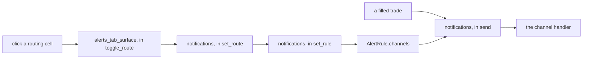

# Notifications and Alerts

Reference. Two channel forms and a Save button on the left. The Event Routing
table and the Notification History table on the right.

## What the Event Routing table is for

The table is the map from an event to the channels that carry it. One row per
event. One column per channel. A cell reads `Yes` when the event reaches that
channel and `No` when it does not.

The operator clicks a routing cell to change it. The click writes the channel
list the notification manager reads, so the next alert of that event follows
the new reading.



`src/gui/alerts_tab.py, in _toggle_route` is the one method both builds enter.
The Qt table reaches it from `cellClicked`. The drawn page reaches it from
`src/gui/react_alerts_tab.py, in _apply_request`, which reads the `route` the
page sends. `src/gui/main_tabs/alerts_tab_surface.py, in toggle_route` holds
the flip itself, so one gesture writes one rule.

## The columns come from one declaration

`src/gui/main_tabs/alerts_tab_surface.py`, `ROUTING_COLUMNS` names one channel
per column with the heading above it. `RULES_COLUMNS`, `RULES_COLUMN_COUNT`
and `ROUTED_CHANNELS` are all read from it.

| Column | Channel | What carries the message |
| ------ | ------- | ------------------------ |
| Event | — | the event name, titled |
| Priority | — | the rule's priority word |
| In-App | `IN_APP` | the log spool the window reads |
| Telegram | `TELEGRAM` | the Telegram Bot API |
| SMS | `SMS` | `src/core/sms_engine.py, in send` |
| Sound | `SOUND` | the alert sound engine |

The Qt table takes its count and its headings from those names. The drawn page
takes the same headings from the `rules_columns` field that
`src/gui/main_tabs/alerts_tab_surface.py, in build_view_model` writes. Removing
one entry from `ROUTING_COLUMNS` removes that column from both builds
together, so the two cannot disagree on a channel.

## Which events reach the message channels

`src/core/notifications.py`, `EVENT_MESSAGE_KIND` pairs an event with the
`src/core/sms_engine.py` switch that gates it. An event listed there is given
the Telegram and SMS channels by
`src/core/notifications.py, in message_channels_for`. An event left out reaches
the in-app spool and the sound engine alone.

Eleven of the fourteen events are paired today. `Buy filled` and `Sell filled`
are among them, so a filled trade reaches in-app, Telegram and SMS.

The switch on `Settings > SMS` still gates the send.
`src/core/sms_engine.py, in send` refuses and writes the refusal to the log
when the group is off, when no switch names the event kind, or when the rate
caps are reached. A ticked SMS cell therefore routes the event; it does not
override the switch.

## The dollar figure in a fill message

`src/core/notifications.py, in fill_message` prints the kind, the units, the
price and the dollars of one fill. The dollars are read by
`src/core/emit_contracts.py, in fill_usd`, which uses the field names
`FILL_USD_FIELDS` declares. All ten emitters of the fill event write that one
name, and the `trade.filled` contract takes its optional dollar fields from the
same tuple.

## The state of this screen

`src/gui/variant_surface.py` registers both builders under the name `ALERTS`.
Nothing calls `surface_class(ALERTS)`, and
`src/gui/main_tabs/retired_tabs.py, in _install_retired_tab_sentinels` sets
`_alerts_tab` to `None`. The running window therefore builds no Alerts page,
and `src/gui/main_window.py, in _refresh_dashboard` skips it.

Both builds of the screen are complete and both draw the same six columns. The
window does not open either one.

The engine behind this screen keeps running. The window builds the notification
manager at launch, and every 2 seconds the refresh tick hands it the fleet P/L
for the milestone check. The screen's own surface loads only when a request for
this page arrives, so a session that never asks for it never imports it.

`src/gui/main_tabs/alerts_tab_surface.py` — `METHOD`, read from the one module that names every retired page's method

```python
METHOD = retired_surfaces.ALERTS_TAB_METHOD
```

The Product Manual PDF rebuild is owed for this page.

Back to [the subsystem index](README.md).
