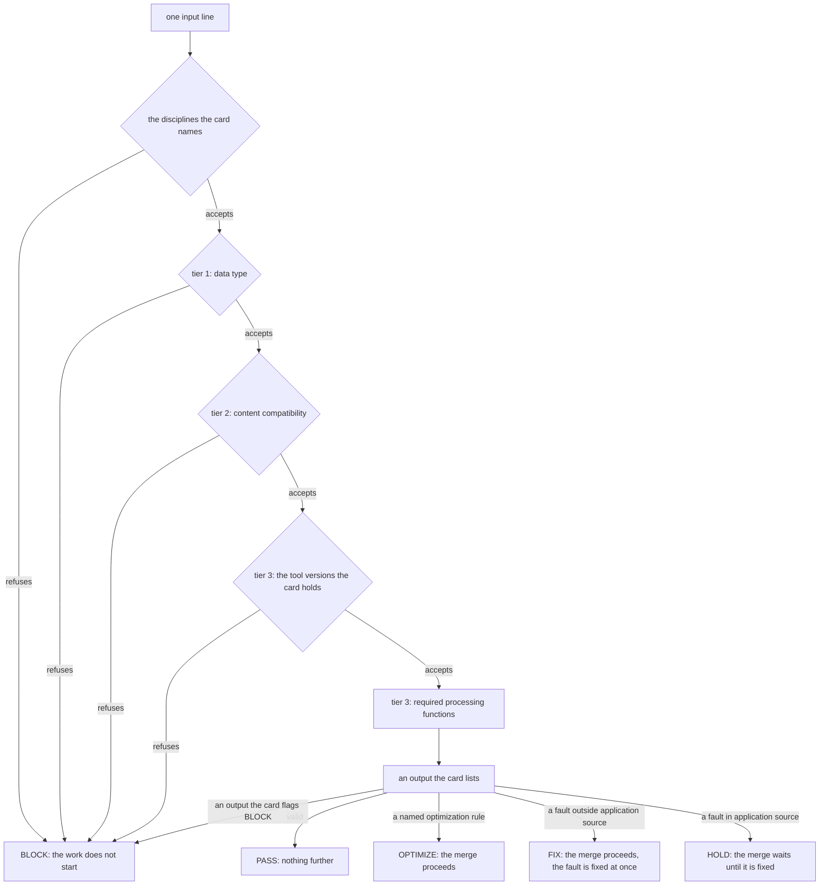

# The Sigil Project

Reference. A sigil vernacular is a working language for an occupation. Each
sigil names a professional workflow or a canonized, restricted output. The
project is named Sigil-based Vernacular Condensate.

In this repository, a sigil is a named check. It reads finished code against a
published rule set and answers from a fixed list. Its mark holds its name and
its edition, such as CODE.LOOP@1. Nothing here changes the trading platform.

## What a sigil is

Each sigil holds its card as data in its own module. The card names the sigil,
its edition, the archetype that owns it, its input form, its three input tiers,
its outputs and the flag of each output. The command prints the card as JSON
with `--card`, so any harness can read the card without this repository's
skills.

`dev_harness/sigils/core.py, in Sigil`, the card as data:

```python
@dataclass(frozen=True)
class Sigil:
    """A card as data, with tiers 1, 2 and 3 as `data_type`, `content`, `functions`."""

    name: str
    edition: int
    owner: str
    input_form: str
    settings: Mapping[str, str]
    tiers: tuple[TierCard, TierCard, TierCard]
    outputs: Mapping[str, FlagRow]
    refusal: str
    follows: Mapping[Flag, str]
    readers: Mapping[str, Callable[..., object]]
    data_type: DataType
    content: Content
    functions: Functions
    fault_file: FaultFile | None = None
    disciplines: tuple[str, ...] = ()
```

## The scope test

A sigil applies only to work with a known set of formatted results. Everything
else stays in prose. Work qualifies for a sigil only when all five lines read
yes. The test is written in `dev_harness/skills/unit-decomposition/SKILL.md`,
in the section headed THE SCOPE TEST.

```
input     its shape is declared, and input out of range has a defined answer
outputs   every allowed output is listed in advance
ground    every output can be checked against code or a document
owner     an archetype reads the result without asking the model
decision  the model makes one named choice; with no choice, it is an ordinary function
```

CODE.DEBUG.PYTHON@1 reads no on the decision line: its card names the decision
as none.

## The three input tiers

A sigil filters each input in three tiers, in this order. A tier runs only
after the tier before it accepts. A refusal names the tier that refused it, and
its output is REJECTED with the flag BLOCK.

```
tier 1  data type                      the input has the declared shape and characters
tier 2  content compatibility          the content belongs to the owning archetype's type and work
tier 3  required processing functions  the function set that does the sigil's work and gives its output
```

Tier 2 comes from the owning archetype. A sigil with no owning archetype has no
tier 2 and is not admitted. Every Coding sigil takes tiers 1 and 2 from one
module. Each Coding sigil built after the first four, except CODE.DEBUG.PYTHON@1,
narrows tier 2: Python's ast module must find the construct the sigil reads, or
the input is refused.

`dev_harness/sigils/core.py, in card_refusal` runs the two checks that read
only the card: its disciplines at tier 0, then the tool versions it holds at
tier 3.

`dev_harness/sigils/core.py, in first_refusal` calls `card_refusal` first, and
then runs tier 1 and tier 2 on the input.

`dev_harness/sigils/core.py, in first_refusal` returns the refusal with the
lowest tier, with its tier number and tier name, or None when every check
accepts.

`dev_harness/sigils/core.py, in Refusal`:

```python
class Refusal(NamedTuple):
    """The `tier`, `tier_name` and `fault` of the refusal `first_refusal` returns."""

    tier: int
    tier_name: str
    fault: str
```

`dev_harness/sigils/core.py, in card_refusal` and `in first_refusal`:

```python
def card_refusal(sigil: Sigil) -> Refusal | None:
    """Return `discipline_fault` at tier 0, else `version_fault` at tier 3, or None."""
    fault = discipline_fault(sigil)
    if fault:
        return Refusal(0, CARD_DISCIPLINES, fault)
    fault = version_fault(sigil)
    if fault:
        return Refusal(3, FUNCTIONS, fault)
    return None


def first_refusal(sigil: Sigil, text: str, root: Path) -> Refusal | None:
    """Return the lowest-tier refusal of `card_refusal`, tier 1 and tier 2, or None."""
    card = card_refusal(sigil)
    if card is not None and card.tier == 0:
        return card
    fault = sigil.data_type(text)
    if fault:
        return Refusal(1, DATA_TYPE, fault)
    fault = sigil.content(text, root)
    if fault:
        return Refusal(2, CONTENT, fault)
    return card
```

`dev_harness/sigils/core.py, in judge` gives the card's refusal with the flag
BLOCK when `dev_harness/sigils/core.py, in first_refusal` returns one.

`dev_harness/sigils/core.py, in judge` runs tier 3 when no check refuses:

```python
def judge(sigil: Sigil, text: str, root: Path, *, in_source: bool) -> Verdict:
    """Return `first_refusal` as a `Flag.BLOCK` `Verdict`, else the tier 3 reading."""
    refusal = first_refusal(sigil, text, root)
    if refusal is not None:
        reason = f"{refusal.tier_name}: {refusal.fault}"
        return Verdict(sigil.refusal, reason, refusal.tier, Flag.BLOCK)
    reading = sigil.functions(text, root)
    holds = not isinstance(reading, Reading) or reading.holds
    detail = reading.detail if isinstance(reading, Reading) else None
    output, reason = reading[0], reading[1]
    flag = flag_of(sigil, output, in_source=in_source and holds)
    return Verdict(output, f"{FUNCTIONS}: {reason}", 3, flag, detail)
```

### The tool versions a card holds

`dev_harness/sigils/core.py, in first_refusal` returns the refusal of
`version_fault` only after tier 2 accepts, and before the card's functions run.

Each card setting whose key ends in `_version` names one installed tool, and
`dev_harness/sigils/core.py, in card_versions` reads those settings.

`dev_harness/sigils/core.py, in version_fault` reads the installed version of
each of those tools from Python's importlib.metadata.

When a tool is missing, or its installed version differs from the card,
`dev_harness/sigils/core.py, in judge` gives the card's refusal at tier 3 with
the flag BLOCK.

The reason that `dev_harness/sigils/core.py, in version_fault` writes names the
tool, the installed version and the version the card holds.

`dev_harness/sigils/coding_partition.py, in prove_sigils` sets such a sigil
aside before [the sigil proof](16-sigil-project/rule-partition.md#the-sigil-proof)
reads any file, and its output names the tool and both versions.

`dev_harness/sigils/core.py, in card_versions` and `in version_fault`:

```python
def card_versions(settings: Mapping[str, str]) -> dict[str, str]:
    """Return each tool a `VERSION_KEY` key in `settings` names, with its version."""
    return {
        key.removesuffix(VERSION_KEY): built
        for key, built in settings.items()
        if key.endswith(VERSION_KEY)
    }


def version_fault(sigil: Sigil) -> str | None:
    """Return each `card_versions` tool not installed at its card version, or None."""
    faults = []
    for tool, built in card_versions(sigil.settings).items():
        try:
            installed = metadata.version(tool)
        except metadata.PackageNotFoundError:
            faults.append(f"no {tool} installed; the card holds {tool} {built}")
            continue
        if installed != built:
            faults.append(
                f"{tool} {installed} installed; the card holds {tool} {built}",
            )
    return "; ".join(faults) or None
```

The cards that `dev_harness/sigils/core.py, in card_versions` reads a version
from today:

| Sigil | Setting | Version on the card |
| ----- | ------- | ------------------- |
| CODE.OPTIMIZE, CODE.LOOP, CODE.IMPORT, CODE.COLLECTION, CODE.FLOW, CODE.VARIABLE | ruff_version | 0.16.0 |
| CODE.REACH | vulture_version | 2.16 |
| CODE.SECURE | bandit_version and semgrep_version | 1.9.4 and 1.171.0 |
| CODE.TYPE | mypy_version and pyright_version | 2.1.0 and 1.1.411 |

CITE.SYMBOL, TA.AUDIT and CODE.DEBUG.PYTHON hold no such setting, so
`dev_harness/sigils/core.py, in version_fault` refuses none of their inputs.

The CODE.TYPE card takes its two versions from
`dev_harness/sigils/coding_house.py, in MYPY_BUILT` and `in PYRIGHT_BUILT`.

The house reading refuses any other installed mypy or pyright in
`dev_harness/sigils/coding_house.py, in _mypy` and `in _pyright`.

The path of one input line, from the tiers to its flag:



### The disciplines a card names

A card names the disciplines it takes its rules from. A coding card names one
discipline, Python, and the characteristics it draws on inside it. Each discipline's SKILL.md
lists the archetypes compatible with it, on its archetypes line. Before tier 1,
the core reads that line for each discipline the card names.

When the line does not name the card's owner, the sigil does not run with that
discipline. Every input reads REJECTED with the flag BLOCK, and its tier reads
0, because no tier ran. The reason names the discipline, the archetypes its
skill lists, and the owner.

`dev_harness/sigils/core.py, in discipline_fault`:

```python
def discipline_fault(sigil: Sigil) -> str | None:
    """Return each `sigil.disciplines` entry whose `archetypes` omit `sigil.owner`, or None."""
    faults = []
    for name in sigil.disciplines:
        try:
            listed = archetypes(name)
        except HouseFault as exc:
            faults.append(f"{name}: {exc}")
            continue
        if sigil.owner not in listed:
            named = ", ".join(listed) or "no archetype"
            faults.append(f"{name} lists {named}, not the owner {sigil.owner}")
    return "; ".join(faults) or None
```

The archetypes line is read in one place, in the module that reads the
discipline folders. A skill with no such line lists no archetype, so every card
that names it is refused.

`dev_harness/sigils/construct_rules.py, in archetypes`:

```python
@cache
def archetypes(name: str) -> tuple[str, ...]:
    """Return each archetype the `ARCHETYPES_LINE` of discipline `name`'s `SKILL_FILE` front matter lists."""
    path = HOUSE / name / SKILL_FILE
    try:
        lines = path.read_text(encoding="utf-8").splitlines()
    except OSError as exc:
        message = f"cannot read {name}/{SKILL_FILE}: {exc}"
        raise HouseFault(message) from exc
    if not lines or lines[0] != FRONT_MATTER:
        return ()
    for line in takewhile(lambda line: line != FRONT_MATTER, lines[1:]):
        found = ARCHETYPES_LINE.fullmatch(line)
        if found:
            return tuple(
                entry.strip() for entry in found["listed"].split(",") if entry.strip()
            )
    return ()
```

## Flags and follow-on rules

Each output maps to one flag on its card. Each flag names the rule that
follows it. The card holds that rule as data. For the six sigils that read ruff
findings, the follow-on runner carries the rule out.

`dev_harness/sigils/core.py, in FLAGS`:

| Flag | Side | When | What follows |
| ---- | ---- | ---- | ------------ |
| BLOCK | input | a tier 0 refusal of a discipline whose skill omits the owner, a tier 1 or tier 2 refusal, a tier 3 refusal of an installed tool version the card does not hold, or a tier 3 output the card flags BLOCK | the work does not start |
| HOLD | output | a fault in application source code | the merge waits until it is fixed |
| FIX | output | a fault anywhere else, such as a document | the merge proceeds, and the fault is fixed at once |
| OPTIMIZE | output | a named optimization rule fires | the merge proceeds |
| PASS | output | the output is valid | nothing further |

Only application source code holds a merge. Application source is a setting of
the card: src, desktop and main.py in this repository. The command's
`--source` option names another tree's own. With `--gate`, the command exits 1
only when an input reads BLOCK or HOLD. Without it, the command exits 1 when
any input reads a flag other than PASS.

`dev_harness/sigils/core.py, in GATED` and `in APPLICATION_SOURCE`:

```python
GATED = frozenset({Flag.BLOCK, Flag.HOLD})

APPLICATION_SOURCE = ("src", "desktop", "main.py")
```

A finding from ruff carries the fix class that ruff states for its rule. The
fix class names the follow-on rule. Each sigil page states which findings read
HOLD.

`dev_harness/sigils/fix_class.py, in FOLLOW_ON`:

```python
FOLLOW_ON = {
    "always": "apply ruff's fix where ruff marks it safe, and read the file again",
    "sometimes": "the same, where ruff offers a safe fix for that line",
    "none": "a unit of work, with the rule's published corrected form",
}
```

### The follow-on runner

The follow-on runner carries out the follow-on rule for the six sigils that
read ruff findings: CODE.LOOP, CODE.IMPORT, CODE.FLOW, CODE.VARIABLE,
CODE.COLLECTION and CODE.OPTIMIZE. It judges one input with the sigil, applies
ruff's own safe fix to each rule the reading names, and judges the file again.

```
python -m dev_harness.sigils.fix_class <sigil> <input>
python -m dev_harness.sigils.fix_class <sigil> <input> --root <folder>
python -m dev_harness.sigils.fix_class <sigil> <input> --root <folder> --write
python -m dev_harness.sigils.fix_class --card
```

The last command prints the runner's card: the six sigils, the follow-on rule
of each fix class, the round limit and the five stops.

The runner applies only the fixes that ruff marks safe. Ruff's own
documentation, in its section on fix safety, says an unsafe fix can change what
the code does when it runs. The runner passes ruff the option that refuses
unsafe fixes, so a ruff setting that turns unsafe fixes on has no effect. A ruff
setting can also mark one rule's unsafe fix as safe. The runner reads the
settings ruff resolves for the file, and it leaves each such rule unfixed.

`dev_harness/sigils/fix_class.py, in _fixed`:

```python
def _fixed(
    source: bytes, folder: Path, codes: Sequence[str], module: ModuleType
) -> bytes:
    """Return `source` after ruff's safe fixes of `codes`, run from `folder`, one call per preview flag."""
    for preview in (False, True):
        group = [code for code in codes if _preview(module, code) is preview]
        if not group:
            continue
        source = _ruff(
            "ruff check --fix-only",
            [
                "check",
                "--no-cache",
                "--fix-only",
                "--no-unsafe-fixes",
                *(["--preview"] if preview else []),
                "--select",
                ",".join(group),
                "-",
            ],
            source=source,
            folder=folder,
        )
    return source
```

Without the write option, the runner copies the named file into a temporary
folder beside it, so ruff reads the same settings, and it fixes the copy. It
prints the change it found and removes the folder, and the named file keeps
every byte. With the write option, the runner writes the fixed copy over the
named file. It writes no file outside the root it is given.

Each round applies ruff's safe fixes for the rules the last reading names, and
then judges the copy again. The runner stops at the first of five events:

| Stop | When |
| ---- | ---- |
| the reading passes | the last reading reads PASS |
| the sigil refuses the input | the last reading reads BLOCK, as when a fix removes the last construct the sigil reads |
| a round changes no byte | ruff has no safe fix left for the rules the reading names |
| ruff's fix changes a line outside the symbol | the input names a symbol, and the fix reaches a line outside it; the runner drops that round's change |
| the round limit is reached | the round limit, 2 rounds, has run |

`dev_harness/sigils/fix_class.py, in _rounds`:

```python
def _rounds(
    module: ModuleType,
    copied: str,
    root: Path,
    first: Verdict,
    *,
    in_source: bool,
    forced: frozenset[str],
    limit: int,
) -> tuple[list[tuple[str, ...]], str, Verdict]:
    """Return the codes fixed per round, the stop and the last `judge` verdict of the copy `copied` names."""
    verdict = first
    rounds: list[tuple[str, ...]] = []
    narrowed = bool(copied.partition(SEPARATOR)[1])
    own = getattr(module, OWN_ATTRIBUTE, {})
    while len(rounds) < limit:
        located = locate(copied, root)
        if isinstance(located, str):
            message = f"{copied}: {located}, after a round"
            raise ToolFault(message)
        file, before, span = located
        codes = tuple(
            code
            for code in reading_codes(verdict)
            if code not in forced and code not in own
        )
        rounds.append(codes)
        after = _fixed(before, file.parent, codes, module) if codes else before
        if after == before:
            return rounds, UNCHANGED, verdict
        if narrowed and _outside(before, after, span):
            return rounds, OUTSIDE, verdict
        file.write_bytes(after)
        verdict = judge(module.SIGIL, copied, root, in_source=in_source)
        if verdict.flag in ENDS:
            return rounds, PASSED if verdict.flag is Flag.PASS else REFUSED, verdict
    return rounds, LIMIT, verdict
```

A rule left in the last reading carries its published corrected form, from the
rule page ruff prints. That rule is a unit of work.

CODE.LOOP's four rules of its own never go to ruff, because ruff does not
know them. A round passes ruff only the other rules the reading names, and the
runner takes each own rule's corrected form from the sigil module.

`dev_harness/sigils/fix_class.py, in OWN_ATTRIBUTE`:

```python
OWN_ATTRIBUTE = "OWN_RULES"
```

The round limit is the largest number of rounds that a published faulty form
needed. The six sigils hold 193 rules, and 189 of them flag their own published
faulty form. Across those forms, no run needed more than 2 rounds. A run needs
2 rounds when the first round applies the safe fixes and the second finds no
safe fix left, as for C400 under CODE.OPTIMIZE.

## Feedback while code is written

The write hook reads each file a writer saves, after the save. Unless the
feedback is off, the nine sigils in CODING_SIGILS then read each saved Python
file, and their findings join the feedback the writer gets back. The writer
reads them while it still holds the file.

The feedback is on by default, and _sigil_feedback_off reports it off in two
cases only. The environment variable ACERVATOR_SIGIL_FEEDBACK reading off turns
it off for every file, and the hook ignores the case of that value and the
spaces around it. A file named SIGIL_FEEDBACK_OFF turns it off for the files
below it, as _sigil_marked reads it. Any other value of ACERVATOR_SIGIL_FEEDBACK,
or no value, leaves the feedback on, and the archetype verdict that _run_post
reports is the same either way.

Experiment 3's result, comment 7000447930, set the default that
_sigil_feedback_off reports. With the feedback that _sigil_part adds, the
starting fault survived in 5 of 23 counted tasks, against 20 of 23 without it.
The same experiment measured the cost of the feedback from _sigil_part: 2.36
against 0.89 minutes per run on average.

Comment 7000669734 on #1633 holds the breakdown for each sigil in CODING_SIGILS,
and comment 7017521152 corrects it. The result holds for seven of those sigils:
CODE.LOOP, CODE.FLOW, CODE.COLLECTION, CODE.TYPE, CODE.VARIABLE, CODE.IMPORT and
CODE.OPTIMIZE. CODE.OPTIMIZE named its task's rule in task10, task14, task17 and
task18, each time beside CODE.LOOP or CODE.COLLECTION, so the experiment cannot
tell its effect apart from theirs. The first reading counted a feedback line only
when its verdict was FINDINGS or UNSOUND, and CODE.OPTIMIZE reports OPTIMIZABLE,
so comment 7000669734 read its lines as absent. CODE.SECURE printed no line in
any run. It held no rule for the redaction-list form of its two tasks' fault, and
CODE.REACH had no task. CODE.SECURE's own rule SECURE001 now reads that form, as
[CODE.SECURE@1](16-sigil-project/code-secure.md#rules-of-its-own) states.

`dev_harness/hooks/archetype_gate.py, in _sigil_feedback_off`:

```python
def _sigil_feedback_off(path: Path) -> bool:
    """Report off when `SIGIL_SWITCH` reads `SIGIL_OFF` or `_sigil_marked` holds."""
    if os.environ.get(SIGIL_SWITCH, "").strip().lower() == SIGIL_OFF:
        return True
    return _sigil_marked(path)
```

The marker is a file named SIGIL_FEEDBACK_OFF. When it sits in the saved file's
folder, or in any folder above it up to the repository root, the feedback is off
for that file whatever ACERVATOR_SIGIL_FEEDBACK reads. The repository root is
the nearest folder above the file that holds .git. The hook checks only that the
marker file is there. It never reads what the file holds. A marker in a sibling
folder or above the repository root does not count, and neither does a folder
with that name. Two folders in one session can therefore run one with the
feedback and one without it.

`dev_harness/hooks/archetype_gate.py, in _sigil_marked`:

```python
def _sigil_marked(path: Path, marker: str = SIGIL_OFF_MARKER) -> bool:
    """Report if a `marker` file sits in `path.parents` up to `_git_root`."""
    root = _git_root(path)
    if root is None:
        return False
    for folder in path.parents:
        if (folder / marker).is_file():
            return True
        if folder == root:
            break
    return False
```

### A marker that refuses a write

A file named SIGIL_FEEDBACK_REFUSE makes the sigils refuse a write before it
lands. _sigil_marked looks for it with the walk it uses for SIGIL_FEEDBACK_OFF:
in the folder of the written file, and in each folder above it up to the
nearest folder that holds .git. The hook checks only that the file is there. It
never reads what the file holds.

The pre-write half of the hook is _run_pre. It first runs the archetypes, as it
does with no marker. When they allow the write, _sigil_refusal runs the nine
sigils in CODING_SIGILS on the pending content. The hook puts that content in a
file beside the target, as it does for the archetypes, so each line number that
a sigil names is a line of the pending content. A line diff then compares the
pending content with the file on disk. A line that the diff does not match is a
line that the write adds or changes. In a new file, every line is one of them.

CODE.REACH also reads the files beside its input. For the copy, the hook gives
CODE.REACH the option `--replaces`, with the path of the target. CODE.REACH
then leaves the target out of the list that vulture reads, so a name that only
the old content uses reads as unused.
[CODE.REACH](16-sigil-project/code-reach.md#what-it-reads) states the list.

`dev_harness/hooks/archetype_gate.py, in _pending_readings`:

```python
def _pending_readings(path: Path, content: str, deadline: float) -> SigilPass | str:
    """Return `_sigil_readings` of `content` staged beside `path`, or why none ran."""
    staging = _stage(path, content)
    if isinstance(staging, str):
        return staging
    staged, created, record = staging
    try:
        return _sigil_readings(staged, deadline, replaced=path)
    except (OSError, ValueError) as exc:
        return f"{type(exc).__name__}: {exc}"
    finally:
        _cleanup_staging(staged, created, record)
```

_sigil_refusal refuses the write when a sigil reading under FIX or HOLD names
one of those lines. The table gives the decision for each case:

| SIGIL_FEEDBACK_REFUSE | SIGIL_FEEDBACK_OFF | The sigil reading | Decision |
| --------------------- | ------------------ | ----------------- | -------- |
| absent | present or absent | any | the archetype check alone decides |
| present | present | any | the archetype check alone decides, and no sigil runs |
| present | absent | FIX or HOLD, and it names a line that the write adds or changes | refused |
| present | absent | FIX or HOLD, and it names only lines that the write leaves untouched | allowed |
| present | absent | FIX or HOLD, and it names no line number | allowed |
| present | absent | OPTIMIZE, PASS or BLOCK | allowed |
| present | absent | not read, because of an error or the time budget | allowed |

The archetype check applies in every case. When the archetypes deny the write,
the reason is theirs, and no sigil runs. When _sigil_feedback_off reports the
feedback off, by SIGIL_FEEDBACK_OFF or by ACERVATOR_SIGIL_FEEDBACK, no sigil
runs. The archetypes and the sigils share the 240 seconds of PRE_BUDGET_S. A
sigil that the budget does not reach reads as not read.

The refusal reason starts with `[sigil-refusal]`, once. Then it gives one row
for each line that refuses the write. The row names the sigil, the rule, the
line and the flag's own text in FLAGS. The reason never names the marker. The
row for a LOOP004 line that an Edit added at line 61:

```
  - CODE.LOOP LOOP004 open-method-readlines-in-for line 61: flag FIX (the merge proceeds, and the fault is fixed at once)
```

The file beside the target stays while the sigils read it. The hook removes a
file that a run left behind only when it is older than STAGING_GRACE_S. That is
300 seconds, the timeout of the pre-write half in
dev_harness/hooks/settings_hooks.json.

`dev_harness/hooks/archetype_gate.py, in _sigil_refusal`:

```python
def _sigil_refusal(path: Path, content: str, deadline: float) -> str:
    """Return `_REFUSAL` text when a sigil flags a `_changed_lines` line, else empty."""
    if path.suffix != SIGIL_SUFFIX or not _sigil_marked(path, SIGIL_REFUSE_MARKER):
        return ""
    if _sigil_feedback_off(path):
        return ""
    _debug_log(f"pre: running the coding sigils on {path.name}")
    read = _pending_readings(path, content, deadline)
    if isinstance(read, str):
        _debug_log(f"pre: no sigil read {path.name}")
        return ""
    readings, follows = read
    unread = [name for name, reading in readings.items() if reading.status == UNREAD]
    if unread:
        _debug_log(f"pre: sigils not read on {path.name}: {', '.join(unread)}")
    rows = _refusal_rows(readings, follows, _changed_lines(path, content))
    if not rows:
        _debug_log(
            f"pre: allow {path.name} (no FIX or HOLD sigil line names a changed line)")
        return ""
    opening = (
        f"{_REFUSAL} This write adds or changes lines of {_rel(path)} that a sigil "
        "flags FIX or HOLD. Correct each line below, then write again.")
    return "\n".join([opening, *rows])
```

`dev_harness/hooks/archetype_gate.py, in _changed_lines` and `in _refusal_rows`:

```python
def _changed_lines(path: Path, pending: str) -> frozenset[int]:
    """Return the number of each `pending` line a line diff does not match to `path`."""
    before = _numbered_lines(_read_text(path)) if path.exists() else []
    matcher = difflib.SequenceMatcher(
        None, before, _numbered_lines(pending), autojunk=False)
    return frozenset(
        number
        for tag, _, _, first, last in matcher.get_opcodes()
        if tag in {"replace", "insert"}
        for number in range(first + 1, last + 1)
    )


def _refusal_rows(
    readings: dict[str, SigilReading], follows: dict[str, str], changed: frozenset[int],
) -> list[str]:
    """Return a row per `changed` line that a `REFUSING_FLAGS` reading names."""
    return [
        f"  - {name} {rule} line {line}: flag {reading.flag} ({follows[reading.flag]})"
        for name, reading in readings.items()
        if reading.flag in REFUSING_FLAGS
        for rule, lines in reading.lines
        for line in lines
        if line in changed
    ]
```

### What the feedback names

Each finding names its sigil, its rule and its line. A ruff rule also carries
one of two notes: ruff holds a safe fix for it, or the feedback prints the
rule's published corrected form under the row. CODE.TYPE, CODE.REACH and
CODE.SECURE hold no corrected forms, so their rows name the rule and its lines
only.

The hook never changes the saved file. The six sigils that the follow-on
runner's card lists run through that runner without its write option, so ruff
fixes only a copy. When a fix changes the copy, the sigil's own command reads
the file once more to give the lines of each rule that ruff fixed. CODE.TYPE,
CODE.REACH and CODE.SECURE run through their own commands. Each sigil reads the
tree of the nearest folder above the file that holds .git, which is the tree
its own command reads by default.

`dev_harness/hooks/archetype_gate.py, in _sigil_readings` and `in _sigil_feedback`:

```python
def _sigil_readings(
    path: Path, deadline: float, replaced: Path | None = None,
) -> SigilPass | str:
    """Return each sigil's reading of `path` and the flag texts, or `_all_unread`."""
    root = _git_root(path)
    cwd = _repo_for(path)
    if root is None:
        return _all_unread(f"no folder holding .git sits above {path.name}")
    if not (cwd / FOLLOW_ON_FILE).is_file():
        return _all_unread(f"{cwd} holds no {FOLLOW_ON_FILE.as_posix()}")
    try:
        rel = path.relative_to(root).as_posix()
        replaces = replaced.relative_to(root).as_posix() if replaced else ""
    except ValueError:
        return _all_unread(f"{path.name} sits outside {root}")
    follow_on = _follow_on_sigils(cwd, deadline)
    if isinstance(follow_on, str):
        return _all_unread(f"the card of {FOLLOW_ON_MODULE} did not read: {follow_on}")
    follows = _flag_follows(cwd, deadline)
    if isinstance(follows, str):
        return _all_unread(f"the FLAGS of {FLAG_MODULE} did not read: {follows}")
    readings: dict[str, SigilReading] = {}
    with tempfile.TemporaryDirectory(
            prefix="sigil_feedback_", ignore_cleanup_errors=True) as folder:
        listing = Path(folder) / "input.txt"
        listing.write_text(f"{rel}\n", encoding="utf-8")
        target = SigilTarget(rel, root, cwd, listing, deadline, follows, replaces)
        for name in CODING_SIGILS:
            read = _ruff_sigil if name in follow_on else _tool_sigil
            readings[name] = read(name, target)
    return readings, follows


def _sigil_feedback(path: Path, deadline: float) -> str:
    """Return the `_feedback_text` of `_sigil_readings`, or its `_all_unread` line."""
    read = _sigil_readings(path, deadline)
    if isinstance(read, str):
        return read
    return _feedback_text(list(read[0].values()))
```

Each sigil ends in one of four states, and the feedback names every sigil in
one of them:

| State | When |
| ----- | ---- |
| findings | the sigil's reading flags a finding: a block with one row per rule |
| clean | the reading passes |
| does not cover this file | tier 1 or tier 2 refuses the file, as CODE.LOOP refuses a file with no loop |
| not read | the sigil's command failed, or the time budget ran out; the reason follows the sigil's name |

The first two blocks of the feedback on the published faulty form of ASYNC110,
with the switch on:

```
[sigil-feedback] CODE.LOOP on known_bad_async110.py: FINDINGS, flag FIX (the merge proceeds, and the fault is fixed at once), 1 finding(s) under 1 rule(s)
  - ASYNC110 async-busy-wait line 8: the published corrected form:
        import asyncio

        DONE = asyncio.Event()


        async def func():
            await DONE.wait()
[sigil-feedback] CODE.REACH on known_bad_async110.py: UNREACHED, flag FIX (the merge proceeds, and the fault is fixed at once), 1 finding(s) under 1 rule(s)
  - function func confidence 60 line 7: CODE.REACH holds no corrected form for this rule
```

A line under the OPTIMIZE flag carries neither note. Each row names a rule and
its lines, then the flag's own text in FLAGS: the merge proceeds. The line
prints no corrected form and no command, so it names every rule. Its flag is the
one its first line names, from the reading before any fix. The block of
CODE.IMPORT on the published faulty form of TC003, read with its sample tree as
the root:

```
[sigil-feedback] CODE.IMPORT on known_bad_tc003.py: OPTIMIZABLE, flag OPTIMIZE, 1 finding(s) under 1 rule(s)
  - TC003 typing-only-standard-library-import line 4: the merge proceeds
```

One mapping in the follow-on runner holds the choice. When the runner's first
reading carries a flag that STATED holds, its output gives that flag's text
under the key stated. Its output still holds the corrected forms that each
card's follow-on rule names.

`dev_harness/sigils/fix_class.py, in STATED`:

```python
STATED = {Flag.OPTIMIZE: FLAGS[Flag.OPTIMIZE]["follows"]}
```

The hook prints the stated text on each row in place of a note, a form or a
command. The runner's output under FIX or HOLD gives no stated text, and the
hook builds that line as before.

`dev_harness/hooks/archetype_gate.py, in _ruff_text`:

```python
def _ruff_text(
    name: str, target: SigilTarget, first_row: dict, left: set[str], row: dict,
) -> str:
    """Return `_stated_section` when `row` holds `stated` text, else `_ruff_section`."""
    stated = row.get("stated")
    if isinstance(stated, str) and stated:
        return _stated_section(name, target, first_row, stated)
    corrected = row.get("corrected")
    forms = corrected if isinstance(corrected, dict) else {}
    return _ruff_section(name, target, first_row, left, forms)
```

The first line of a block under the FIX or HOLD flag states the flag's own text
in FLAGS, in brackets after the flag's word. Its rows read as before. A first
line under OPTIMIZE names the flag's word alone, and its rows state the text.
The block of CODE.SECURE on the faulty SECURE001 sample, read with its sample
tree as the root:

```
[sigil-feedback] CODE.SECURE on known_bad_secure001.py: WEAK, flag FIX (the merge proceeds, and the fault is fixed at once), 1 finding(s) under 1 rule(s)
  - code_secure SECURE001 CWE-532 medium missing sign, auth, credential line 9: CODE.SECURE holds no corrected form for this rule
```

Under HOLD, the first line reads `flag HOLD (the merge waits until it is fixed)`,
as for CODE.COLLECTION on the faulty F822 sample in src, whose row still prints
its corrected form.

`dev_harness/hooks/archetype_gate.py, in _header`:

```python
def _header(name: str, target: SigilTarget, row: dict, counts: tuple[int, int]) -> str:
    """Return sigil `name`'s first line on `target`; `counts` is (findings, rules)."""
    findings, rules = counts
    flag = row.get("flag")
    follows = target.follows.get(str(flag))
    flag_shown = f"{flag} ({follows})" if follows else f"{flag}"
    return (
        f"{_FEEDBACK} {name} on {target.rel}: {row.get('verdict')}, "
        f"flag {flag_shown}, {findings} finding(s) under {rules} rule(s)"
    )
```

The hook reads the two texts once for each saved file, before any sigil runs. A
child Python process prints them from FLAGS in the tree the sigils read, and the
hook holds neither text. When the texts do not read, the feedback names every
sigil as not read, with the reason, as it does when the runner's card does not
read.

`dev_harness/hooks/archetype_gate.py, in FOLLOWS_IN_HEADER` and `in FOLLOWS_PROGRAM`:

```python
FOLLOWS_IN_HEADER = ("FIX", "HOLD")
FOLLOWS_PROGRAM = (
    f"import json; from {FLAG_MODULE} import FLAGS; "
    "print(json.dumps({flag.name: row['follows'] for flag, row in FLAGS.items()}))"
)
```

`dev_harness/hooks/archetype_gate.py, in _flag_follows`:

```python
def _flag_follows(cwd: Path, deadline: float) -> dict[str, str] | str:
    """Return each `FOLLOWS_IN_HEADER` flag's `FLAGS` text, or why it did not read."""
    row, why = _row_of(_sigil_run(
        [sys.executable, "-c", FOLLOWS_PROGRAM], cwd, deadline))
    if row is None:
        return why
    follows = {
        flag: text
        for flag, text in row.items()
        if flag in FOLLOWS_IN_HEADER and isinstance(text, str) and text
    }
    absent = [flag for flag in FOLLOWS_IN_HEADER if flag not in follows]
    if absent:
        return f"it holds no text for {', '.join(absent)}"
    return follows
```

### The time budget of the feedback

The archetypes and the sigils share `POST_BUDGET_S`, 200 seconds per write. The
sigils run one at a time, in the order of `CODING_SIGILS`: the six ruff sigils,
then CODE.TYPE, CODE.REACH and CODE.SECURE. A sigil starts only while 2 seconds
of the budget remain. A sigil still running when the budget ends is stopped with
each process it started. The feedback then names it as not read, with the
reason.

Four settings bound the length of the feedback:

| Setting | Value | What it bounds |
| ------- | ----- | -------------- |
| SIGIL_LINES_SHOWN | 20 | the lines named for one rule; the rest are counted |
| SIGIL_RULES_SHOWN | 15 | the rules named for one sigil; the rest point to the sigil's command |
| SIGIL_FORMS_SHOWN | 8 | the corrected forms printed for one sigil |
| SIGIL_FORM_LINES | 30 | the lines printed of one corrected form |

A line under the OPTIMIZE flag prints no form and points to no command, so only
SIGIL_LINES_SHOWN bounds it, and it names every rule.

### Readings of the feedback

Each coding sigil's faulty forms and corrected twins under `harness_fixtures/`
were written through the after-write half. Each file was read with its sample
tree as the root, as its lists state. A faulty form passes when the feedback
names its rule with a corrected form or the safe-fix note. A twin fails when the
feedback names the rule of its faulty partner.

| Sigil | Faulty forms named with a form or note | Twins naming their partner's rule |
| ----- | -------------------------------------- | --------------------------------- |
| CODE.LOOP | 32 of 32 | 0 of 39 |
| CODE.IMPORT | 21 of 21 | 0 of 22 |
| CODE.FLOW | 22 of 22 | 0 of 28 |
| CODE.VARIABLE | 18 of 18 | 0 of 21 |
| CODE.COLLECTION | 19 of 19 | 0 of 20 |
| CODE.OPTIMIZE | 6 of 6 | 0 of 8 |
| CODE.TYPE | 7 of 7, rule and lines only | 0 of 5 |
| CODE.REACH | 1 of 1, rule and lines only | 0 of 3 |
| CODE.SECURE | 7 of 7, rule and lines only | 0 of 6 |

The table was read before LOOP004 joined CODE.LOOP. Its four files were
written through the same half later. The feedback named LOOP004 with its
corrected form on known_bad_loop004.py, and named no CODE.LOOP rule on
known_good_loop004.py, outside_loop004.py or fresh_loop004.py.

The table was also read before a line under the OPTIMIZE flag stopped printing
forms and notes. A second reading ran _ruff_sigil on the lists of the six ruff
sigils, once for each whole file a list names, with its sample tree as the
root. Of the 275 readings, the 11 lines under OPTIMIZE name each rule with the
merge proceeds and hold no form, note or command. The 140 lines under FIX or
HOLD read the same as before, byte for byte.

The table was also read before the first line under FIX or HOLD stated its
flag's text. A third reading built the feedback of all nine sigils for each of
the 317 files the nine sigils' lists name, with the file's sample tree as the
root, once with the hook before that change and once with it after. Each side
printed 2,714 lines. The 416 first lines under FIX and the 13 under HOLD state
their flag's text. The other 2,285 lines, the 62 first lines under OPTIMIZE
among them, read the same as before, byte for byte. The sigils ran the same
commands on both sides, and the read of FLAGS is the one command the change
adds.

The hook was also run whole, with a tool record on standard input. On the
faulty SECURE001 sample saved under a gitignored folder, the first line of
CODE.SECURE states FIX's text, and saved in src, HOLD's text. On the faulty
F822 sample, the first line of CODE.COLLECTION states FIX's text, and its row
still prints the corrected form. On the faulty form of TC003, whose only
finding is CODE.IMPORT's TC003, the hook's whole output is the same before and
after, byte for byte.

The failure-mode list of CODE.LOOP, `harness_fixtures/sigil_code_loop/failure_modes.txt`,
holds 64 faulty forms and 140 twins as functions and classes, and two faulty
forms at module scope. With each file read whole by CODE.LOOP, a line of the
form's own rule sits inside 64 of 64 faulty forms and inside 0 of 140 twins,
and LOOP004 names both module-scope lines. For LOOP004 that is 45 of 45 and 0
of 98, and no line it named also carries FURB129. The feedback prints the first
20 lines of a rule and counts the rest, so on one long file it names fewer.

The failure-mode list of CODE.SECURE, `harness_fixtures/sigil_code_secure/failure_modes.txt`,
holds 12 faulty forms and 48 twins as functions. With that file written whole,
the feedback named a SECURE001 line inside 12 of 12 faulty forms and inside 0
of 48 twins.

The switch was read on one saved Python file, two folders below a gitignored
folder of the repository, by driving _run_post with a tool record on standard
input and counting the `[sigil-feedback]` lines it printed:

| ACERVATOR_SIGIL_FEEDBACK | Marker file | Feedback lines |
| ------------------------ | ----------- | -------------- |
| unset | none | 2 |
| off | none | 0 |
| unset | SIGIL_FEEDBACK_OFF in the folder above the file's folder | 0 |
| unset | SIGIL_FEEDBACK_OFF in a sibling folder | 2 |
| " Off " | none | 0 |
| off | SIGIL_FEEDBACK_ON beside the file | 0 |
| on | SIGIL_FEEDBACK_OFF in the folder above the file's folder | 0 |

On all seven rows, the archetype part of the _run_post output is the same, byte
for byte. Where the feedback is on, _sigil_part adds its two lines after it.

The refusal marker was read by driving _run_pre the way the write hook runs it,
with one tool record on standard input for each case of its table. Each module
sat in a gitignored folder of the repository, except the one in src. Five
records edit the starting module of Task_04_Event_Log, which holds a LOOP004
line at line 20. Each of the five adds a function last_error, with its loop at
line 61:

| SIGIL_FEEDBACK_REFUSE | SIGIL_FEEDBACK_OFF | Tool record | Decision | Reason |
| --------------------- | ------------------ | ----------- | -------- | ------ |
| absent | absent | an Edit whose loop reads readlines() | allowed | none |
| absent | present | the same Edit | allowed | none |
| present | present | the same Edit | allowed, and no sigil ran | none |
| present | absent | the same Edit | refused | CODE.LOOP, LOOP004, line 61, the text of FIX |
| present | absent | an Edit whose loop reads the file object | allowed | none, and LOOP004 at line 20 is untouched |
| present, in src | absent | a Write of a new file with SECURE001 at line 22 | refused | CODE.SECURE, SECURE001, line 22, the text of HOLD |
| present | absent | a Write of a new file whose one finding is UP031 at line 8, under OPTIMIZE | allowed | none |
| present | absent | the SECURE001 Write, read by a copy of the sigils whose CODE.SECURE rows name no line | allowed | none |
| present | absent | the SECURE001 Write, read by a copy of the sigils with no rule packs | allowed | none |
| present | absent | the SECURE001 Write, read by the sigils of the repository | refused | CODE.SECURE, SECURE001, line 22, the text of FIX |
| present | absent | a Write that adds an unused import | refused by the archetype check | the archetype's reason for the unused import |

In the file of the UP031 Write, CODE.LOOP and CODE.IMPORT do not cover the
file, and the other sigils pass. No sigil in the repository prints a FIX or
HOLD row that names no line number. That case therefore read a copy of
dev_harness in the module's folder, whose CODE.SECURE prints its rows without
the line. Its own reading of the module gave FIX and named no line. The case of
a sigil not read used a copy that holds no CODE.SECURE rule packs. The last
SECURE001 Write reads the same module with the sigils of the repository, which
name line 22, and that write is refused.

With the SIGIL_FEEDBACK_REFUSE file taken away, the hook before this change and
the hook after it read the same eleven records. Each gave the same decision and
the same output as the other, byte for byte. On each file that a record wrote,
the after-write output of the two hooks was also the same, byte for byte. The
refused Edit of the Task_04_Event_Log module took 21.3 seconds, against the
300 second timeout of the pre-write half.

## The shared modules

Seven modules hold the steps that sigils share: every sigil builds its card with
`dev_harness/sigils/core.py, in Sigil`, and each of the other six serves only
some sigils. Each step has one body. No sigil module imports from another sigil
module.

| Module | What it holds |
| ------ | ------------- |
| `dev_harness/sigils/core.py` | the card as data in `Sigil`, the checks that read only the card in `card_refusal`, the first refusal before tier 3 in `first_refusal`, the tiers in `judge`, the tool version check in `version_fault`, the flags in `FLAGS`, and the command in `main` |
| `dev_harness/sigils/coding_input.py` | the Coding Archetype's input: tier 1 in `DATA_TYPE_TIER`, tier 2 in `CONTENT_TIER`, and the file readers in `READERS` |
| `dev_harness/sigils/ruff_rules.py` | one ruff run for a rule list in `check`, each rule's fix class and its preview and removed marks in `listing`, the fix class in `fix_class`, and a rule's published faulty and corrected forms in `rule_page` |
| `dev_harness/sigils/construct_rules.py` | the rules a coding sigil holds from its disciplines: `take` for a construct sigil, `hold` for a tool sigil, and the reason each other scope rule left in `why_left` |
| `dev_harness/sigils/coding_partition.py` | the rules a coding sigil runs on one input: the input's facts in `facts_of`, the run rule in `runs`, and the held rules it keeps in `selection` |
| `dev_harness/sigils/fix_class.py` | the follow-on rule of each fix class, in `FOLLOW_ON`, and the follow-on runner, in `follow_on` |
| `dev_harness/sigils/citation.py` | the citation form that CITE.SYMBOL@3 and TA.AUDIT@1 share: tier 1 in `data_type_fault`, and the definition search in `definition_verdict` |

CITE.SYMBOL@3 keeps its own tiers 1 and 2. Its input form differs, and the
Truth Archetype owns it.

CODE.DEBUG.PYTHON@1 reads the places that house a rule through
`dev_harness/sigils/construct_rules.py, in places`. Its findings reach the
printed row through the detail field of `dev_harness/sigils/core.py, in Reading`.

## Portability

Every sigil is built to work in any repository, not only this one. Acervator is
the first place it does a real job.

```
imports    the Python standard library or a declared third-party package; nothing from the host application
target     the tree a sigil reads is an input, never derived from where the sigil file sits
card       the sigil's name, edition, input form, outputs and reject reasons are data in its module,
           and its command prints them, so any harness can read the card without this repository's skills
languages  each file type has one reader behind one interface; a type with no reader is rejected, never guessed
settings   a house convention, such as the citation form, is a named setting of the card, not a literal in code
fixtures   each sigil ships a small sample tree, so its test pair runs in any repository
proof      a sigil is called universal only after it runs on a second repository and its results are stated
```

Where the code holds each row:

| Row | Where it is in the code |
| --- | ----------------------- |
| target | `dev_harness/sigils/core.py, in main`: the `--root` option |
| card | `dev_harness/sigils/core.py, in render_card`, printed by `--card` |
| languages | `dev_harness/sigils/coding_input.py, in READERS`: `.py` is the only reader |
| settings | `dev_harness/sigils/core.py, in APPLICATION_SOURCE`, which `--source` replaces |
| fixtures | one folder per sigil, named for its module: `harness_fixtures/sigil_code_loop/` serves `dev_harness/sigils/code_loop.py` |

## What a sigil cannot guarantee

| Layer | The sigil's check | What it stops | What it cannot stop |
| ----- | ----------------- | ------------- | ------------------- |
| Form | The output fits the restricted shape | A malformed result | A well-formed wrong answer |
| Reference | Every cited name resolves in the published canon | A fabricated code, case or formula | A real citation that does not support the claim |
| Computation | The function set runs outside the model | A miscalculated result | A wrong choice of function |
| Judgement | The owning archetype, or a licensed reviewer | What that owner can read | Whatever that owner cannot read |

A real citation that does not support the claim passes every check above. That
layer stays with the owning archetype or a licensed reviewer.

## The Coding Archetype's disciplines

The Coding Archetype reviews source code. Its disciplines are by programming
language and its syntax. It has one discipline today, Python, in the skill
folder `dev_harness/disciplines/python`, which covers Python source in .py files
as the ast module of Python 3.14 parses it.

ISO/IEC 5055:2021 measures source
code on four characteristics, and those four are characteristics of the
archetype's Python discipline:
security, reliability, performance efficiency and maintainability. Each
discipline is a skill folder under `dev_harness/disciplines`, with a SKILL.md
and a rules.json. Only an archetype that runs a rule the discipline holds is
compatible with it, and SKILL.md names those archetypes as data.

Two more characteristics hold Python's own published standards, which ISO/IEC 5055
does not measure: conventions, grounded in PEP 8 and PEP 257, and typing,
grounded in PEP 484 and the Python typing specification. Each is an entry in the
Python discipline's rules.json shaped like the four.

Every rule the archetype can run on a Python file sits in the Python discipline,
under each characteristic whose
weakness it reports, or in unplaced.json with its reason. One rule can sit under
more than one characteristic. Each placement names its ground: a CWE id that the
characteristic's ISO/IEC 5055 list holds, or the tool's own words naming the
concern. The CWE lists come from the
[OMG ASCQM 1.0 specification](https://www.omg.org/spec/ASCQM/1.0/PDF), Tables 1
to 4.

Each rule row names the characteristics it sits under, with each one's
standard, and each ground names the characteristic it grounds. The Python
discipline holds 859 rules: 809 under one characteristic, 46 under two and 4
under three.

A placement by definition quotes the CWE's description from the MITRE CWE list
beside the rule's own text, and the CWE must be in the characteristic's list. A
conventions or typing placement quotes the PEP or specification section that
states the rule's check, beside the rule's own text.

A placement can also rest on Python's own published canon. In conventions, a
line of PEP 20, the Zen of Python, grounds a rule whose own text names that
line's concern, such as "Readability counts." or "Flat is better than nested."
A section of the [Python 3.14 documentation](https://docs.python.org/3.14/)
grounds a rule where it states the failure, cost, idiom or type of the construct
the rule detects, and the rule sits under that concern's characteristic. A framework
rule rests the same way on the framework's own documentation, such as pytest or
Django. Each such placement quotes both texts, with the section's address.

The Python discipline's SKILL.md lists the coding, gui, docs and ta archetypes,
each one compatible with at least one characteristic below.

| Characteristic | CWE ids in its list | Rules it holds | Compatible archetypes |
| -------------- | ------------------- | -------------- | --------------------- |
| security | 74 | 390 | coding, gui, docs, ta |
| reliability | 74 | 111 | coding, gui, docs |
| performance efficiency | 18 | 52 | coding, gui, ta |
| maintainability | 29 | 30 | coding, gui |
| conventions | 0 | 254 | coding, gui, ta |
| typing | 0 | 76 | coding, gui |

| Tool | Rules it can run | Placed | Unplaced |
| ---- | ------------- | ------ | -------- |
| ruff, with every rule selected | 810 | 484 | 326 |
| ruff preview rules the sigils run | 7 | 7 | 0 |
| semgrep | 216 | 216 | 0 |
| bandit | 75 | 75 | 0 |
| mypy | 58 | 34 | 24 |
| pyright | 42 | 31 | 11 |
| pylint | 12 | 1 | 11 |
| vulture | 1 | 1 | 0 |
| the six rule modules | 19 | 4 | 15 |
| the rule CODE.TYPE runs itself | 1 | 1 | 0 |
| the rules CODE.LOOP runs itself | 4 | 4 | 0 |
| the rule CODE.SECURE runs itself | 1 | 1 | 0 |
| all | 1,246 | 859 | 387 |

Each rule left in unplaced.json carries its reason: no listed CWE definition and
no PEP or specification section describes it, or its text names a PEP that no
discipline holds. The reason also names the PEP 20 lines and the documentation
sections read against the rule, and why none of them grounds it.

The five construct sigils, CODE.LOOP, CODE.IMPORT, CODE.COLLECTION, CODE.FLOW
and CODE.VARIABLE, also read 7 preview rules. The archetype runs ruff without
preview rules, so the house holds none of the 7 from the archetype's own call.

The house also reads the card each built coding sigil prints, and counts every
rule a card runs that no call of the archetype enables. A card that names
preview rules runs ruff with preview on, so its 7 preview rules join the count:
all 7 are placed.

| Sigil | Preview rules it runs | Placed | Unplaced |
| ----- | --------------------- | ------ | -------- |
| CODE.LOOP | 2 | 2 | 0 |
| CODE.COLLECTION | 2 | 2 | 0 |
| CODE.FLOW | 3 | 3 | 0 |
| CODE.OPTIMIZE | 3 | 3 | 0 |

CODE.IMPORT and CODE.VARIABLE select only rules the archetype already runs.
CODE.OPTIMIZE runs the same 3 preview rules that CODE.LOOP and CODE.FLOW run, so
the 7 stay 7.
CODE.SECURE, CODE.TYPE and CODE.REACH run bandit, semgrep, mypy, pyright and
vulture, and the house counts those under the archetype's own lists.

CODE.TYPE also runs one rule of its own, unused-builtin-result, which no call of
the archetype runs. Its card names that rule and its tool, and the house counts
the rule as the sigil's own. The Python discipline places it under reliability.

CODE.LOOP runs four rules of its own the same way, LOOP001 to LOOP004, with
code_loop as their tool. The Python discipline places them under performance
efficiency, each on the Python 3.14 documentation section that states its cost.
[CODE.LOOP@1](16-sigil-project/code-loop.md#rules-of-its-own) lists them with
their sources.

CODE.SECURE runs one rule of its own the same way, SECURE001, with code_secure
as its tool. The Python discipline places it under security, on CWE-532, the
CWE id the rule attaches to each finding.
[CODE.SECURE@1](16-sigil-project/code-secure.md#rules-of-its-own) states the
rule and its two sources.

`dev_harness/sigils/coding_house.py, in _card_own`:

```python
def _card_own(card: dict[str, Any]) -> set[tuple[str, str]]:
    """Return an (own_tool, rule) pair for each rule the `card` settings name in own_rules."""
    settings = card.get("settings", {})
    tool = str(settings.get("own_tool") or "")
    rules = str(settings.get("own_rules") or "").split()
    return {(tool, rule) for rule in rules} if tool else set()
```

`dev_harness/sigils/coding_house.py, in _card_ruff`:

```python
    preview = ["--preview"] if settings.get("preview_rules") else []
    flags = [sys.executable, "-m", "ruff", "check", "--no-cache", *preview]
    return _enabled([*flags, "--select", ",".join(codes)], root)
```

The command reads each tool's own rule list under the archetype's own flags.
It then checks that list against the Python discipline's rules.json and unplaced.json,
and exits 1 on any fault. `--root` names the tree, and `--card` prints the card.

`dev_harness/sigils/coding_house.py, in count`:

```python
    faults = {
        "missing": sorted(f"{t} {r}" for t, r in pairs - held),
        "stale": sorted(f"{t} {r}" for t, r in held - pairs if t in run),
        "both": sorted(f"{t} {r}" for t, r in housed & unplaced),
        "ungrounded": ungrounded(folder),
        "unread": unread,
    }
```

An ungrounded fault names a CWE ground that its characteristic's list does not
hold and the tool did not attach, a ground with no quote, or a rule row whose
characteristics are not those of its grounds.

The archetype's coding sigils, except CODE.DEBUG.PYTHON@1, do not run every rule
on every input. The input
decides which rules run, before any rule runs. The archetype's own ruff call
still runs every rule it enables. [Rule run partitioning](16-sigil-project/rule-partition.md)
states the inputs, the four keys each rule carries, the run rule, and the proof
on `src/`.

CODE.DEBUG.PYTHON@1 is the one coding sigil that selects no rules. It runs the
archetype's own command, so every rule that the archetype enables runs on every
input. [CODE.DEBUG.PYTHON@1](16-sigil-project/code-debug-python.md) states how.

## The construct scope

The five construct sigils hold no rule list of their own. Each one takes the
ruff rules that its disciplines house, under its characteristics, inside its construct's scope. A rule sits
on a construct where its own published faulty example raises its finding on that
construct.

The scope command reads each example, the ruff run over it and the finding's
node through the partition reading. It then climbs from that node to the first
node that a construct sigil's tier 2 names. The climb stops outside every
construct when it enters a statement through a part the construct does not own,
such as an assignment's value, or when it reaches a def, class, lambda or module
first. A for header and a while test belong to their loop.

The rule partition keys answer three more questions. A rule whose finding sits
on an import statement sits on the import construct. A rule that reads text the
AST does not hold, or fires on stub files only, sits on none. A rule whose page
publishes no corrected form stays off every card, because a finding carries both
forms.

One more reading places loop rules. Each rule the scope command lists in
LOOP_PAIRS sits on the loop construct as well, because its published corrected
form changes a loop of its faulty form. The command reads each pair through the
rule page and records the first loop node that changes. It refuses to write the
scope when a listed rule's pair changes no loop. A rule the climb placed on no
construct keeps that reason beside its loop entry.
[CODE.LOOP@1](16-sigil-project/code-loop.md#how-its-loop-rules-were-found) names
the 11 rules and the two readings that found them.

`dev_harness/sigils/construct_scope.py, in pair_change`:

```python
    kept = [ast.dump(node) for node in ast.walk(corrected) if isinstance(node, LOOP_NODES)]
    loops = [node for node in ast.walk(faulty) if isinstance(node, LOOP_NODES)]
    for node in sorted(loops, key=lambda found: (found.lineno, found.col_offset)):
        dump = ast.dump(node)
        if dump not in kept:
            return PAIRED.format(node=type(node).__name__, line=node.lineno)
        kept.remove(dump)
```

`dev_harness/sigils/construct_scope.py, in owners`:

```python
def owners(chain: list[ast.AST]) -> tuple[frozenset[str], ast.AST]:
    """Return the `CONSTRUCTS` holding the first node of `chain`, and the node the climb stops on."""
    previous: ast.AST | None = None
    for node in chain:
        if previous is not None:
            slot = _slot(node, previous)
            header = any(isinstance(node, kind) and slot == field for kind, field in HEADERS)
            holder = isinstance(node, HOLDERS) and not isinstance(node, ast.Expr)
            if holder and not header and slot not in OWNED_SLOTS:
                return frozenset(), node
        found = frozenset(name for name, holds in CONSTRUCTS.items() if holds(node))
        if found or isinstance(node, BOUNDARY):
            return found, node
        previous = node
    return frozenset(), chain[-1]
```

One command writes the scope beside the sigils, and each sigil reads it when it
loads.

```
python -m dev_harness.sigils.construct_scope
```

| Construct | Rules the scope places on it | Rules its sigil can run |
| --------- | ---------------------------- | ----------------------- |
| loop | 38 | 29, and 4 rules of its own |
| import | 32 | 25 |
| collection | 50 | 23 |
| flow | 62 | 33 |
| variable | 73 | 38 |

A scope rule that no discipline houses and unplaced.json does not list leaves
with a reason too: the house holds only the rules the archetype or a sigil runs,
and neither runs it. Eight preview rules leave the construct sigils this way.

## The tool scope

The four tool sigils, CODE.OPTIMIZE, CODE.TYPE, CODE.SECURE and CODE.REACH,
hold no rule list of their own either, except the one rule CODE.TYPE runs
itself, which a discipline must still house. Each one holds the rules its disciplines
house, under its characteristics, inside its tool's scope. A finding under any other rule moves no verdict,
and each sigil's page lists the rules it holds and the rules that left.

`dev_harness/sigils/construct_rules.py, in hold`:

```python
def hold(
    tool: str, rules: Iterable[str], named: Sequence[str], characteristics: Sequence[str]
) -> Held:
    """Return the `Held` scope `rules` of `tool` that the `named` disciplines house under `characteristics`."""
    _check_named(named, characteristics)
    held: list[str] = []
    left: dict[str, str] = {}
    for rule in rules:
        why = why_left(tool, rule, named, characteristics)
        if why is None:
            held.append(rule)
        else:
            left[rule] = why
    return Held(tool, tuple(named), tuple(characteristics), tuple(held), left)
```

| Sigil | Scope | Rules in scope | Rules it can run | Disciplines | Characteristics |
| ----- | ----- | -------------- | ---------------- | ----------- | --------------- |
| CODE.OPTIMIZE | each ruff rule in its seven families | 149 | 85 | python | conventions, maintainability, performance efficiency, typing |
| CODE.TYPE | each mypy error code, each pyright rule the house holds, and its own rule | 121 | 63 | python | conventions, reliability, typing |
| CODE.SECURE | each bandit test and semgrep rule the house holds, and its own rule | 292 | 292 | python | security |
| CODE.REACH | the vulture rule the house holds | 1 | 1 | python | maintainability |

A tool sigil names its characteristics so that a rule the Python discipline
houses only under another characteristic stays off its card. CODE.OPTIMIZE
leaves 3 rules this way and CODE.TYPE leaves 3; with every characteristic named,
they would run 88 and 66 rules.

## The defects this tree had

Each OCIR catalogue row that names a code defect this tree had, with the commit
that fixed it, is a case. All nine coding sigils read each case's code before
and after its fix, and git restores both sides on each run.
[The OCIR cases](16-sigil-project/ocir-cases.md) states the case list, how a
case is restored and read, and which rows the sigils read.

CODE.DEBUG.PYTHON@1 is a tenth coding sigil. It holds no rule list, so the case
reading leaves it out.

## Progress

Every sigil, its owner and where it stands. A built sigil's count comes from
the card its command prints. A sigil that is not built has no card yet.

| Sigil | Owner | Rules on the card | Status | Module |
| ----- | ----- | ----------------- | ------ | ------ |
| CITE.SYMBOL@3 | truth | no rule list: its tiers decide | built | `dev_harness/sigils/cite_symbol.py, in SIGIL` |
| CODE.OPTIMIZE@1 | coding | 85 ruff rules it can run | built | `dev_harness/sigils/code_optimize.py, in SIGIL` |
| CODE.TYPE@1 | coding | 63 rules it can run: 62 mypy and pyright rules and its own | built | `dev_harness/sigils/code_type.py, in SIGIL` |
| CODE.SECURE@1 | coding | 292 rules it can run: 291 bandit and semgrep rules and its own | built | `dev_harness/sigils/code_secure.py, in SIGIL` |
| CODE.REACH@1 | coding | 1 vulture rule it can run | built | `dev_harness/sigils/code_reach.py, in SIGIL` |
| CODE.LOOP@1 | coding | 33 rules it can run: 29 ruff rules and 4 of its own | built | `dev_harness/sigils/code_loop.py, in SIGIL` |
| CODE.IMPORT@1 | coding | 25 ruff rules it can run | built | `dev_harness/sigils/code_import.py, in SIGIL` |
| CODE.COLLECTION@1 | coding | 23 ruff rules it can run | built | `dev_harness/sigils/code_collection.py, in SIGIL` |
| CODE.FLOW@1 | coding | 33 ruff rules it can run | built | `dev_harness/sigils/code_flow.py, in SIGIL` |
| CODE.VARIABLE@1 | coding | 38 ruff rules it can run | built | `dev_harness/sigils/code_variable.py, in SIGIL` |
| CODE.DEBUG.PYTHON@1 | coding | no rule list: every rule the Coding Archetype runs | built | `dev_harness/sigils/code_debug_python.py, in SIGIL` |
| TA.AUDIT@1 | ta | no rule list: its tiers decide | built | `dev_harness/sigils/ta_audit.py, in SIGIL` |
| ROW.CLOSE@1 | not named yet | no card yet | unbuilt | not in the tree |

CODE.FLOW@1 reads if, try, with, return, raise, assert, pass and del. VARIABLE
reads names, assignments and function arguments. TA.AUDIT@1 ranks one departure
in one indicator module against its published formula. ROW.CLOSE@1 answers
verified, fixed, completed, removed, it waits or NOT_GROUNDED for one row of an
issue.

## The trial pilot

The pilot asked one question: does a unit that loads the Coding sigils before
it writes need less rework than the same unit without them? It ran three tasks,
once without the sigils and once with them. It found no benefit from loading
the sigils before writing. Rework split one task each way, the loaded arm cost
21 to 37 percent more tokens, and no replayed fault appeared in either arm. The
sigils work as readers of finished code.

| Task | Arm | Writes refused | Edits after the first accepted write | Final module | Tokens |
| ---- | --- | -------------- | ------------------------------------ | ------------ | ------ |
| T1 | without | 0 | 3 | passed | 93,625 |
| T1 | with | 0 | 0 | passed | 113,483 |
| T2 | without | 1 | 0 | no module | 110,167 |
| T2 | with | 2 | 0 | no module | 150,925 |
| T3 | without | 0 | 0 | passed | 78,960 |
| T3 | with | 0 | 2 | passed | 101,412 |

The full trial is not built. It would score four arms on drift, hallucination
and validity.

*Proposed, not present:*

```
arms     Plain   the task alone
         Cited   the task and the name of its canon
         Bound   the task and a Sigil line, resolved, held and refused by the harness
         Dummy   the task and a mark with no bloc
scores   drift          the share of a task's repeats that give its most common rank
         hallucination  checkable claims per run that fail against the tree or the canon
         validity       the rank matches the key and the result passes the owning archetype
falls    the binding claim falls if Bound does not beat Cited on validity
```

## Application archetypes

An archetype per professional program, such as Blender, Unity, Unreal or
FreeCAD. Its sigils are professional approaches built from that program's own
scripting calls. A prompt becomes a run of those approaches instead of a
generated picture.

Each discipline of a game team is a mode. A discipline's practice is the same
in every program: a lighting artist lights a scene by the same rules in Unreal,
Unity or Blender. A mode states each discipline once, and every application
archetype carries it out with its own program's calls. A mode is a
family of sigils, such as `LIGHT.<approach>@1`, grounded in that discipline's
published practice. A prompt names the role, that mode's sigils load, and the
program's archetype carries each one out.

*Proposed, not present:*

```
ground    the scripting calls the program lists from inside itself, for a pinned version
modes     one per discipline of a game team, written once and carried out by every
          application archetype: WORLD, LIGHT, LOOK, ANIMATE, VFX, CINEMA, AUDIO, UI,
          QA, GAMEPLAY, each a family of sigils grounded in that discipline's published
          practice
owner     the archetype reopens the saved file with no window and reads the scene back
waits     built only if a bound sigil beats a cited one on validity in the full trial
status    unbuilt
```

The table lists the first ten modes. Each mode maps to the section of the
Unreal Engine documentation that covers that work. Unity and Blender map the
same modes to their own manuals' sections once their archetypes exist.
FreeCAD is an engineering program, so its modes come from its own manual, not
from this list.

| Mode | The role on a game team | Unreal Engine documentation section |
| ---- | ----------------------- | ----------------------------------- |
| WORLD | level designer, environment artist | Building Virtual Worlds |
| LIGHT | lighting artist | Lighting the Environment |
| LOOK | technical artist: materials and rendering | Designing Visuals, Rendering and Graphics |
| ANIMATE | animator | Animating Characters and Objects |
| VFX | visual effects artist | Creating Visual Effects |
| CINEMA | cinematic artist | Cinematics and Movie Making |
| AUDIO | sound designer | Working with Audio |
| UI | user interface designer | Creating User Interfaces |
| QA | quality and performance tester | Testing and Optimizing Your Content |
| GAMEPLAY | gameplay programmer | Programming with C++ |

Sources:

- [Unreal Engine documentation](https://dev.epicgames.com/documentation/en-us/unreal-engine)
- [Cinematics and Movie Making](https://dev.epicgames.com/documentation/en-us/unreal-engine/cinematics-and-movie-making-in-unreal-engine)
- [What is an environment artist](https://www.unrealengine.com/blog/what-is-an-environment-artist)
- [Jobs in Unreal Engine: technical artist](https://www.unrealengine.com/tech-blog/jobs-in-unreal-engine---technical-artist)

## The sigil pages

One page per built sigil. Each page states what the sigil reads, its tier 2
condition, its outputs and flags, the command that runs it, and its rules.

- [CITE.SYMBOL@3](16-sigil-project/cite-symbol.md)
- [CODE.OPTIMIZE@1](16-sigil-project/code-optimize.md)
- [CODE.TYPE@1](16-sigil-project/code-type.md)
- [CODE.SECURE@1](16-sigil-project/code-secure.md)
- [CODE.REACH@1](16-sigil-project/code-reach.md)
- [CODE.LOOP@1](16-sigil-project/code-loop.md)
- [CODE.IMPORT@1](16-sigil-project/code-import.md)
- [CODE.COLLECTION@1](16-sigil-project/code-collection.md)
- [CODE.FLOW@1](16-sigil-project/code-flow.md)
- [CODE.VARIABLE@1](16-sigil-project/code-variable.md)
- [CODE.DEBUG.PYTHON@1](16-sigil-project/code-debug-python.md)
- [TA.AUDIT@1](16-sigil-project/ta-audit.md)
