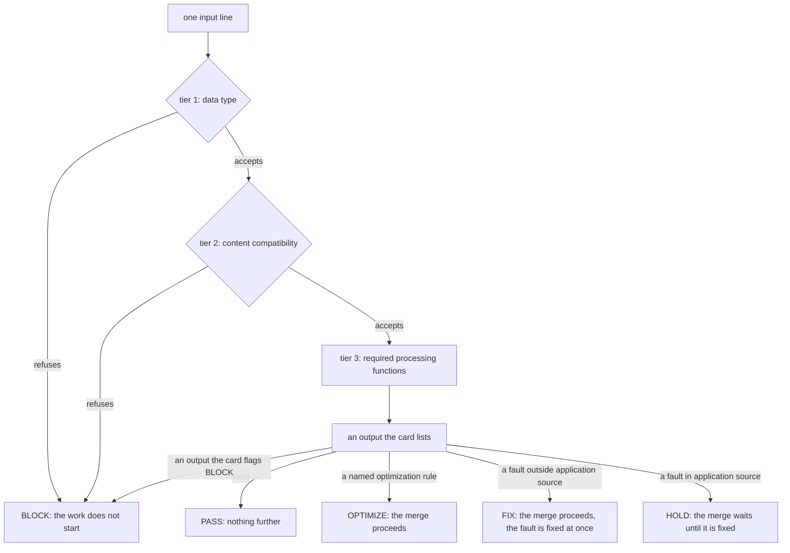

# The Sigil Project

Reference. A sigil vernacular is a working language for an occupation. Each
sigil names a professional workflow or a canonized, restricted output. The
project is named Sigil-based Vernacular Condensate.

In this repository, a sigil is a named check. It reads finished code against a
published rule set and answers from a fixed list. Its mark holds its name and
its edition, such as CODE.LOOP@1. Nothing here changes the trading platform.

## What a sigil is

Each sigil holds its card as data in its own module. The card names the sigil,
its edition, the archetype that owns it, its input form, its three input tiers,
its outputs and the flag of each output. The command prints the card as JSON
with `--card`, so any harness can read the card without this repository's
skills.

`dev_harness/sigils/core.py, in Sigil`, the card as data:

```python
@dataclass(frozen=True)
class Sigil:
    """A card as data, with tiers 1, 2 and 3 as `data_type`, `content`, `functions`."""

    name: str
    edition: int
    owner: str
    input_form: str
    settings: Mapping[str, str]
    tiers: tuple[TierCard, TierCard, TierCard]
    outputs: Mapping[str, FlagRow]
    refusal: str
    follows: Mapping[Flag, str]
    readers: Mapping[str, Callable[..., object]]
    data_type: DataType
    content: Content
    functions: Functions
    fault_file: FaultFile | None = None
```

## The scope test

A sigil applies only to work with a known set of formatted results. Everything
else stays in prose. Work qualifies for a sigil only when all five lines read
yes. The test is written in `dev_harness/skills/unit-decomposition/SKILL.md`,
in the section headed THE SCOPE TEST.

```
input     its shape is declared, and input out of range has a defined answer
outputs   every allowed output is listed in advance
ground    every output can be checked against code or a document
owner     an archetype reads the result without asking the model
decision  the model makes one named choice; with no choice, it is an ordinary function
```

## The three input tiers

A sigil filters each input in three tiers, in this order. A tier runs only
after the tier before it accepts. A refusal names the tier that refused it, and
its output is REJECTED with the flag BLOCK.

```
tier 1  data type                      the input has the declared shape and characters
tier 2  content compatibility          the content belongs to the owning archetype's type and work
tier 3  required processing functions  the function set that does the sigil's work and gives its output
```

Tier 2 comes from the owning archetype. A sigil with no owning archetype has no
tier 2 and is not admitted. Every Coding sigil takes tiers 1 and 2 from one
module. Each Coding sigil built after the first four narrows tier 2: Python's
ast module must find the construct the sigil reads, or the input is refused.

`dev_harness/sigils/core.py, in judge`, the three tiers in order:

```python
def judge(sigil: Sigil, text: str, root: Path, *, in_source: bool) -> Verdict:
    """Run `text` through tiers 1, 2 and 3 of `sigil`, stopping at the first refusal."""
    fault = sigil.data_type(text)
    if fault:
        return Verdict(sigil.refusal, f"{DATA_TYPE}: {fault}", 1, Flag.BLOCK)
    fault = sigil.content(text, root)
    if fault:
        return Verdict(sigil.refusal, f"{CONTENT}: {fault}", 2, Flag.BLOCK)
    reading = sigil.functions(text, root)
    holds = not isinstance(reading, Reading) or reading.holds
    output, reason = reading[0], reading[1]
    flag = flag_of(sigil, output, in_source=in_source and holds)
    return Verdict(output, f"{FUNCTIONS}: {reason}", 3, flag)
```

The path of one input line, from the tiers to its flag:



## Flags and follow-on rules

Each output maps to one flag on its card. Each flag names the rule that
follows it. The card holds that rule as data, and nothing runs a follow-on
rule yet.

`dev_harness/sigils/core.py, in FLAGS`:

| Flag | Side | When | What follows |
| ---- | ---- | ---- | ------------ |
| BLOCK | input | a tier 1 or tier 2 refusal, or a tier 3 output the card flags BLOCK | the work does not start |
| HOLD | output | a fault in application source code | the merge waits until it is fixed |
| FIX | output | a fault anywhere else, such as a document | the merge proceeds, and the fault is fixed at once |
| OPTIMIZE | output | a named optimization rule fires | the merge proceeds |
| PASS | output | the output is valid | nothing further |

Only application source code holds a merge. Application source is a setting of
the card: src, desktop and main.py in this repository. The command's
`--source` option names another tree's own. With `--gate`, the command exits 1
only when an input reads BLOCK or HOLD. Without it, the command exits 1 when
any input reads a flag other than PASS.

`dev_harness/sigils/core.py, in GATED` and `in APPLICATION_SOURCE`:

```python
GATED = frozenset({Flag.BLOCK, Flag.HOLD})

APPLICATION_SOURCE = ("src", "desktop", "main.py")
```

A finding from ruff carries the fix class that ruff states for its rule. The
fix class names the follow-on rule. Each sigil page states which findings read
HOLD.

`dev_harness/sigils/fix_class.py, in FOLLOW_ON`:

```python
FOLLOW_ON = {
    "always": "apply ruff's fix for that rule and read the file again",
    "sometimes": "the same, where ruff offers it for that line",
    "none": "a unit of work",
}
```

## The shared modules

Five modules hold the steps that sigils share: every sigil builds its card with
`dev_harness/sigils/core.py, in Sigil`, and each of the other four serves only
some sigils. Each step has one body. No sigil module imports from another sigil
module.

| Module | What it holds |
| ------ | ------------- |
| `dev_harness/sigils/core.py` | the card as data in `Sigil`, the tiers in `judge`, the flags in `FLAGS`, and the command in `main` |
| `dev_harness/sigils/coding_input.py` | the Coding Archetype's input: tier 1 in `DATA_TYPE_TIER`, tier 2 in `CONTENT_TIER`, and the file readers in `READERS` |
| `dev_harness/sigils/ruff_rules.py` | one ruff run for a rule list in `check`, the fix class in `fix_class`, and a rule's published faulty and corrected forms in `rule_page` |
| `dev_harness/sigils/fix_class.py` | the follow-on rule of each fix class, in `FOLLOW_ON` |
| `dev_harness/sigils/citation.py` | the citation form that CITE.SYMBOL@3 and TA.AUDIT@1 share: tier 1 in `data_type_fault`, and the definition search in `definition_verdict` |

CITE.SYMBOL@3 keeps its own tiers 1 and 2. Its input form differs, and the
Truth Archetype owns it.

## Portability

Every sigil is built to work in any repository, not only this one. Acervator is
the first place it does a real job.

```
imports    the Python standard library or a declared third-party package; nothing from the host application
target     the tree a sigil reads is an input, never derived from where the sigil file sits
card       the sigil's name, edition, input form, outputs and reject reasons are data in its module,
           and its command prints them, so any harness can read the card without this repository's skills
languages  each file type has one reader behind one interface; a type with no reader is rejected, never guessed
settings   a house convention, such as the citation form, is a named setting of the card, not a literal in code
fixtures   each sigil ships a small sample tree, so its test pair runs in any repository
proof      a sigil is called universal only after it runs on a second repository and its results are stated
```

Where the code holds each row:

| Row | Where it is in the code |
| --- | ----------------------- |
| target | `dev_harness/sigils/core.py, in main`: the `--root` option |
| card | `dev_harness/sigils/core.py, in render_card`, printed by `--card` |
| languages | `dev_harness/sigils/coding_input.py, in READERS`: `.py` is the only reader |
| settings | `dev_harness/sigils/core.py, in APPLICATION_SOURCE`, which `--source` replaces |
| fixtures | one folder per sigil under `harness_fixtures/`, named `sigil_` and the module name |

## What a sigil cannot guarantee

| Layer | The sigil's check | What it stops | What it cannot stop |
| ----- | ----------------- | ------------- | ------------------- |
| Form | The output fits the restricted shape | A malformed result | A well-formed wrong answer |
| Reference | Every cited name resolves in the published canon | A fabricated code, case or formula | A real citation that does not support the claim |
| Computation | The function set runs outside the model | A miscalculated result | A wrong choice of function |
| Judgement | The owning archetype, or a licensed reviewer | What that owner can read | Whatever that owner cannot read |

A real citation that does not support the claim passes every check above. That
layer stays with the owning archetype or a licensed reviewer.

## Progress

Every sigil, its owner and where it stands. A built sigil's count comes from
the card its command prints. A sigil that is not built has no card yet.

| Sigil | Owner | Rules on the card | Status | Module |
| ----- | ----- | ----------------- | ------ | ------ |
| CITE.SYMBOL@3 | truth | no rule list: its tiers decide | built | `dev_harness/sigils/cite_symbol.py, in SIGIL` |
| CODE.OPTIMIZE@1 | coding | 7 ruff rule families | built | `dev_harness/sigils/code_optimize.py, in SIGIL` |
| CODE.TYPE@1 | coding | no rule list: every mypy and pyright error | built | `dev_harness/sigils/code_type.py, in SIGIL` |
| CODE.SECURE@1 | coding | no rule list: every bandit and semgrep finding | built | `dev_harness/sigils/code_secure.py, in SIGIL` |
| CODE.REACH@1 | coding | no rule list: every vulture item | built | `dev_harness/sigils/code_reach.py, in SIGIL` |
| CODE.LOOP@1 | coding | 19 ruff rules | built | `dev_harness/sigils/code_loop.py, in SIGIL` |
| CODE.IMPORT@1 | coding | 8 of 28 ruff rules | built | `dev_harness/sigils/code_import.py, in SIGIL` |
| CODE.COLLECTION@1 | coding | 34 of 39 ruff rules | built | `dev_harness/sigils/code_collection.py, in SIGIL` |
| CODE.FLOW@1 | coding | 39 of 56 ruff rules | built | `dev_harness/sigils/code_flow.py, in SIGIL` |
| CODE.VARIABLE@1 | coding | 54 of 89 ruff rules | built | `dev_harness/sigils/code_variable.py, in SIGIL` |
| TA.AUDIT@1 | ta | no rule list: its tiers decide | built | `dev_harness/sigils/ta_audit.py, in SIGIL` |
| ROW.CLOSE@1 | not named yet | no card yet | unbuilt | not in the tree |

CODE.FLOW@1 reads if, try, with, return, raise, assert, pass and del. VARIABLE
reads names, assignments and function arguments. TA.AUDIT@1 ranks one departure
in one indicator module against its published formula. ROW.CLOSE@1 answers
verified, fixed, completed, removed, it waits or NOT_GROUNDED for one row of an
issue.

## The trial pilot

The pilot asked one question: does a unit that loads the Coding sigils before
it writes need less rework than the same unit without them? It ran three tasks,
once without the sigils and once with them. It found no benefit from loading
the sigils before writing. Rework split one task each way, the loaded arm cost
21 to 37 percent more tokens, and no replayed fault appeared in either arm. The
sigils work as readers of finished code.

| Task | Arm | Writes refused | Edits after the first accepted write | Final module | Tokens |
| ---- | --- | -------------- | ------------------------------------ | ------------ | ------ |
| T1 | without | 0 | 3 | passed | 93,625 |
| T1 | with | 0 | 0 | passed | 113,483 |
| T2 | without | 1 | 0 | no module | 110,167 |
| T2 | with | 2 | 0 | no module | 150,925 |
| T3 | without | 0 | 0 | passed | 78,960 |
| T3 | with | 0 | 2 | passed | 101,412 |

The full trial is not built. It would score four arms on drift, hallucination
and validity.

*Proposed, not present:*

```
arms     Plain   the task alone
         Cited   the task and the name of its canon
         Bound   the task and a Sigil line, resolved, held and refused by the harness
         Dummy   the task and a mark with no bloc
scores   drift          the share of a task's repeats that give its most common rank
         hallucination  checkable claims per run that fail against the tree or the canon
         validity       the rank matches the key and the result passes the owning archetype
falls    the binding claim falls if Bound does not beat Cited on validity
```

## Application archetypes

An archetype per professional program, such as Blender, Unity, Unreal or
FreeCAD. Its sigils are professional approaches built from that program's own
scripting calls. A prompt becomes a run of those approaches instead of a
generated picture.

Each discipline of a game team is a mode. A discipline's practice is the same
in every program: a lighting artist lights a scene by the same rules in Unreal,
Unity or Blender. A mode states each discipline once, and every application
archetype carries it out with its own program's calls. A mode is a
family of sigils, such as `LIGHT.<approach>@1`, grounded in that discipline's
published practice. A prompt names the role, that mode's sigils load, and the
program's archetype carries each one out.

*Proposed, not present:*

```
ground    the scripting calls the program lists from inside itself, for a pinned version
modes     one per discipline of a game team, written once and carried out by every
          application archetype: WORLD, LIGHT, LOOK, ANIMATE, VFX, CINEMA, AUDIO, UI,
          QA, GAMEPLAY, each a family of sigils grounded in that discipline's published
          practice
owner     the archetype reopens the saved file with no window and reads the scene back
waits     built only if a bound sigil beats a cited one on validity in the full trial
status    unbuilt
```

The table lists the first ten modes. Each mode maps to the section of the
Unreal Engine documentation that covers that work. Unity and Blender map the
same modes to their own manuals' sections once their archetypes exist.
FreeCAD is an engineering program, so its modes come from its own manual, not
from this list.

| Mode | The role on a game team | Unreal Engine documentation section |
| ---- | ----------------------- | ----------------------------------- |
| WORLD | level designer, environment artist | Building Virtual Worlds |
| LIGHT | lighting artist | Lighting the Environment |
| LOOK | technical artist: materials and rendering | Designing Visuals, Rendering and Graphics |
| ANIMATE | animator | Animating Characters and Objects |
| VFX | visual effects artist | Creating Visual Effects |
| CINEMA | cinematic artist | Cinematics and Movie Making |
| AUDIO | sound designer | Working with Audio |
| UI | user interface designer | Creating User Interfaces |
| QA | quality and performance tester | Testing and Optimizing Your Content |
| GAMEPLAY | gameplay programmer | Programming with C++ |

Sources:

- [Unreal Engine documentation](https://dev.epicgames.com/documentation/en-us/unreal-engine)
- [Cinematics and Movie Making](https://dev.epicgames.com/documentation/en-us/unreal-engine/cinematics-and-movie-making-in-unreal-engine)
- [What is an environment artist](https://www.unrealengine.com/blog/what-is-an-environment-artist)
- [Jobs in Unreal Engine: technical artist](https://www.unrealengine.com/tech-blog/jobs-in-unreal-engine---technical-artist)

## The sigil pages

One page per built sigil. Each page states what the sigil reads, its tier 2
condition, its outputs and flags, the command that runs it, and its rules.

- [CITE.SYMBOL@3](16-sigil-project/cite-symbol.md)
- [CODE.OPTIMIZE@1](16-sigil-project/code-optimize.md)
- [CODE.TYPE@1](16-sigil-project/code-type.md)
- [CODE.SECURE@1](16-sigil-project/code-secure.md)
- [CODE.REACH@1](16-sigil-project/code-reach.md)
- [CODE.LOOP@1](16-sigil-project/code-loop.md)
- [CODE.IMPORT@1](16-sigil-project/code-import.md)
- [CODE.COLLECTION@1](16-sigil-project/code-collection.md)
- [CODE.FLOW@1](16-sigil-project/code-flow.md)
- [CODE.VARIABLE@1](16-sigil-project/code-variable.md)
- [TA.AUDIT@1](16-sigil-project/ta-audit.md)
