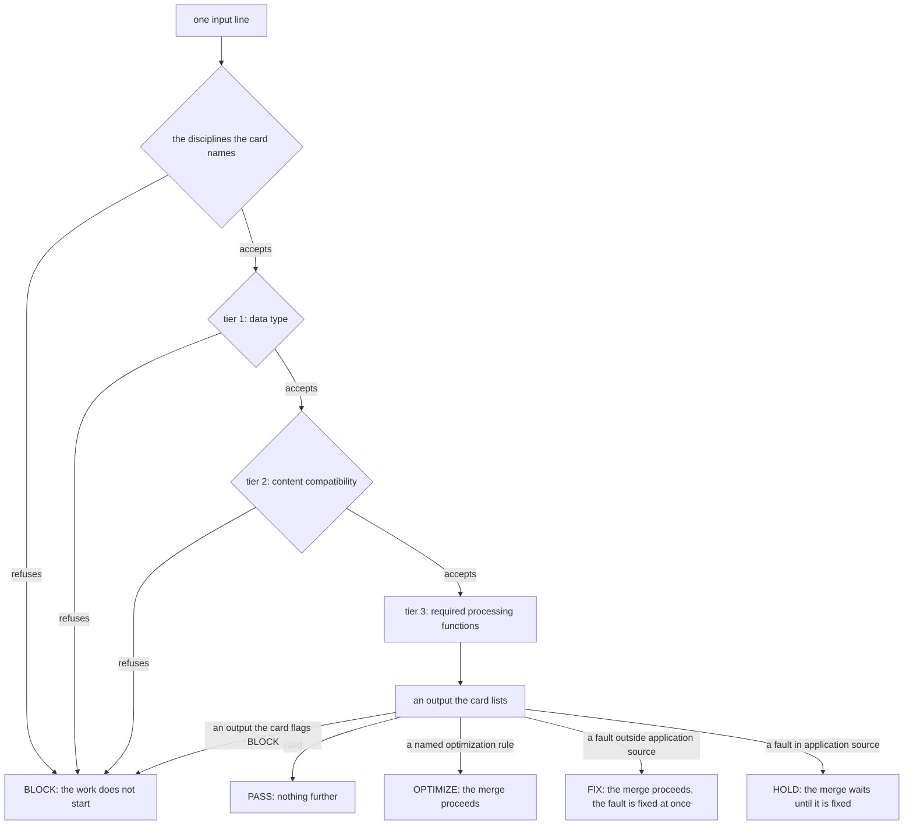

# The Sigil Project

Reference. A sigil vernacular is a working language for an occupation. Each
sigil names a professional workflow or a canonized, restricted output. The
project is named Sigil-based Vernacular Condensate.

In this repository, a sigil is a named check. It reads finished code against a
published rule set and answers from a fixed list. Its mark holds its name and
its edition, such as CODE.LOOP@1. Nothing here changes the trading platform.

## What a sigil is

Each sigil holds its card as data in its own module. The card names the sigil,
its edition, the archetype that owns it, its input form, its three input tiers,
its outputs and the flag of each output. The command prints the card as JSON
with `--card`, so any harness can read the card without this repository's
skills.

`dev_harness/sigils/core.py, in Sigil`, the card as data:

```python
@dataclass(frozen=True)
class Sigil:
    """A card as data, with tiers 1, 2 and 3 as `data_type`, `content`, `functions`."""

    name: str
    edition: int
    owner: str
    input_form: str
    settings: Mapping[str, str]
    tiers: tuple[TierCard, TierCard, TierCard]
    outputs: Mapping[str, FlagRow]
    refusal: str
    follows: Mapping[Flag, str]
    readers: Mapping[str, Callable[..., object]]
    data_type: DataType
    content: Content
    functions: Functions
    fault_file: FaultFile | None = None
    disciplines: tuple[str, ...] = ()
```

## The scope test

A sigil applies only to work with a known set of formatted results. Everything
else stays in prose. Work qualifies for a sigil only when all five lines read
yes. The test is written in `dev_harness/skills/unit-decomposition/SKILL.md`,
in the section headed THE SCOPE TEST.

```
input     its shape is declared, and input out of range has a defined answer
outputs   every allowed output is listed in advance
ground    every output can be checked against code or a document
owner     an archetype reads the result without asking the model
decision  the model makes one named choice; with no choice, it is an ordinary function
```

## The three input tiers

A sigil filters each input in three tiers, in this order. A tier runs only
after the tier before it accepts. A refusal names the tier that refused it, and
its output is REJECTED with the flag BLOCK.

```
tier 1  data type                      the input has the declared shape and characters
tier 2  content compatibility          the content belongs to the owning archetype's type and work
tier 3  required processing functions  the function set that does the sigil's work and gives its output
```

Tier 2 comes from the owning archetype. A sigil with no owning archetype has no
tier 2 and is not admitted. Every Coding sigil takes tiers 1 and 2 from one
module. Each Coding sigil built after the first four narrows tier 2: Python's
ast module must find the construct the sigil reads, or the input is refused.

`dev_harness/sigils/core.py, in judge`, the three tiers in order:

```python
def judge(sigil: Sigil, text: str, root: Path, *, in_source: bool) -> Verdict:
    """Run `discipline_fault`, then tiers 1, 2 and 3 on `text`, until one refuses."""
    fault = discipline_fault(sigil)
    if fault:
        return Verdict(sigil.refusal, f"{CARD_DISCIPLINES}: {fault}", 0, Flag.BLOCK)
    fault = sigil.data_type(text)
    if fault:
        return Verdict(sigil.refusal, f"{DATA_TYPE}: {fault}", 1, Flag.BLOCK)
    fault = sigil.content(text, root)
    if fault:
        return Verdict(sigil.refusal, f"{CONTENT}: {fault}", 2, Flag.BLOCK)
    reading = sigil.functions(text, root)
    holds = not isinstance(reading, Reading) or reading.holds
    output, reason = reading[0], reading[1]
    flag = flag_of(sigil, output, in_source=in_source and holds)
    return Verdict(output, f"{FUNCTIONS}: {reason}", 3, flag)
```

The path of one input line, from the tiers to its flag:



### The disciplines a card names

A card names the disciplines it takes its rules from. Each discipline's SKILL.md
lists the archetypes compatible with it, on its archetypes line. Before tier 1,
the core reads that line for each discipline the card names.

When the line does not name the card's owner, the sigil does not run with that
discipline. Every input reads REJECTED with the flag BLOCK, and its tier reads
0, because no tier ran. The reason names the discipline, the archetypes its
skill lists, and the owner.

`dev_harness/sigils/core.py, in discipline_fault`:

```python
def discipline_fault(sigil: Sigil) -> str | None:
    """Return each `sigil.disciplines` entry whose `archetypes` omit `sigil.owner`, or None."""
    faults = []
    for name in sigil.disciplines:
        try:
            listed = archetypes(name)
        except HouseFault as exc:
            faults.append(f"{name}: {exc}")
            continue
        if sigil.owner not in listed:
            named = ", ".join(listed) or "no archetype"
            faults.append(f"{name} lists {named}, not the owner {sigil.owner}")
    return "; ".join(faults) or None
```

The archetypes line is read in one place, in the module that reads the
discipline folders. A skill with no such line lists no archetype, so every card
that names it is refused.

`dev_harness/sigils/construct_rules.py, in archetypes`:

```python
@cache
def archetypes(name: str) -> tuple[str, ...]:
    """Return each archetype the `ARCHETYPES_LINE` of discipline `name`'s `SKILL_FILE` front matter lists."""
    path = HOUSE / name / SKILL_FILE
    try:
        lines = path.read_text(encoding="utf-8").splitlines()
    except OSError as exc:
        message = f"cannot read {name}/{SKILL_FILE}: {exc}"
        raise HouseFault(message) from exc
    if not lines or lines[0] != FRONT_MATTER:
        return ()
    for line in takewhile(lambda line: line != FRONT_MATTER, lines[1:]):
        found = ARCHETYPES_LINE.fullmatch(line)
        if found:
            return tuple(
                entry.strip() for entry in found["listed"].split(",") if entry.strip()
            )
    return ()
```

## Flags and follow-on rules

Each output maps to one flag on its card. Each flag names the rule that
follows it. The card holds that rule as data, and nothing runs a follow-on
rule yet.

`dev_harness/sigils/core.py, in FLAGS`:

| Flag | Side | When | What follows |
| ---- | ---- | ---- | ------------ |
| BLOCK | input | a tier 0 refusal of a discipline whose skill omits the owner, a tier 1 or tier 2 refusal, or a tier 3 output the card flags BLOCK | the work does not start |
| HOLD | output | a fault in application source code | the merge waits until it is fixed |
| FIX | output | a fault anywhere else, such as a document | the merge proceeds, and the fault is fixed at once |
| OPTIMIZE | output | a named optimization rule fires | the merge proceeds |
| PASS | output | the output is valid | nothing further |

Only application source code holds a merge. Application source is a setting of
the card: src, desktop and main.py in this repository. The command's
`--source` option names another tree's own. With `--gate`, the command exits 1
only when an input reads BLOCK or HOLD. Without it, the command exits 1 when
any input reads a flag other than PASS.

`dev_harness/sigils/core.py, in GATED` and `in APPLICATION_SOURCE`:

```python
GATED = frozenset({Flag.BLOCK, Flag.HOLD})

APPLICATION_SOURCE = ("src", "desktop", "main.py")
```

A finding from ruff carries the fix class that ruff states for its rule. The
fix class names the follow-on rule. Each sigil page states which findings read
HOLD.

`dev_harness/sigils/fix_class.py, in FOLLOW_ON`:

```python
FOLLOW_ON = {
    "always": "apply ruff's fix for that rule and read the file again",
    "sometimes": "the same, where ruff offers it for that line",
    "none": "a unit of work",
}
```

## The shared modules

Seven modules hold the steps that sigils share: every sigil builds its card with
`dev_harness/sigils/core.py, in Sigil`, and each of the other six serves only
some sigils. Each step has one body. No sigil module imports from another sigil
module.

| Module | What it holds |
| ------ | ------------- |
| `dev_harness/sigils/core.py` | the card as data in `Sigil`, the tiers in `judge`, the flags in `FLAGS`, and the command in `main` |
| `dev_harness/sigils/coding_input.py` | the Coding Archetype's input: tier 1 in `DATA_TYPE_TIER`, tier 2 in `CONTENT_TIER`, and the file readers in `READERS` |
| `dev_harness/sigils/ruff_rules.py` | one ruff run for a rule list in `check`, each rule's fix class and its preview and removed marks in `listing`, the fix class in `fix_class`, and a rule's published faulty and corrected forms in `rule_page` |
| `dev_harness/sigils/construct_rules.py` | the rules a coding sigil holds from its disciplines: `take` for a construct sigil, `hold` for a tool sigil, and the reason each other scope rule left in `why_left` |
| `dev_harness/sigils/coding_partition.py` | the rules a coding sigil runs on one input: the input's facts in `facts_of`, the run rule in `runs`, and the held rules it keeps in `selection` |
| `dev_harness/sigils/fix_class.py` | the follow-on rule of each fix class, in `FOLLOW_ON` |
| `dev_harness/sigils/citation.py` | the citation form that CITE.SYMBOL@3 and TA.AUDIT@1 share: tier 1 in `data_type_fault`, and the definition search in `definition_verdict` |

CITE.SYMBOL@3 keeps its own tiers 1 and 2. Its input form differs, and the
Truth Archetype owns it.

## Portability

Every sigil is built to work in any repository, not only this one. Acervator is
the first place it does a real job.

```
imports    the Python standard library or a declared third-party package; nothing from the host application
target     the tree a sigil reads is an input, never derived from where the sigil file sits
card       the sigil's name, edition, input form, outputs and reject reasons are data in its module,
           and its command prints them, so any harness can read the card without this repository's skills
languages  each file type has one reader behind one interface; a type with no reader is rejected, never guessed
settings   a house convention, such as the citation form, is a named setting of the card, not a literal in code
fixtures   each sigil ships a small sample tree, so its test pair runs in any repository
proof      a sigil is called universal only after it runs on a second repository and its results are stated
```

Where the code holds each row:

| Row | Where it is in the code |
| --- | ----------------------- |
| target | `dev_harness/sigils/core.py, in main`: the `--root` option |
| card | `dev_harness/sigils/core.py, in render_card`, printed by `--card` |
| languages | `dev_harness/sigils/coding_input.py, in READERS`: `.py` is the only reader |
| settings | `dev_harness/sigils/core.py, in APPLICATION_SOURCE`, which `--source` replaces |
| fixtures | one folder per sigil under `harness_fixtures/`, named `sigil_` and the module name |

## What a sigil cannot guarantee

| Layer | The sigil's check | What it stops | What it cannot stop |
| ----- | ----------------- | ------------- | ------------------- |
| Form | The output fits the restricted shape | A malformed result | A well-formed wrong answer |
| Reference | Every cited name resolves in the published canon | A fabricated code, case or formula | A real citation that does not support the claim |
| Computation | The function set runs outside the model | A miscalculated result | A wrong choice of function |
| Judgement | The owning archetype, or a licensed reviewer | What that owner can read | Whatever that owner cannot read |

A real citation that does not support the claim passes every check above. That
layer stays with the owning archetype or a licensed reviewer.

## The Coding Archetype's disciplines

The Coding Archetype reviews source code. ISO/IEC 5055:2021 measures source
code on four characteristics, and those four are the archetype's disciplines:
security, reliability, performance efficiency and maintainability. Each
discipline is a skill folder under `dev_harness/disciplines`, with a SKILL.md
and a rules.json. Only an archetype that runs a rule the discipline holds is
compatible with it, and SKILL.md names those archetypes as data.

Two more disciplines hold Python's own published standards, which ISO/IEC 5055
does not measure: conventions, grounded in PEP 8 and PEP 257, and typing,
grounded in PEP 484 and the Python typing specification. Each is a skill folder
shaped like the four.

Every rule the archetype can run on a Python file sits under each discipline whose
weakness it reports, or in unplaced.json with its reason. One rule can sit under
more than one discipline. Each placement names its ground: a CWE id that the
discipline's ISO/IEC 5055 list holds, or the tool's own words naming the
concern. The CWE lists come from the
[OMG ASCQM 1.0 specification](https://www.omg.org/spec/ASCQM/1.0/PDF), Tables 1
to 4.

A placement by definition quotes the CWE's description from the MITRE CWE list
beside the rule's own text, and the CWE must be in the discipline's list. A
conventions or typing placement quotes the PEP or specification section that
states the rule's check, beside the rule's own text.

A placement can also rest on Python's own published canon. In conventions, a
line of PEP 20, the Zen of Python, grounds a rule whose own text names that
line's concern, such as "Readability counts." or "Flat is better than nested."
A section of the [Python 3.14 documentation](https://docs.python.org/3.14/)
grounds a rule where it states the failure, cost, idiom or type of the construct
the rule detects, and the rule sits under that concern's discipline. A framework
rule rests the same way on the framework's own documentation, such as pytest or
Django. Each such placement quotes both texts, with the section's address.

| Discipline | CWE ids in its list | Rules it holds | Compatible archetypes |
| ---------- | ------------------- | -------------- | --------------------- |
| security | 74 | 389 | coding, gui, docs, ta |
| reliability | 74 | 110 | coding, gui, docs |
| performance efficiency | 18 | 48 | coding, gui, ta |
| maintainability | 29 | 30 | coding, gui |
| conventions | 0 | 254 | coding, gui, ta |
| typing | 0 | 76 | coding, gui |

| Tool | Rules it can run | Placed | Unplaced |
| ---- | ------------- | ------ | -------- |
| ruff, with every rule selected | 810 | 484 | 326 |
| ruff preview rules the sigils run | 7 | 7 | 0 |
| semgrep | 216 | 216 | 0 |
| bandit | 75 | 75 | 0 |
| mypy | 58 | 34 | 24 |
| pyright | 42 | 31 | 11 |
| pylint | 12 | 1 | 11 |
| vulture | 1 | 1 | 0 |
| the six rule modules | 19 | 4 | 15 |
| all | 1,240 | 853 | 387 |

Each rule left in unplaced.json carries its reason: no listed CWE definition and
no PEP or specification section describes it, or its text names a PEP that no
discipline holds. The reason also names the PEP 20 lines and the documentation
sections read against the rule, and why none of them grounds it.

The five construct sigils, CODE.LOOP, CODE.IMPORT, CODE.COLLECTION, CODE.FLOW
and CODE.VARIABLE, also read 7 preview rules. The archetype runs ruff without
preview rules, so the house holds none of the 7 from the archetype's own call.

The house also reads the card each built coding sigil prints, and counts every
rule a card runs that no call of the archetype enables. A card that names
preview rules runs ruff with preview on, so its 7 preview rules join the count:
all 7 are placed.

| Sigil | Preview rules it runs | Placed | Unplaced |
| ----- | --------------------- | ------ | -------- |
| CODE.LOOP | 2 | 2 | 0 |
| CODE.COLLECTION | 2 | 2 | 0 |
| CODE.FLOW | 3 | 3 | 0 |
| CODE.OPTIMIZE | 3 | 3 | 0 |

CODE.IMPORT and CODE.VARIABLE select only rules the archetype already runs.
CODE.OPTIMIZE runs the same 3 preview rules that CODE.LOOP and CODE.FLOW run, so
the 7 stay 7.
CODE.SECURE, CODE.TYPE and CODE.REACH run bandit, semgrep, mypy, pyright and
vulture, and the house counts those under the archetype's own lists.

`dev_harness/sigils/coding_house.py, in _card_ruff`:

```python
    preview = ["--preview"] if settings.get("preview_rules") else []
    flags = [sys.executable, "-m", "ruff", "check", "--no-cache", *preview]
    return _enabled([*flags, "--select", ",".join(codes)], root)
```

The command reads each tool's own rule list under the archetype's own flags.
It then checks that list against the six rules.json files and unplaced.json,
and exits 1 on any fault. `--root` names the tree, and `--card` prints the card.

`dev_harness/sigils/coding_house.py, in count`:

```python
    faults = {
        "missing": sorted(f"{t} {r}" for t, r in pairs - held),
        "stale": sorted(f"{t} {r}" for t, r in held - pairs if t in run),
        "both": sorted(f"{t} {r}" for t, r in housed & unplaced),
        "ungrounded": ungrounded(folder),
        "unread": unread,
    }
```

The archetype's coding sigils do not run every rule on every input. The input
decides which rules run, before any rule runs. The archetype's own ruff call
still runs every rule it enables. [Rule run partitioning](16-sigil-project/rule-partition.md)
states the inputs, the four keys each rule carries, the run rule, and the proof
on `src/`.

## The construct scope

The five construct sigils hold no rule list of their own. Each one takes the
ruff rules that its disciplines house inside its construct's scope. A rule sits
on a construct where its own published faulty example raises its finding on that
construct.

The scope command reads each example, the ruff run over it and the finding's
node through the partition reading. It then climbs from that node to the first
node that a construct sigil's tier 2 names. The climb stops outside every
construct when it enters a statement through a part the construct does not own,
such as an assignment's value, or when it reaches a def, class, lambda or module
first. A for header and a while test belong to their loop.

The rule partition keys answer three more questions. A rule whose finding sits
on an import statement sits on the import construct. A rule that reads text the
AST does not hold, or fires on stub files only, sits on none. A rule whose page
publishes no corrected form stays off every card, because a finding carries both
forms.

`dev_harness/sigils/construct_scope.py, in owners`:

```python
def owners(chain: list[ast.AST]) -> tuple[frozenset[str], ast.AST]:
    """Return the `CONSTRUCTS` holding the first node of `chain`, and the node the climb stops on."""
    previous: ast.AST | None = None
    for node in chain:
        if previous is not None:
            slot = _slot(node, previous)
            header = any(isinstance(node, kind) and slot == field for kind, field in HEADERS)
            holder = isinstance(node, HOLDERS) and not isinstance(node, ast.Expr)
            if holder and not header and slot not in OWNED_SLOTS:
                return frozenset(), node
        found = frozenset(name for name, holds in CONSTRUCTS.items() if holds(node))
        if found or isinstance(node, BOUNDARY):
            return found, node
        previous = node
    return frozenset(), chain[-1]
```

One command writes the scope beside the sigils, and each sigil reads it when it
loads.

```
python -m dev_harness.sigils.construct_scope
```

| Construct | Rules the scope places on it | Rules its sigil can run |
| --------- | ---------------------------- | ----------------------- |
| loop | 27 | 18 |
| import | 32 | 25 |
| collection | 50 | 23 |
| flow | 62 | 33 |
| variable | 73 | 38 |

A scope rule that no discipline houses and unplaced.json does not list leaves
with a reason too: the house holds only the rules the archetype or a sigil runs,
and neither runs it. Eight preview rules leave the construct sigils this way.

## The tool scope

The four tool sigils, CODE.OPTIMIZE, CODE.TYPE, CODE.SECURE and CODE.REACH,
hold no rule list of their own either. Each one holds the rules its disciplines
house inside its tool's scope. A finding under any other rule moves no verdict,
and each sigil's page lists the rules it holds and the rules that left.

`dev_harness/sigils/construct_rules.py, in hold`:

```python
def hold(tool: str, rules: Iterable[str], named: Sequence[str]) -> Held:
    """Return the `Held` scope `rules` of `tool` that the `named` disciplines house."""
    _check_named(named)
    held: list[str] = []
    left: dict[str, str] = {}
    for rule in rules:
        why = why_left(tool, rule, named)
        if why is None:
            held.append(rule)
        else:
            left[rule] = why
    return Held(tool, tuple(named), tuple(held), left)
```

| Sigil | Scope | Rules in scope | Rules it can run | Disciplines |
| ----- | ----- | -------------- | ---------------- | ----------- |
| CODE.OPTIMIZE | each ruff rule in its seven families | 149 | 85 | conventions, maintainability, performance efficiency, typing |
| CODE.TYPE | each mypy error code, and each pyright rule the house holds | 120 | 62 | conventions, reliability, typing |
| CODE.SECURE | each bandit test and semgrep rule the house holds | 291 | 291 | security |
| CODE.REACH | the vulture rule the house holds | 1 | 1 | maintainability |

## The defects this tree had

Each OCIR catalogue row that names a code defect this tree had, with the commit
that fixed it, is a case. All nine coding sigils read each case's code before
and after its fix, and git restores both sides on each run.
[The OCIR cases](16-sigil-project/ocir-cases.md) states the case list, how a
case is restored and read, and which rows the sigils read.

## Progress

Every sigil, its owner and where it stands. A built sigil's count comes from
the card its command prints. A sigil that is not built has no card yet.

| Sigil | Owner | Rules on the card | Status | Module |
| ----- | ----- | ----------------- | ------ | ------ |
| CITE.SYMBOL@3 | truth | no rule list: its tiers decide | built | `dev_harness/sigils/cite_symbol.py, in SIGIL` |
| CODE.OPTIMIZE@1 | coding | 85 ruff rules it can run | built | `dev_harness/sigils/code_optimize.py, in SIGIL` |
| CODE.TYPE@1 | coding | 62 mypy and pyright rules it can run | built | `dev_harness/sigils/code_type.py, in SIGIL` |
| CODE.SECURE@1 | coding | 291 bandit and semgrep rules it can run | built | `dev_harness/sigils/code_secure.py, in SIGIL` |
| CODE.REACH@1 | coding | 1 vulture rule it can run | built | `dev_harness/sigils/code_reach.py, in SIGIL` |
| CODE.LOOP@1 | coding | 18 ruff rules it can run | built | `dev_harness/sigils/code_loop.py, in SIGIL` |
| CODE.IMPORT@1 | coding | 25 ruff rules it can run | built | `dev_harness/sigils/code_import.py, in SIGIL` |
| CODE.COLLECTION@1 | coding | 23 ruff rules it can run | built | `dev_harness/sigils/code_collection.py, in SIGIL` |
| CODE.FLOW@1 | coding | 33 ruff rules it can run | built | `dev_harness/sigils/code_flow.py, in SIGIL` |
| CODE.VARIABLE@1 | coding | 38 ruff rules it can run | built | `dev_harness/sigils/code_variable.py, in SIGIL` |
| TA.AUDIT@1 | ta | no rule list: its tiers decide | built | `dev_harness/sigils/ta_audit.py, in SIGIL` |
| ROW.CLOSE@1 | not named yet | no card yet | unbuilt | not in the tree |

CODE.FLOW@1 reads if, try, with, return, raise, assert, pass and del. VARIABLE
reads names, assignments and function arguments. TA.AUDIT@1 ranks one departure
in one indicator module against its published formula. ROW.CLOSE@1 answers
verified, fixed, completed, removed, it waits or NOT_GROUNDED for one row of an
issue.

## The trial pilot

The pilot asked one question: does a unit that loads the Coding sigils before
it writes need less rework than the same unit without them? It ran three tasks,
once without the sigils and once with them. It found no benefit from loading
the sigils before writing. Rework split one task each way, the loaded arm cost
21 to 37 percent more tokens, and no replayed fault appeared in either arm. The
sigils work as readers of finished code.

| Task | Arm | Writes refused | Edits after the first accepted write | Final module | Tokens |
| ---- | --- | -------------- | ------------------------------------ | ------------ | ------ |
| T1 | without | 0 | 3 | passed | 93,625 |
| T1 | with | 0 | 0 | passed | 113,483 |
| T2 | without | 1 | 0 | no module | 110,167 |
| T2 | with | 2 | 0 | no module | 150,925 |
| T3 | without | 0 | 0 | passed | 78,960 |
| T3 | with | 0 | 2 | passed | 101,412 |

The full trial is not built. It would score four arms on drift, hallucination
and validity.

*Proposed, not present:*

```
arms     Plain   the task alone
         Cited   the task and the name of its canon
         Bound   the task and a Sigil line, resolved, held and refused by the harness
         Dummy   the task and a mark with no bloc
scores   drift          the share of a task's repeats that give its most common rank
         hallucination  checkable claims per run that fail against the tree or the canon
         validity       the rank matches the key and the result passes the owning archetype
falls    the binding claim falls if Bound does not beat Cited on validity
```

## Application archetypes

An archetype per professional program, such as Blender, Unity, Unreal or
FreeCAD. Its sigils are professional approaches built from that program's own
scripting calls. A prompt becomes a run of those approaches instead of a
generated picture.

Each discipline of a game team is a mode. A discipline's practice is the same
in every program: a lighting artist lights a scene by the same rules in Unreal,
Unity or Blender. A mode states each discipline once, and every application
archetype carries it out with its own program's calls. A mode is a
family of sigils, such as `LIGHT.<approach>@1`, grounded in that discipline's
published practice. A prompt names the role, that mode's sigils load, and the
program's archetype carries each one out.

*Proposed, not present:*

```
ground    the scripting calls the program lists from inside itself, for a pinned version
modes     one per discipline of a game team, written once and carried out by every
          application archetype: WORLD, LIGHT, LOOK, ANIMATE, VFX, CINEMA, AUDIO, UI,
          QA, GAMEPLAY, each a family of sigils grounded in that discipline's published
          practice
owner     the archetype reopens the saved file with no window and reads the scene back
waits     built only if a bound sigil beats a cited one on validity in the full trial
status    unbuilt
```

The table lists the first ten modes. Each mode maps to the section of the
Unreal Engine documentation that covers that work. Unity and Blender map the
same modes to their own manuals' sections once their archetypes exist.
FreeCAD is an engineering program, so its modes come from its own manual, not
from this list.

| Mode | The role on a game team | Unreal Engine documentation section |
| ---- | ----------------------- | ----------------------------------- |
| WORLD | level designer, environment artist | Building Virtual Worlds |
| LIGHT | lighting artist | Lighting the Environment |
| LOOK | technical artist: materials and rendering | Designing Visuals, Rendering and Graphics |
| ANIMATE | animator | Animating Characters and Objects |
| VFX | visual effects artist | Creating Visual Effects |
| CINEMA | cinematic artist | Cinematics and Movie Making |
| AUDIO | sound designer | Working with Audio |
| UI | user interface designer | Creating User Interfaces |
| QA | quality and performance tester | Testing and Optimizing Your Content |
| GAMEPLAY | gameplay programmer | Programming with C++ |

Sources:

- [Unreal Engine documentation](https://dev.epicgames.com/documentation/en-us/unreal-engine)
- [Cinematics and Movie Making](https://dev.epicgames.com/documentation/en-us/unreal-engine/cinematics-and-movie-making-in-unreal-engine)
- [What is an environment artist](https://www.unrealengine.com/blog/what-is-an-environment-artist)
- [Jobs in Unreal Engine: technical artist](https://www.unrealengine.com/tech-blog/jobs-in-unreal-engine---technical-artist)

## The sigil pages

One page per built sigil. Each page states what the sigil reads, its tier 2
condition, its outputs and flags, the command that runs it, and its rules.

- [CITE.SYMBOL@3](16-sigil-project/cite-symbol.md)
- [CODE.OPTIMIZE@1](16-sigil-project/code-optimize.md)
- [CODE.TYPE@1](16-sigil-project/code-type.md)
- [CODE.SECURE@1](16-sigil-project/code-secure.md)
- [CODE.REACH@1](16-sigil-project/code-reach.md)
- [CODE.LOOP@1](16-sigil-project/code-loop.md)
- [CODE.IMPORT@1](16-sigil-project/code-import.md)
- [CODE.COLLECTION@1](16-sigil-project/code-collection.md)
- [CODE.FLOW@1](16-sigil-project/code-flow.md)
- [CODE.VARIABLE@1](16-sigil-project/code-variable.md)
- [TA.AUDIT@1](16-sigil-project/ta-audit.md)
