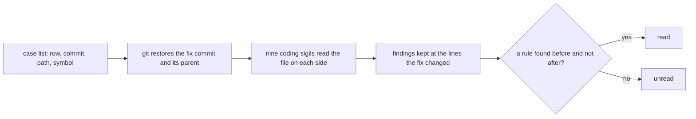

# The OCIR cases

Reference. The OCIR catalogue records checks and code that could not fail. Some
of its rows name a defect that this tree had in its own code, and git holds the
commit that fixed it. Each such row is a case. All nine coding sigils read each
case's code before its fix and after it. This page is part of
[the sigil project](../16-sigil-project.md).
[Which OCIR rows are cases](ocir-qualify.md) lists every catalogue entry with yes
or no and its reason.



## The case list

`harness_fixtures/ocir_cases/cases.txt` holds one case per line. Each line has
four fields: the catalogue row, the commit that fixed the defect, the file, and
the def or class that held it. The file holds nothing else. The restored code is
never committed, because git restores it on each run.

```
C1 416b614a4231ed5153038492a10885ec63957721 src/trading/scrumming_bot.py ScrummingBot._ensure_capital_reservation
C7 a17b274a00b67bbf92fde2d7055568c9c8eac1a4 tests/test_crypto_news_ticker_thread_ownership.py TestStopIsBounded.test_stop_abandons_rather_than_destroys_an_unstoppable_thread
C11 3ec415d10e04faf15158e21c5c5af8cc909e4da1 tests/test_bot_selection_surface_parity.py test_the_offscreen_host_paints_no_glyphs
C20 864f9ac5c1ffb8457b8cb8665915d87db05cf7d1 src/gui/live_bot_window.py LiteLiveBotWindow._build_controls
C47 78dbb615704a737e6437468340eaba15596dd174 src/trading/scrumming/execution.py ExecutionEngineMixin._execute_detonation
C54 0f951fe3661635074cab3e9290d0808a2e9015c9 tools/exchange_diagnostic.py _authenticated_test
C60 ae9d147a44c575ead039de7f041c291bfa6a54ec tests/test_bot_swarm_list_surface_parity.py test_the_bridge_import_list_stays_in_order
C61 1616221418ce23032b625faaf0bf3bfa050aa662 src/gui/history_tab.py HistoryTab
C74 a5b664f6fcd0b07242f13e84cbe56b46d27f782a src/gui/widgets/status_log.py StatusLog.__init__
C80 9830d60f2ca2aabf9575ef5988067cbfc798d191 tests/test_react_table_cells.py test_the_literal_scan_names_a_value_appended_to_the_module_file
C130 d20f503982dbc7d536955a43a31e37485170a3e4 src/competition/quintessence_ledger.py QuintessenceLedger.transfer
C143 ca642b7d7459c5c4437118ed5d59900426205bd3 src/gui/main_tabs/class_filter_surface.py market_class
C144 ca642b7d7459c5c4437118ed5d59900426205bd3 src/gui/main_tabs/class_filter_surface.py market_class
C149 4a32f6043335883db5a866a21282b81e6843c85a src/gui/widgets/bot_status_table.py BotStatusTable._write_row
C151 1bfab86fa6e7ca3a230a9b8edec019c59b9840e3 src/exchange/ccxt_connector.py CCXTConnector.await_bulk_read_slot
C152 ccc8ea8fbe7d2923f544702aaea27bc36531053b src/gui/settings_dialog.py SettingsDialog._create_exchange_tab
```

The four test files in the list are not in the tree today. Git holds each one
at its commit, and the command reads it from there.

## How a case is restored

The command makes two detached git worktrees in a temporary folder: one at the
fix commit and one at its parent. Each worktree holds that commit's Python files
and its tool settings files, such as pyproject.toml. Documents and pictures stay
out, because no sigil reads them. Git writes each file as stored, with line-ending
conversion off.

Two checks run before any sigil reads. Git reports that no restored file differs
from what it checked out. The case file's bytes equal what `git show` returns at
that commit. A difference stops the case. Both worktrees are removed by name when
the case is read.

`dev_harness/sigils/ocir_cases.py, in restored`:

```python
@contextmanager
def restored(commit: str, case_path: str) -> Iterator[Path]:
    """Yield a detached worktree of `commit` holding its `kept` files, `case_path` checked against `git show`."""
    folder = Path(tempfile.mkdtemp(prefix="ocir_case_"))
    try:
        git("worktree", "add", "--no-checkout", "--detach", str(folder), commit)
    except CaseFault:
        shutil.rmtree(folder, ignore_errors=True)
        raise
    try:
        listed = tool_text(git("ls-tree", "-r", "-z", "--name-only", commit)).split(
            "\0"
        )
        names = "\0".join(name for name in listed if name and kept(name)).encode(
            "utf-8"
        )
        git(
            "-c",
            "core.autocrlf=false",
            "checkout",
            commit,
            "--pathspec-from-file=-",
            "--pathspec-file-nul",
            cwd=folder,
            stdin=names,
        )
        git("diff", "--quiet", cwd=folder)
        shown = git("show", f"{commit}:{case_path}")
        if (folder / case_path).read_bytes() != shown:
            message = f"{commit}:{case_path} on disk differs from git show"
            raise CaseFault(message)
        yield folder
    finally:
        git("worktree", "remove", "--force", str(folder))
        shutil.rmtree(folder, ignore_errors=True)
```

## How a case is read

Each sigil reads the case file as one module input, on each side, with its own
commit's tree as the root. It runs its tiers first. Then it runs the rules that
the input selects, the same rules its own command runs.

The site is the lines the fix changed inside the named def or class. On the
fixed side, where the fix renamed or removed that def or class, the site is every
line the fix wrote. For each sigil, the command keeps the rules found at the site
on each side. A rule found more times before the fix than after it is a reading.

`dev_harness/sigils/ocir_cases.py, in read_case`:

```python
def read_case(
    case: Case, sigils: list[ModuleType], *, same_commit: bool
) -> dict[str, Any]:
    """Return each sigil's site rules before and after `case.commit`, and the row's verdict."""
    old_lines, new_lines = changed(case.commit, case.path)
    with restored(case.commit, case.path) as after_root:
        after_span = span(case, after_root)
        after_site = new_lines & after_span if after_span else new_lines
        after = {
            m.SIGIL.name: read_side(m, after_root, case.path, after_site)
            for m in sigils
        }
    before, before_site = after, after_site
    if not same_commit:
        with restored(f"{case.commit}^", case.path) as before_root:
            before_site = old_lines & span(case, before_root)
            before = {
                m.SIGIL.name: read_side(m, before_root, case.path, before_site)
                for m in sigils
            }
    readings = {name: compare(before[name], after[name]) for name in before}
```

`dev_harness/sigils/ocir_cases.py, in compare`:

```python
def compare(before: dict[str, Any], after: dict[str, Any]) -> dict[str, Any]:
    """Return both sides of one sigil and the rule ids its `site` holds before and not after."""
    if "site" not in before or "site" not in after:
        return {"before": before, "after": after}
    lost = Counter(before["site"]) - Counter(after["site"])
    return {"before": before, "after": after, "read": sorted(lost.elements())}
```

## The rule used

A row is read when three things hold:

```
site     a sigil reports a finding at the lines the fix changed, in the named def or class
change   the code before the fix holds that finding, and the code after the fix does not
defect   the finding is the defect the fix removed, by the fix commit and the rule's own page
```

The command reports the first two, and marks a case read when any sigil has
such a finding. The third is read against the fix commit, and the table below
states it for each finding. A rule can differ at the site only because the fix
deleted or rewrote those lines for another reason. Two rows are counted unread
for that reason:

- C60: the fix deleted an assert. Ruff S101 and bandit B101 report every
  assert, so both differ when any assert is deleted. The defect is the assert's
  claim that one import sits next to another, and no rule reads that claim.
- C152: the fix rewrote an import inside the method that builds the exchange
  tab. Ruff I001 reads the order of imports. The defect is the dropdown left
  beside the venue buttons that replaced it, and no rule reads that.

## The command

```
python -m dev_harness.sigils.ocir_cases
python -m dev_harness.sigils.ocir_cases --row C54
python -m dev_harness.sigils.ocir_cases --same-commit
```

It prints one JSON line per case and a count of the verdicts. It exits 1 when a
case faults. With `--same-commit`, both sides come from the fix commit, so no
row can read, and the command also exits 1 when a row reads.

## The rows read and unread

Three of the 16 rows read. The column "Found before, not after" lists each rule
the command reports, with the sigil that ran it.

| Row | Commit | Found before, not after | The finding is the defect | Reading |
| --- | ------ | ----------------------- | ------------------------- | ------- |
| C1 | `416b614a` | none | no finding | unread |
| C7 | `a17b274a` | none | no finding | unread |
| C11 | `3ec415d1` | none | no finding | unread |
| C20 | `864f9ac5` | none | no finding | unread |
| C47 | `78dbb615` | none | no finding | unread |
| C54 | `0f951fe3` | CODE.SECURE: bandit B105 | yes: a password name set to a string | read |
| C60 | `ae9d147a` | CODE.FLOW: ruff S101; CODE.SECURE: bandit B101 | no: the fix deleted the assert, and both rules read any assert | unread |
| C61 | `16162214` | CODE.TYPE: pyright reportOptionalCall 13 times, reportOptionalMemberAccess once | yes: the 13 calls on names the fallback set to None | read |
| C74 | `a5b664f6` | CODE.FLOW: ruff S110; CODE.SECURE: bandit B110 | yes for S110: the rule the moved marker names fires on its clause; no for B110, which never reads that marker | read |
| C80 | `9830d60f` | none | no finding | unread |
| C130 | `d20f5039` | none | no finding | unread |
| C143 | `ca642b7d` | none | no finding | unread |
| C144 | `ca642b7d` | none | no finding | unread |
| C149 | `4a32f604` | none | no finding | unread |
| C151 | `1bfab86f` | none | no finding | unread |
| C152 | `ccc8ea8f` | CODE.IMPORT: ruff I001 | no: the rule reads the order of an import the fix rewrote | unread |

C61 reads part of its row. The fallback set four toolkit names to None, and the
fix commit names thirteen calls on them; the sigil reports those 13 calls. The
three names the fallback never bound give no finding that the fix removed, so
that part of the row stays unread.

## The rows no sigil reads

Each unread row goes back to step 1 of the Coding Archetype's mind. The table
names the rule that reads the shape where a tool the Coding Archetype runs has
one, the discipline that houses it, and the sigil that holds it.

| Row | The shape | The rule that reads it |
| --- | --------- | ---------------------- |
| C1 | one expression passed as both the actual and the expected value | no tool has one; ruff PLR0124 reads only a comparison of a name with itself |
| C7 | a test reads caplog from a logger that does not pass records up | no tool has one |
| C11 | a test asserts that the host has no fonts | no tool has one |
| C20 | a layout built on a group box the window then dropped | no tool has one |
| C47 | a call whose value is thrown away | no tool has one; ruff B018 reads a bare expression and leaves calls out, by its own rule page |
| C60 | a test asserts that one import sits next to another | no tool has one |
| C80 | a test rewrites a shipped file in two steps while a page reads it | no tool has one |
| C130 | a repeating share held as a decimal | no tool has one |
| C143 | a tie-break that takes the first sorted name | no tool has one for the tie-break; ruff FURB192 reads a sorted list indexed in one expression, and this code takes two statements; performance efficiency houses FURB192, and CODE.OPTIMIZE holds it |
| C144 | a docstring example the code answers wrongly | no tool has one |
| C149 | two buttons pinned to a number beside a row height | the GUI Archetype's GUI011 in `dev_harness/harness/gui_archetype.py`; the Coding Archetype does not run it, no discipline houses it, and no coding sigil holds it |
| C151 | a wait on a condition that almost never holds | no tool has one |
| C152 | a dropdown left beside the buttons that replaced it | no tool has one |

## The control

With `--same-commit`, both sides of each case come from its fix commit, so the
before side and the after side hold the same code. All 16 cases read unread.
That includes C54, C61 and C74, which read when the before side comes from the
parent commit. So a reading comes from the code the fix changed, and not from
the comparison itself.

| Run | Cases | Read by the command | Unread | Seconds |
| --- | ----- | ------------------- | ------ | ------- |
| before against after | 16 | 5 | 11 | 933 |
| `--same-commit` | 16 | 0 | 16 | 452 |

The command reports five cases read in the first run: C54, C60, C61, C74 and
C152. By the rule used, C60 and C152 count unread, so three rows read.

## CODE.SECURE on C1

CODE.SECURE runs semgrep with no per-rule time limit. Under semgrep's default
limit of 5 seconds a rule, one or two rules stop on the file of C1, and the
sigil refuses the file, because it refuses any semgrep error. With no limit, C1
reads on both sides with no fault. [CODE.SECURE@1](code-secure.md) states the
setting and its measurement.
