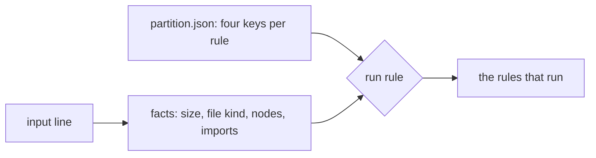

# Rule run partitioning

Reference. The Coding Archetype can run 1,240 rules. The keys below were
measured over 1,251, and the 11 more are preview rules no sigil runs now.
For one input it runs only
the rules that input can hold, and that choice is made before any rule runs.
This page states the inputs, the facts read from each one, the four keys every
rule carries, the run rule, and the table measured on `src/`. It is part of
[the sigil project](../16-sigil-project.md).



## Inputs

| Input | Form | What it holds |
| ----- | ---- | ------------- |
| scope | `<path>, in <symbol>` | one def, async def or class, with its decorators |
| module | `<path>` | one Python file |
| project | `<folder>` | every `.py` file under the folder |

The scope and module forms are the sigils' own input line. The project form is
the folder a tool reads when it reads the whole project.

## Facts

Four facts are read from an input before any rule runs.

| Fact | What it is |
| ---- | ---------- |
| size | scope, module or project, from the input's form |
| file kind | stub for `.pyi`, notebook for `.ipynb`, test for a name pytest finds by default (`test_*.py`, `*_test.py`), else source |
| nodes | the AST node type names the input holds |
| imports | the top-level package of every absolute import in the input's file |

A scope input reads the nodes inside its own def or class, and the imports of
the whole file.

## Keys

Every rule carries four keys in `dev_harness/disciplines/partition.json`. Each
key holds a value and its ground, or the word open and the reason no ground was
found. An open key binds nothing, so the rule runs on every input of its reach.

| Key | Value | Ground |
| --- | ----- | ------ |
| reach | the smallest input a finding fits inside: statement, scope, module or project | the node the published example's finding sits on, or the tool's own scope |
| nodes | the node types an input must hold one of | the finding's node and the nodes holding it, up to the nearest statement |
| imports | the modules the input's file must import one of; an empty list needs none | the example with its imports removed, or the family's own documentation |
| file | the file kinds the rule reads | the example written as each kind, or the tool's own documentation |

mypy, pyright, vulture and pylint duplicate-code read the whole project to give
one finding, so their rules have reach project. The eight hallucination rules
and four pylint configuration messages read the project too.

## How each key is measured

The published faulty example is the first ground. For ruff it is the example
on the rule's own page. For bandit it is bandit's examples folder at 1.9.4. For
semgrep it is the test file beside each rule in the semgrep-rules repository.
For mypy it is each code block on its error code pages at 2.1.0. For the rule
modules it is the archetype's own known-bad calibration files.

Each example is written to a folder and read with the tool's own command. The
finding's span gives a node path.

`dev_harness/sigils/partition_measure.py, in path_to_statement`:

```python
    parents = {
        child: parent
        for parent in ast.walk(tree)
        for child in ast.iter_child_nodes(parent)
    }
    node: ast.AST | None = deepest(tree, start, end)
    path: list[ast.AST] = []
    while node is not None:
        path.append(node)
        if isinstance(node, (ast.stmt, ast.Module)):
            break
        node = parents.get(node)
    return path
```

Four more readings of the same example settle the other keys.

| Reading | What it decides |
| ------- | --------------- |
| the example as `ast.unparse` writes it | silent there means the rule reads comments or layout, so its nodes stay open |
| each import statement made `pass` | still firing means no import is needed; else the modules whose removal stopped it |
| the example as `.py`, `test_` `.py`, `.pyi` and a one-cell `.ipynb` | the file kinds where it fires |
| the Python documentation | async def, async for, async with and `except*` count with their plain forms, and both import forms as one statement |

Some keys come from the tool's own declarations instead. Bandit declares the
node types each test reads, and its blacklist names the modules each call test
reads. A semgrep generic rule names the file patterns it reads. Pyright
publishes no example per rule, so its nodes and imports stay open. A rule
module with no finding on the calibration files takes its keys from its own
module docstring.

The proof can open a key. When a real finding in `src/` falls outside a
measured value, the measuring command opens that key and names the input that
holds the finding.

## The run rule

A rule runs on an input when each grounded key is met: its reach is no larger
than the input, the input holds one node type it names, the file imports one
module it names, and the file kind is one it names.

`dev_harness/sigils/coding_partition.py, in left_out_by`:

```python
    out = []
    if not reach_fits(keys, facts):
        out.append("reach")
    nodes = keys["nodes"].get("value")
    if nodes and not facts.nodes.intersection(nodes):
        out.append("nodes")
    imports = keys["imports"].get("value")
    if imports and not facts.imports.intersection(imports):
        out.append("imports")
    if binds(keys["file"]) and not facts.kinds.intersection(keys["file"]["value"]):
        out.append("file")
    return out
```

A reach whose ground is the tool's own scope fits every input. Mypy, pyright,
vulture, the eight hallucination rules and four pylint messages read the whole
project to give a finding, so their reach is project. The finding still sits
on a line of one file, and a sigil that runs one of these tools runs it over
the project from the root of the tree, whatever the input. Pylint F0011 has
reach project on its own documentation, so it runs on the project input only.

`dev_harness/sigils/coding_partition.py, in reach_fits`:

```python
def reach_fits(keys: dict[str, Any], facts: Facts) -> bool:
    """Report whether the rule's reach is no larger than `facts.size`; a `TOOL_SCOPE` reach fits every input."""
    if keys["reach"].get("ground") == TOOL_SCOPE:
        return True
    return RANK[reach_of(keys)] <= RANK[facts.size]
```

## Measured keys

| Key | Grounded | Open |
| --- | -------- | ---- |
| reach | 1,193 | 58 |
| nodes | 1,051 | 200 |
| imports | 1,104 | 147 |
| file | 1,176 | 75 |

Why each open key stays open:

| Reason | reach | nodes | imports | file |
| ------ | ----- | ----- | ------- | ---- |
| the published example draws no finding of its own | 56 | 66 | 66 | 66 |
| the rule reads comments, layout or line text | 0 | 74 | 0 | 0 |
| pyright publishes no example per rule | 0 | 42 | 42 | 0 |
| the finding sits on the import itself | 0 | 0 | 36 | 0 |
| pylint reads lines, options or a failed parse | 0 | 12 | 0 | 0 |
| a semgrep rule names folders whose files of any kind it reads | 0 | 0 | 0 | 9 |
| a finding in `src/` fell outside the measured value | 2 | 3 | 0 | 0 |
| no single import removal explains the finding | 0 | 0 | 3 | 0 |
| vulture's one rule id covers every kind of unused code | 0 | 1 | 0 | 0 |
| the rule reads text the AST joins or the module's line count | 0 | 2 | 0 | 0 |

## Measured on src/

`src/` holds 503 Python files and 13,893 defs and classes.

| Input | Inputs | Rules run, lowest | Median | Highest |
| ----- | ------ | ----------------- | ------ | ------- |
| scope | 13,893 | 310 | 771 | 942 |
| module, source | 502 | 194 | 880 | 973 |
| module, test | 1 | 899 | 899 | 899 |
| project | 1 | 1,061 | 1,061 | 1,061 |

How many rules each key left out of at least one of those inputs:

| Key | Rules it partitions |
| --- | ------------------- |
| reach | 21 |
| nodes | 1,051 |
| imports | 369 |
| file | 31 |

## The proof

The proof reads every archetype call once over `src/`: ruff, mypy, pyright,
bandit, vulture, semgrep, pylint, the sigils' preview rules, and the six rule
modules. Those calls give 48,865 findings of 234 rules. For every module, scope
and project input, each finding the input must carry is checked against the
rules selected for it. A module or scope input carries each finding inside its
lines whose rule's reach fits it, and the project carries every finding.

| Reading | Result |
| ------- | ------ |
| findings left out by the selection | 0 |
| mypy notes with no error code, outside the 1,251 rules | 249 |
| control: one rule's imports key made wrong | 4 lost findings reported, exit 1 |

The control copies the keys and makes bandit B404 need a module no input
imports. The proof then reports both B404 findings in `src/` by file and line,
at each module input and at the project input.

## The selection each sigil runs

Each of the nine coding sigils applies the run rule to its input before its
tool runs. It keeps the rules of its own card that the run rule selects, and
passes only those to its tool. Ruff gets them as its rule list, bandit as its
tests, and semgrep excludes each rule of the card that the selection leaves
out. Mypy gets a disabled error code for each mypy rule of the card that the
selection leaves out. Pyright and vulture count only the selected codes, and
every one of their rules fits every source file. A tool with no selected rule
does not run.

`dev_harness/sigils/coding_partition.py, in selection`:

```python
def selection(text: str, root: Path, held: Iterable[str]) -> list[str]:
    """Return the `held` rules that `select` gives over `keys` for the `facts_of` input `text` under `root`."""
    facts = facts_of(text, root)
    if isinstance(facts, str):
        message = f"{text}: {facts}"
        raise FactsFault(message)
    return select(keys(), facts, held)
```

The keys are read once per process. No sigil reads `partition.json` itself,
and no sigil holds a run rule of its own.

### The sigil proof

The sigil proof reads every tracked Python file of `src/` as a file input, and
every def and class in them as a scope input: 503 files and 13,885 defs and
classes. Each sigil whose tier 2 accepts the input runs twice, once with the
selection and once with every rule it can run. The two lists of findings must
be equal, in the same order.

| Sigil | Can run | Files: rules run now, lowest, median, highest | Defs and classes: rules run now, lowest, median, highest | Findings with the selection | Findings with every rule |
| ----- | ------- | --------------------------------------------- | -------------------------------------------------------- | --------------------------- | ------------------------ |
| CODE.LOOP | 18 | 10, 13, 17 | 4, 13, 17 | 145 | 145 |
| CODE.IMPORT | 25 | 25, 25, 25 | 25, 25, 25 | 7,240 | 7,240 |
| CODE.COLLECTION | 23 | 14, 18, 21 | 3, 17, 21 | 652 | 652 |
| CODE.FLOW | 33 | 9, 22, 29 | 3, 12, 29 | 533 | 533 |
| CODE.VARIABLE | 38 | 16, 33, 35 | 12, 32, 35 | 14,417 | 14,417 |
| CODE.OPTIMIZE | 85 | 4, 71, 81 | 7, 61, 81 | 6,711 | 6,711 |
| CODE.TYPE | 62 | 32, 61, 62 | 41, 59, 62 | 17,525 | 17,525 |
| CODE.SECURE | 291 | 18, 187, 202 | 34, 176, 198 | 62 | 62 |
| CODE.REACH | 1 | 1, 1, 1 | 1, 1, 1 | 2,822 | 2,822 |

Without the selection, a sigil runs every rule it can run on every input: the
count in the second column. Each sigil page gives its own rows by input size.
CODE.IMPORT stays at 25 because each of its rules needs an import statement and
its tier 2 already refuses an input without one. CODE.REACH stays at 1 because
its one rule fits every source file.

| Reading | Result |
| ------- | ------ |
| findings that differ with and without the selection | 0 |
| sigils that refused an input after tier 2 accepted it | 0 |
| control: one rule's imports key made wrong | 46 lost findings reported, exit 1 |

The control copies the keys and makes ruff B007 need a module no input
imports. The proof then runs CODE.LOOP@1, the one sigil that can run B007. It
reports every B007 finding as lost, each with its line: 16 at 9 files and 30 at
19 defs and classes. No other finding moves.

## Commands

```text
python -m dev_harness.sigils.coding_partition --root . "src/core/log_paths.py, in resolve_log_root"
python -m dev_harness.sigils.coding_partition --root . --prove --findings <file>
python -m dev_harness.sigils.coding_partition --root . --prove --findings <file> --control "bandit B404"
python -m dev_harness.sigils.partition_measure --sources <folder> --proof <proof file>
python -m dev_harness.sigils.coding_partition --root . --sigils --findings <file>
python -m dev_harness.sigils.coding_partition --root . --sigils --control "ruff B007"
python -m dev_harness.sigils.coding_partition --root . --sigils --sigil CODE.TYPE --findings <file>
```

The first prints an input's facts and the rules that run on it: 809 of 1,251
for that function, 897 for its file. The second runs every archetype call over
`src/` once and checks every input. The third runs the same check on a copy of
the keys with one key made wrong. The fourth measures the keys from the
published sources that its `--card` lists.

The fifth runs the sigil proof. It saves each file's rows to the named file as
it goes, and a run started again on the same file reads them and goes on from
there. The sixth runs the sigil proof on a copy of the keys with one rule's key
made wrong, for the sigils that can run that rule. The seventh runs the sigil
proof for one sigil alone.
