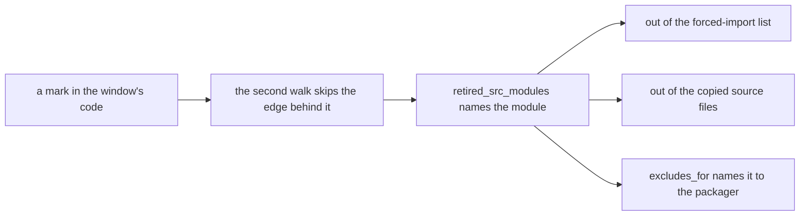

# What the Build Includes

Reference. What a packaged build of Acervator carries out of the source folder,
the reading that decides it, and what that reading cannot see.

The index is [README.md](README.md). How the build gets its version number, what
each variant ships and how the bundle's own archive is read are in
[09-updates-and-versioning.md](09-updates-and-versioning.md).

## The rule

A module enters the build when the program can reach it from its starting file.
A module nothing can reach stays out, and its source file stays out with it.

The starting file is named once, in `tools/spec_common.py, ENTRY_SCRIPT`, and it
is `main.py`. Nothing else is a starting point. A screen that only another
screen opens is still reached, because the reading follows the chain.

The rule is a reading taken at every build. It is not a list anybody keeps up to
date. Delete a screen and the next build stops carrying it with no edit
anywhere.

**Read on the current tree.** The program reaches a module only through a screen
the window builds. A module that only a screen the window never builds imports
stays out, and its source file stays out with it. How the build reads that from
the window's own code is under
[A screen the window never builds](#a-screen-the-window-never-builds).

## The three readings that make up "reached"

`tools/spec_common.py, in reachable_src_modules` joins three readings.

**One, the import lines.** Every `import` line in the starting file is followed,
then every `import` line in each file that reaches, and so on until no new name
appears. `tools/spec_common.py, in _src_import_names` does the following, and it
reads an import line wherever it sits, at the top of a file or inside a
function.

**Read on the current tree.** Two kinds of import line inside a function are not
followed: one inside a builder the window never calls, and one inside a loader of
a screen that nothing asks for. Every other import line is followed as before.

**Two, the folders on the way.** A module named `src.gui.main_window` needs
`src`, then `src.gui`, before Python can load it. Each of those parent names is
added.

**Three, the names the program builds while it runs.** Three screens ask Python
for a module by a name they assemble from text, so no `import` line names it.
`tools/spec_common.py, in _joined_import_prefixes` finds the text each one joins
onto, by reading the call itself, and
`tools/spec_common.py, in _dynamic_src_names` tries every piece of text in that
file against it. A join that spells a real module is reached. A join that spells
nothing is dropped.

The three screens doing the joining are
`src/gui/react_bot_live_settings.py, in tab_payload`,
`src/gui/paper/paper_react_bot_detail.py, in tab_payload` and
`src/gui/simulator/sim_react_bot_detail.py, in tab_payload`. Each names eight
tab pages in its own table, `MODEL_BY_SURFACE`, so twenty-four modules reach the
build this way.

**Read on the current tree.** A fourth module joins a module name from text:
`src/gui/main_tabs/retired_surfaces.py, in _handler`, the loader of the retired
pages. The build reads its joins as it reads the other three, then skips each
join onto a retired page.

Anything else stays out. A file reaches the build because something names it,
never because of the folder it sits in.

## What leaves when a module leaves

Three things leave together.

The module is dropped from the forced-import list by
`tools/spec_common.py, in reachable_only`, so the packager is not told to go and
find it.

Its source file is dropped from the copied files by
`tools/spec_common.py, in unreachable_src_files`, which hands the paths to
`tools/spec_common.py, in build_graceful_datas`.

Any outside package that only that module used then has no reader left, so the
packager's own walk never reaches it and it is not carried. One retired screen
took a whole image library out of the product this way.

**Read on the current tree.** A module that only a screen the window never builds
reaches leaves a fourth way as well. The build names it in the list of modules
the packager refuses, `tools/spec_common.py, in excludes_for`. Without that, the
packager would pull the module back in through the import line in a builder that
never runs.

## The outside packages named outright

`tools/spec_common.py, EXCLUDES` names nine outside packages the build refuses
by name: the old desktop toolkit, the plotting library, the image library, and
six notebook, test and documentation packages. Each one was read against every
import line in the source folder first. A package the product actually uses is
never on that list.

## What the build log says

`tools/spec_common.py, in report_unreachable` prints the count and then every
name the build is leaving out. Both recipes, `Acervator_win.spec` and
`Acervator_mac.spec`, call it before the packager starts, so the names are near
the top of the build output.

```
  [spec] 29 of 498 src modules unreached, left out:
  [spec]   src.core.mini_display
  [spec]   src.core.system_load_oscillator
  ...
```

If a screen the operator wants is on that list, the build log says so before the
build finishes.

**Read on the current tree.** The log prints a second list: the modules that only
a screen the window never builds reaches.

`tools/spec_common.py` — `report_unreachable`, both lists on this tree

```
  [spec] 30 of 501 src modules unreached, left out:
  ...
  [spec] 10 of 501 src modules reached only through a screen the window never builds, left out:
  [spec]   src.gui.alerts_tab
  [spec]   src.gui.main_tabs.alerts_tab_surface
  ...
  [spec]   src.gui.react_proof_of_accumulation_tab
```

## Today's reading

Measured on this tree: the source folder holds **498** modules, **469** of them
reached and **29** not.

The 29, grouped by what they are:

| what it is | modules |
| --- | --- |
| screens no window builds | `src.gui.analytics_tab`, `src.gui.competition_tab`, `src.gui.init_wizard`, `src.gui.launcher`, `src.gui.live_bot_window`, `src.gui.stock_main_window`, `src.gui.testnet_tab`, `src.gui.usb_auth_widget`, `src.gui.journal_tab` |
| React strips nothing draws | `src.gui.react_crypto_news_ticker`, `src.gui.react_simulator_tab`, `src.gui.react_status_log` |
| the equities engine, not wired | `src.stocks.stock_accumulation_bot`, `src.stocks.stock_assets`, `src.stocks.stock_bot`, `src.stocks.tradingview_bridge` |
| trading parts nothing calls | `src.trading.arbitrage`, `src.trading.logo_library`, `src.trading.mr_inspector` |
| tablet record helpers | `src.trading.stone_tablets.addressing`, `src.trading.stone_tablets.parity_harness`, `src.trading.stone_tablets.ra_import` |
| hardware and import helpers | `src.core.mini_display`, `src.core.system_load_oscillator`, `src.core.usb_auth`, `src.exchange.market_data`, `src.exchange.tablet_backend`, `src.exchange.ytd_csv_import` |
| the manual builder's own chart module | `src.design_system` |

Read again once the main window stopped building the analytics engine: the source
folder holds **501** modules, **471** reached and **30** not. The thirtieth is
`src.trading.analytics_engine`, which no reached module imports any more. Its
file stays on disk, and the build leaves it out.

`tools/spec_common.py` — `report_unreachable`, the build log on this tree

```
  [spec] 30 of 501 src modules unreached, left out:
  ...
  [spec]   src.trading.analytics_engine
  ...
```

Two modules read as reached and are worth naming, because an earlier reading had
them wrong. `src.gui.audio_suite` is reached from
`src/gui/market_inspector.py`, which imports it for the chime.
`src.gui.alerts_tab` is reached from `src/gui/variant_surface.py`, which the
live tabs reach. Leaving either one out would break a screen the operator uses.

**Read on the current tree.** `src.gui.audio_suite` still ships, because the
Market Inspector imports its chime. `src.gui.alerts_tab` now leaves the build.
The window never builds the Alerts screen, and the one path to that module is a
loader that no screen asks for.

## What the reading cannot see

The reading is taken from the text of the files, not from a running program. It
can be wrong in one direction, and that direction matters.

A module named from a value the program reads while it runs, from a file or from
a setting, would read as not reached. So would a module that only loads because
some other module happened to touch it first. A wrong answer there costs an
error at the moment the operator opens the screen that needed it.

One thing holds that mistake back. The module list is **subtracted from and
never replaced**, so the packager's own import walk still runs over the real
imports. A name dropped by this reading that any carried file imports is pulled
back in by the packager and ships anyway.

**Read on the current tree.** That holds for a module nothing reaches. A module
that only a screen the window never builds reaches is named to the packager as a
module to refuse, so the packager does not pull it back. What keeps a reading of
a mark from removing a module that a built screen needs is under
[What each mark reading keeps](#what-each-mark-reading-keeps).

The reading cannot be proved by this repository. Nothing here launches the
packaged application. The proof is the operator's own launch.

## What the reading does not decide

The reading answers one question: can the program reach this module. It does not
answer whether the screen behind the module is finished.

Nothing in the source folder marks a screen finished.
`src/gui/main_tabs/retired_tabs.py, in RetiredTabsMixin` marks a screen the main
window does not build at all. `src/gui/main_tabs/empty_tabs.py, in EmptyTabsMixin`
draws a placeholder for a screen that is not written yet, and nothing calls it.
Neither says that a screen the window *does* build is half built.

So a half-built screen the window builds reads as reached, and it ships. Keeping
it out needs the operator to name which screens are not finished.

In development.

**Read on the current tree.** The build now reads the window's own marks of a
screen it never builds, and leaves that screen out. A screen the window does
build still ships, finished or not.

## A screen the window never builds

The window's own code marks a screen it never builds in three places. The build
reads each mark where the window declares it, and the import walk does not
follow the edges behind it. No list of screens is kept anywhere else, so a
screen the window stops building leaves the next build with no edit to the build.

| the window's mark | where the build reads it | the edge the walk skips |
| --- | --- | --- |
| a retired page | `src/gui/main_tabs/retired_surfaces.py`, `SURFACE_MODULES` | the loader's join onto that page's surface |
| an unbuilt tab | `src/gui/main_tabs/main_window_surface.py`, `UNBUILT_TABS`, and each `if X not in UNBUILT_TABS:` guard | each import line in the builder that the guard skips |
| a screen nothing asks for | `src/gui/variant_surface.py`, each `register` call | each import line in the loaders of a screen that no `surface_class` or `draws_react` call names |

The sentinels the window sets for its retired tabs name attributes, not modules,
so the build reads no module from them. The first and third rows cover the
screens those sentinels mark.

`tools/spec_common.py` — the three places the build reads, each named once

```python
RETIRED_PAGE_TABLE = ("src.gui.main_tabs.retired_surfaces", "SURFACE_MODULES")
UNBUILT_TAB_TUPLE = ("src.gui.main_tabs.main_window_surface", "UNBUILT_TABS")
SCREEN_REGISTRY = "src.gui.variant_surface"
REGISTER_CALL = "register"
ASKING_CALLS: tuple[str, ...] = ("surface_class", "draws_react")
```

### How a screen's mark becomes its absence

`tools/spec_common.py, in _readings` walks the imports twice. The first walk
follows every edge. The second walk skips the edges the three marks name. A
module the first walk reaches and the second does not is reached only through a
screen the window never builds.



Such a module leaves three ways. The third is needed because the packager reads
an import line inside a function too, so a builder that never runs would
otherwise carry its module back into the bundle.

`tools/spec_common.py` — the answers both recipes read

```python
def reachable_src_modules(project_root: str) -> frozenset[str]: ...
def retired_src_modules(project_root: str) -> frozenset[str]: ...
def excludes_for(project_root: str) -> list[str]: ...
```

### What a request for a left-out page gets

The seven retired pages keep their place in the bridge's source.
`src/gui/main_tabs/retired_surfaces.py, in on_demand_handlers` registers a page
only when the running program can find its surface. A packaged build carries
none of the seven, so its registry holds none of their methods. A request for
one gets the bridge's refusal for a method that no surface serves, and no import
runs.

`src/gui/main_tabs/retired_surfaces.py` — `_is_carried`, the test each retired page passes before it is registered

```python
def _is_carried(module_name: str) -> bool:
    """Return True when ``find_spec`` finds ``module_name`` beside this module."""
    return importlib.util.find_spec("." + module_name, __package__) is not None
```

The registry passage and the whole function that calls this are in
[the tab index](08-tabs/README.md), under "How a screen reaches its renderer".

Read on a copy of the source folder without the seven surface files, which is
what a packaged build carries:

```
registry methods          66, against 73 with the files present
analytics.tab answers     UnknownMethod: analytics.tab
surface module imported   no
```

A run from the source folder still answers all seven pages.

### What each mark reading keeps

Each reading keeps a module whenever it cannot be sure.

- An import line outside the skipped builder or loader is followed, inside a
  function or not.
- A builder named anywhere outside its guard keeps its imports, and so does a
  loader named anywhere outside its `register` call.
- An ask that names its screen by any value but the screen's own constant keeps
  every registered screen. So does `surface_class` or `draws_react` used without
  a call.
- A mark the build cannot find where it reads it stops the build with the mark's
  name.

Each case was read on a copy of the source folder:

| the copy | modules the marks leave out |
| --- | --- |
| unchanged | 10 |
| the Accumulation builder also called outside its guard | 9, and the panel stays |
| one screen asked for through a variable | 7, and both Alerts screens and their surface stay |
| `surface_class` handed on without a call | 7, and the same three stay |
| the retired-page table renamed | none: the build stops with `LookupError` |

The reading cannot see a method name assembled from text while the program runs.
A builder called only that way would read as never called.

### What leaves today

Measured on this tree, the source folder holds 501 modules. 461 are reached
through a screen the window builds, 30 are reached by nothing, and 10 are
reached only through a screen the window never builds.

| the window's mark | the modules that leave |
| --- | --- |
| retired page | `src.gui.main_tabs.alerts_tab_surface`, `src.gui.main_tabs.analytics_tab_surface`, `src.gui.main_tabs.audio_suite_surface`, `src.gui.main_tabs.competition_tab_surface`, `src.gui.main_tabs.journal_tab_surface`, `src.gui.main_tabs.risk_tab_surface`, `src.gui.main_tabs.testnet_tab_surface` |
| unbuilt tab, Accumulation | `src.gui.react_proof_of_accumulation_tab` |
| screen nothing asks for, Alerts | `src.gui.alerts_tab`, `src.gui.react_alerts_tab` |

Each module's other imports are reached through a screen the window builds, so
nothing else leaves with them. Two modules of those screens stay.
`src.gui.audio_suite` stays because the Market Inspector imports its chime, and
`src.gui.main_tabs.proof_of_accumulation_tab_surface` stays because the window's
own model imports it for the tab's heading.

Nothing here launches the packaged application. The launch is the operator's
verification.
