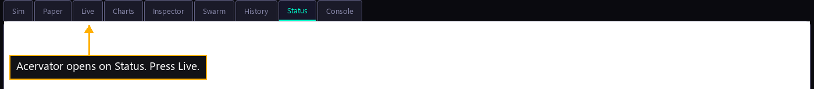

# Step 6 — The window opens

One step of the [New User Procedure](README.md) how-to.

**Acervator opens on Status. Press Live.**

The Live page opens.

## Which tab the window opens on now

The instruction above says:

> **Acervator opens on Status. Press Live.**

The window opens on Live. `src/gui/main_window.py, in MainWindow.__init__`
builds the Live tab first, and `_reorder_main_tabs` moves each tab with
`QTabBar.moveTab`, which carries the selected tab with it. Live ends third on
the bar and stays selected, so the press is already done for you.

Driven on an empty home, in both builds:

| reading | Qt build | React build |
|---|---|---|
| tabs on the bar | 9 | 9 |
| the selected index | 2 | 2 |
| the tab the window opens on | Live | Live |
| sub-tabs Live carries | Get Started | Get Started |

Status still draws nothing and still sits eighth on the bar. The picture above
shows the window with Status selected, which is where a launch used to land.
