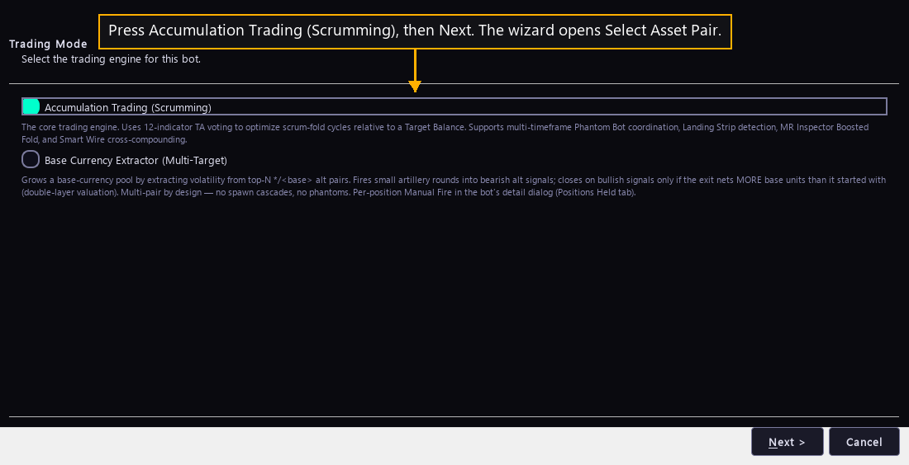

# Step 9 — Choose the engine

One step of the [New User Procedure](README.md) how-to.

**Press Accumulation Trading (Scrumming), then Next.**

The New Bot button opens this wizard on Trading Mode. Next opens Select Asset
Pair.

The page offers two engines and the bot keeps the one picked here. The wizard
asks once. A running bot's own settings screen offers no way to swap it.

Accumulation Trading is the engine this product is built around. It holds one
asset. It sells the part of the position that has risen above a dollar target,
and it buys back more of the asset when price falls. Each finished round leaves
the bot holding more of the asset than it held before. Twelve indicators vote on
when to sell and when to buy.

Base Currency Extractor is the other engine. It grows a pool of one currency by
sending small amounts into many other markets at once. It closes a position only
when the exit returns more of the pool currency than it spent. It runs no shadow
bots, and it is not what a first bot wants.

The choice changes the pages that follow. Accumulation Trading asks for one pair
next, then for the settings the next nine steps cover, then for shadow bots. The
Extractor asks for a pool instead of a pair, and the wizard finishes without ever
showing the shadow-bot page.

Every bot in the live fleet runs Accumulation Trading, all 38 of them. That is
what this how-to follows from here on.

## What the page says now

OVERTAKEN, quoted whole:

> **Press Accumulation Trading (Scrumming), then Next.**

True today: press the row the page shows. It is named after the layer New Bot was
pressed on. On the Crypto layer it reads Crypto Scrumming. On the other five it
reads Stock Scrumming, Commodity Scrumming, Forex Scrumming, Index Scrumming or
Futures Scrumming. It is the same engine under every one of those names, and the
name says which sector's published rules it sizes orders under.

OVERTAKEN, quoted whole:

> The page offers two engines and the bot keeps the one picked here.

True today: the page offers two engines on the Crypto layer and one on each of
the other five. Base Currency Extractor grows a pool of a crypto currency, so it
shows on Crypto and nowhere else. The bot still keeps the engine picked here, and
the wizard still asks once.

`src/gui/main_tabs/bot_wizard_surface.py`, in `mode_offer`, decides the rows one
layer draws. `EXTRACTOR_SECTORS` in the same file names the one layer the
Extractor reaches.
